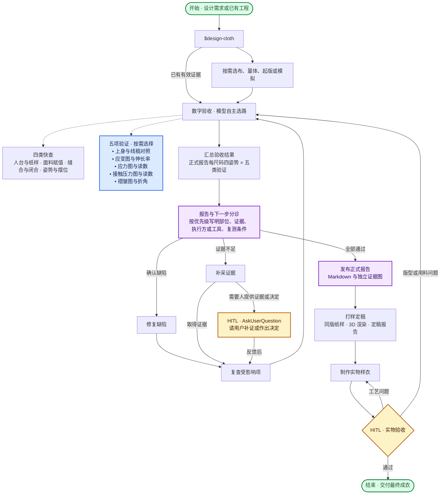

# 服装设计与试穿

按用户指定的范围、尺码、姿势、工程和运行环境执行。默认用中文交付，遵循用户指定的语言。原始证据保留软件名、标识和单位。

## 流程图

## 服装开发

从最能推进当前任务的环节接手。需要准备输入时，按[工作流程](references/workflows.md)选布、量体、起版或接续已有工程。需要新模拟或取证时，按[运行环境对照](references/runtime-support.md)选择 Style3D、原生 CLO、CLO_RUST 或 Boat。保留原工程，在副本上修订。

## 数字验收与定稿

按症状、最近改动和证据缺口，自主选用[四类常见问题快查](references/workflows.md#四类常见问题)和[五种验证方法](references/workflows.md#五种验证方法)。可从已有证据开始，也可在试穿前后切换。复用与当前版次、尺码和姿势匹配的证据。按[验证方法索引](references/verification/index.md)查各软件的逐项操作手册。

用[整衣验收](references/finish-verification.md)判断当前候选，按[三条处理路径](references/workflows.md#数字验收的三条路径)推进。

- **有缺陷。** 自动修复范围内已确认的问题，重查受影响项，回到同一验收关口。
- **证据不足。** 自主补采或做受控对比。仍需用户输入或决定时，按[疑难交接](references/workflows.md#定稿与疑难交接)用 `AskUserQuestion` 提问，并给出证据和建议下一步。收到反馈后继续当前验收。
- **全部适用项通过。** 交付同版定稿纸样、3D 渲染和[定稿报告](references/试穿报告模板.md)。需要实物验证时，由实际样衣和试穿证据判定。

试穿、复验和定稿报告面向版师、服装设计师及没有服装背景的工程师。正文先用日常语言说明服装部位、改动和结果。每轮验收后在[结论与复测标准](references/试穿报告模板.md#七结论与复测标准)按优先级给出下一步、对应证据、执行方或工具及复测条件。正式交付前按[四姿势五类验收](references/workflows.md#四姿势五类验收)完成检查，再按[报告模板](references/试穿报告模板.md)交付 Markdown（.md）和随附的独立证据图。用[导出脚本](scripts/bake-report.mjs)校验发布清单并生成默认 Markdown。正文用大图和短图注，采用多级标题，所有表格集中放在结论前。

## Style3D MCP / 原生 API Playbook

指定 Style3D 时先读 [Style3D 操作约定](references/verification/style3d.md)，再从[验证方法索引](references/verification/index.md)选对应的 Style3D 手册。只核对工具能力时使用目录和 schema。原生工程读写、导出与模拟按本轮授权和当前版本能力执行。指定 CLO 3D 时读 [CLO 3D MCP 操作约定](references/verification/clo3d.md)及对应手册。
