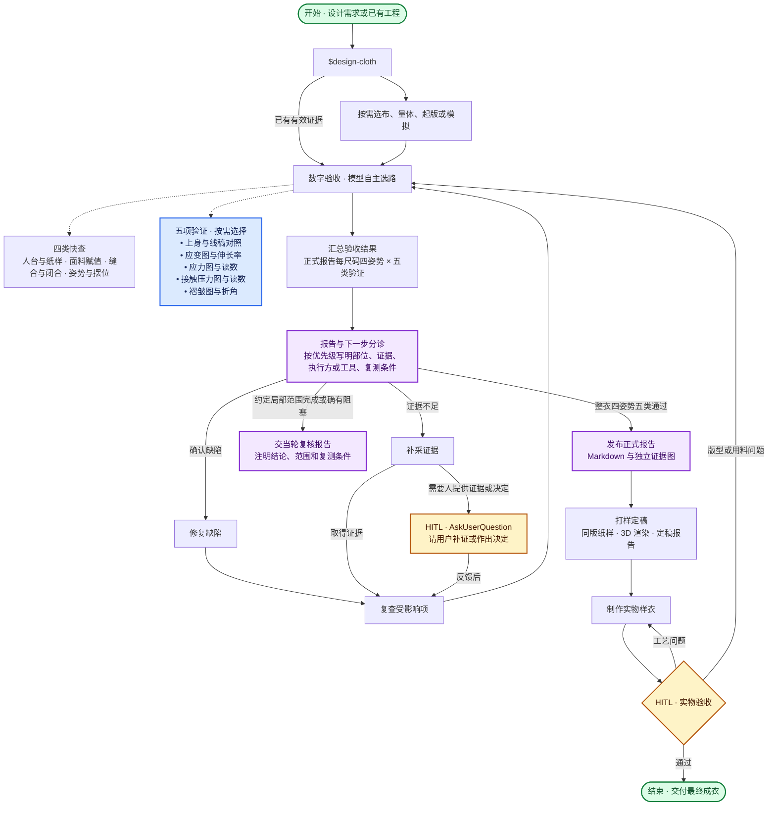

# 服装设计与试穿

按用户指定的范围、尺码、姿势、工程和运行环境执行。默认用中文交付，遵循用户指定的语言。原始证据保留软件名、标识和单位。

## 流程图

## 服装开发

**只有设计意图、没有母版时**，从 [从零起版到可打印纸样](references/zero-draft.md) 开始。先将款式、量体、松量、面料和工艺变成可执行规格，再实际运行起版工具。保留可重建的参数源、同版矢量和足尺文件，独立回读尺寸、配缝及校准标尺。把偏差交回实际修改并复验。遇到会改变款式、尺码或可穿脱性的缺项，优先从现有资料推断并登记依据，确实无法推断时在该步骤等答复。

**可打印纸样放行**需要至少五个独立且可复核的数字关口、全部适用关口通过和同版最终人工签核。数字评测结果只能判定候选状态。按[放行条件](references/zero-draft.md#可打印纸样的放行条件)等待人工实际查验和批准，退回后修复并重新验收，同时保留试穿和实物合身各自的判定。

从最能推进当前任务的环节接手。需要准备输入时，按[工作流程](references/workflows.md)选布、量体、起版或接续已有工程。需要新模拟或取证时，按[运行环境对照](references/runtime-support.md)选择 Style3D、原生 CLO、CLO_RUST 或 Boat。保留原工程，在副本上修订。

## 数字验收与定稿

按症状、最近改动和证据缺口，自主选用[四类常见问题快查](references/workflows.md#四类常见问题)和[五种验证方法](references/workflows.md#五种验证方法)。可从已有证据开始，也可在试穿前后切换。复用与当前版次、尺码和姿势匹配的证据。按[验证方法索引](references/verification/index.md)查各软件的逐项操作手册。

**已有试穿工程验收失败时**，从现有工程和失败姿势着手。原因未明时，按[修复优先级](references/workflows.md#验收失败且原因未明时的默认顺序)依次快查仿真与摆位、材质、人台尺寸、缝合、配件，最后考虑纸样。用最小的受控复测判断改动是否有效，再补齐约定的验收范围。

用[整衣验收](references/finish-verification.md)判断当前候选，按[三条处理路径](references/workflows.md#数字验收的三条路径)推进。

- **有缺陷。** 自动修复范围内已确认的问题，重查受影响项，回到同一验收关口。
- **证据不足。** 自主补采或做受控对比。仍需用户输入或决定时，按[疑难交接](references/workflows.md#定稿与疑难交接)用 `AskUserQuestion` 提问，并给出证据和建议下一步。收到反馈后继续当前验收。
- **整衣验收通过。** 交付同版定稿纸样、3D 渲染和[定稿报告](references/试穿报告模板.md)。需要实物验证时，由实际样衣和试穿证据判定。

**分诊后先执行可做的复测。** 结束当轮前，从报告的首项待办判断谁能推进。已有可用工程和运行环境时，在副本上执行当前范围内的最小受控对比，记录实际结果并回到原验收关口。照片起版形成候选后也适用。未知目标尺码或实布物性仅阻塞依赖它们的正式验收。仍需用户补证时，直接发出当前最能推进的一项结构化提问，收到答复后接续同一候选。用户明确只要报告或局部检查时，按约定范围结束。

**当轮验收报告。** 按[报告模板](references/试穿报告模板.md)交付有独立证据图的 Markdown。效果图对照、局部验收和证据不足的交接也有当轮报告。把本轮报告引用的每张证据图用独立成段的 `` 嵌入 Markdown 正文，补充图也按此处理。数据、工程和原始记录用链接。发送前在交付目录预览 Markdown，核对图像加载，并逐项对照本轮证据清单，避免只在索引表里放地图或原图链接。在答复开头用明确的报告名链接文件，作为第一条交付链接，旁边写明本轮状态与范围。答复中的本地报告链接用实际绝对路径，报告内的证据图用相对路径。用户只要求一张图、确认取证方法或要对话简报时，直接交付该项及其必要的来源说明。

**需要用户决定时发结构化提问。** 在起版、放码、复验或分诊的每个决策点，先复用已经给出的选择和证据，完成不依赖答复的工作。若下一项必须由用户或版师选基准 DXF、提供目标尺码表或样布物性、确认设计取舍或补证，直接发出当前最能推进的一道结构化问题。开始前就遇到阻塞时可以当时问。复核结束时应在交付答复前问。收到答复后继续同一候选和相关步骤，只更新答复解决的判定，保留本轮范围和未采证或未通过的项目。普通方案解释、已定的输入和能自主完成的复测无需提问。

按会话实际提供的接口调用 Claude `AskUserQuestion`、Codex `request_user_input` 或 `request_user_input_async`。提供有实际影响的选项，或明确索取所缺的文件、读数或决定。等待时继续独立工作，将依赖答复的分支保留为待确认。报告中的清单和答复里的文字只用于记录，工具确实不可用时才在对话中直接提问。详见[疑难交接](references/workflows.md#定稿与疑难交接)。

试穿、复验和定稿报告面向版师、服装设计师及没有服装背景的工程师。正文先用日常语言说明服装部位、改动和结果。每个问题从首次出现便使用固定编号（如 `#01`），发现、证据和复测沿用同一编号，并明确是已证实的缺陷、已确认的设计效果，还是证据不足。

**每份报告的正文必须以「分诊与下一步复测」收尾。** Markdown 与 HTML 都把附录、补充图和统计放在这节之前。优先列出下一项可执行动作，用原问题编号注明证据、执行方、复测条件和通过标准。把其余待办按优先级列全，标明哪些阻塞放行。范围内已结案时，写明已验的范围和无需继续复测的依据。交付前用[报告检查器](evals/check-report-follow-up.py)直接读取拟交付文件，并逐项核对编号、证据和下一步。正式报告和打样定稿须先通过[四姿势五类验收](references/workflows.md#四姿势五类验收)，再用[导出脚本](scripts/bake-report.mjs)校验发布清单并生成默认 Markdown。

## Style3D MCP / 原生 API Playbook

指定 Style3D 时先读 [Style3D 操作约定](references/verification/style3d.md)，再从[验证方法索引](references/verification/index.md)选对应的 Style3D 手册。只核对工具能力时使用目录和 schema。原生工程读写、导出与模拟按本轮授权和当前版本能力执行。指定 CLO 3D 时读 [CLO 3D MCP 操作约定](references/verification/clo3d.md)及对应手册。

## Boat CLO 3D 四尺码十动作

使用 [Boat CLO 3D 四尺码十动作](references/verification/clo-motion-batch.md) 的固定入口。配置列出四码原生工程、动作、关键帧和阈值；命令并行调用专用 Boat worker，输出逐帧五图审查卡与统计表。先查统计缺证与失败，再看逐项关键帧和异常片段。
