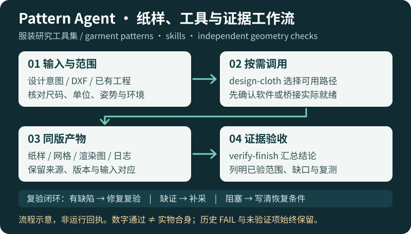
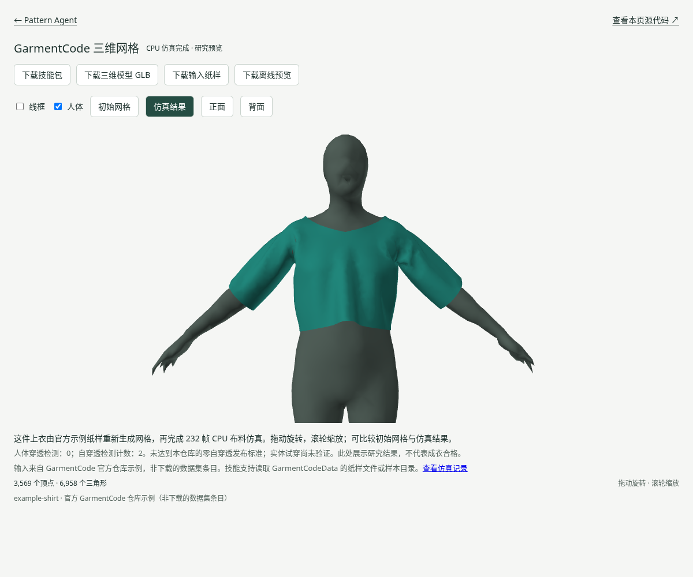
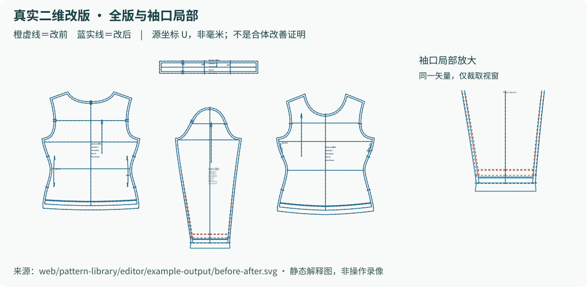

# Pattern Agent

**面向服装研究者与编码 Agent 的纸样、人体编辑和独立几何核查工具集。** 从设计意图、DXF 或已有工程接手，用真实工具生成产物，再按同版证据复核；不是一键成衣系统。

[立即体验 Brian 纸样](https://liush2yuxjtu.github.io/pattern-agent/freesewing/brian/) · [本地首次任务](#本地首次任务无需账号) · [复制任务提示词](#给-agent-的任务提示词) · [研究与历史索引](docs/readme-history.md)



> **研究边界**：数字几何、软件交互、仿真与实物合身分别判定。历史 T-shirt 仍为 **FAIL**：最大缝隙 **7.6455 mm（阈值 2 mm）**、**20 处非相邻面相交（阈值 0）**；实物试穿 **NOT_RUN**。新案例不能覆盖旧失败。

## 先选一个任务

| 任务 | 入口与实际产物 | 状态 / 不能据此推断 |
| --- | --- | --- |
| 调整尺寸、看二维纸样 | [Brian 在线工具](https://liush2yuxjtu.github.io/pattern-agent/freesewing/brian/) → SVG 与输入 JSON；[输入契约](web/freesewing/brian/input-contract.json) | 可用的研究工具；原生 FreeSewing Brian 4.10.2，长度 mm / 肩斜 °，不提供布料仿真或工厂放码表 |
| 调整人体与姿势 | [Human Studio](https://liush2yuxjtu.github.io/pattern-agent/human-studio/) → 状态文件、PNG、OBJ cm / GLB m；[源码与量测定义](web/human-studio/README.md) | 可用的研究编辑器；12 项 cm 尺寸、163 骨骼；网格尺寸不等于真人尺寸 |
| 从设计意图或工程接手 | [`design-cloth`](.agents/skills/design-cloth/SKILL.md) → 按范围生成纸样、取证与复核报告 | 流程技能；产物依赖已安装工具、工程与证据，不能保证整衣通过 |
| 独立复算袖片尖折 | [`verify-sleeve-creases`](.agents/skills/verify-sleeve-creases/SKILL.md) → JSON 指标与追踪日志 | 冻结样例可离线重测；只判当前网格的局部几何，不判材料或审美 |
| 复现设计意图与模拟研究 | [实验总入口](experiments/intent-edit-review/README.md) / [Teagan 源码归档](experiments/teagan_sites_studio/README.md) | 实验 / 历史；各自保留 PASS、FAIL、UNKNOWN 和未验证项，不是通用合体承诺 |

### 同一任务：只看预览，还是复核证据？

以“这件衣服是否可以放行”为例，下面是**工作方式对照，不是效果或效率实测**。

| 只看一张渲染图 | 使用本仓库的证据流程 |
| --- | --- |
| 能看外观，但不知道输入、单位与版次 | 保留输入、工程、尺码和姿势，将纸样、网格、图与报告对应 |
| 视觉上闭合，不代表缝边和穿透通过 | 独立核查适用几何项；失败项保留数值和阈值 |
| 容易把“好看”误作“合身” | 分开数字检查与实物试穿；缺证则补采或交接，不自动宣告成功 |

代价是要准备匹配文件、运行相应工具并人工签核；只需二维演示时，直接用 Brian，不必启动完整验收。

## 本地首次任务（无需账号）

先用冻结的真实袖片样例重测几何检查器。只需 **Git 与 Python 3.9+ 标准库**，不需要 CLO、模型 API、云算力或付费账号。

```sh
git clone --depth 1 https://github.com/liush2yuxjtu/pattern-agent.git
cd pattern-agent
python3 -m unittest discover \
  -s .agents/skills/verify-sleeve-creases/scripts -p test_inspect.py -v
```

预期：**15 项测试通过**，含正例、负例与来源对应检查。也可直接处理包内样例并写出真实结果：

```sh
python3 .agents/skills/verify-sleeve-creases/scripts/inspect.py \
  --input .agents/skills/verify-sleeve-creases/fixtures/after-basic.json.gz \
  --out /tmp/pattern-agent-creases.json --trace /tmp/pattern-agent-creases-trace.json
```

预期标准输出含 `"status": "PASS"`、`"sharpCount": 0`，并生成结果与追踪文件；耗时因机器而异。这不是新模拟，也不证明实物合身。[样例与来源清单](.agents/skills/verify-sleeve-creases/fixtures/manifest.json) · [CLI 与输入说明](.agents/skills/verify-sleeve-creases/SKILL.md) · [完整安装说明](.agents/skills/verify-sleeve-creases/INSTALL.md)

## Works with：按实际条件选环境

这是**文档支持范围**，不是所有客户端/后端均已端到端实测的兼容认证。

| 环境 | 如何接入 | 前提与限制 |
| --- | --- | --- |
| Codex 项目技能 | 仓库内 `.agents/skills/`；显式请求 `$design-cloth` 或 `$verify-sleeve-creases` | 在仓库会话加载对应 SKILL.md；[袖片安装说明](.agents/skills/verify-sleeve-creases/INSTALL.md)。文件存在不证明原生自动触发 |
| Claude 项目技能 | `.claude/skills/verify-sleeve-creases` 链接到 canonical 源 | 仅列实际存在的发现路径；`design-cloth` 不宣称有同名 Claude 链接；[路由评测限制](tools/skill_evals/README.md) |
| 本地 Python CLI | 不依赖 Agent 客户端，按上方首次任务运行 | 可重测冻结样例；处理新网格需匹配的 geometry 输入 |
| FreeSewing Brian | [网页 / 离线 HTML 与复现说明](tools/freesewing-brian/README.md) | 4.10.2；本地构建需 Node 24+，运行制版不等于合体验收 |
| 原生 CLO 3D / CLO_RUST | [运行环境矩阵与插件入口](.agents/skills/design-cloth/references/runtime-support.md) | 原生 CLO 需授权安装与可用桥接；CLO_RUST 已存结果复核与新模拟须分开确认 |
| Style3D | [接入记录](docs/style3d-integration.md) / [只读发现 CLI](tools/style3d/README.md) | 真实集成仍 **BLOCKED**；协议测试不证明原生模拟可用，需目标版本安装与账号登录 |

## 给 Agent 的任务提示词

先在本仓库打开相应 SKILL.md；`$技能名` 是显式请求语法，不代表本次已验证客户端自动触发。替换方括号中的真实输入。代码块可用 GitHub 原生复制按钮复制，未加入自定义复制组件。

<details>
<summary>任务 1 · 已有 DXF / 工程 → 当轮复核报告（design-cloth）</summary>

```text
$design-cloth
输入：工程或 DXF=[路径]；目标尺码与单位=[值]；姿势=[范围]；
本轮允许使用的本机工具=[实际可用环境]。先读本仓库的 design-cloth/SKILL.md。
保留原件，在副本上接手；先核对现有同版证据，再执行范围内最小复测。
产物：按实际执行交付纸样/网格/图，并给出含独立证据图的 Markdown 当轮报告，
列明输入、工具版本、执行命令或调用、已确认问题、缺证项与复测条件。
边界：工具未就绪、材料未标定、缺姿势或原生图时如实标注；
不得把静态几何通过写成整衣或实物合身。未经授权不启动远程算力。
```

输入尚不完整时按技能流程补证，不拿演示尺寸冒充用户尺寸。[完整机制与放行条件](.agents/skills/design-cloth/SKILL.md)

</details>

<details>
<summary>任务 2 · 袖片 geometry JSON → 可重算尖折指标（verify-sleeve-creases）</summary>

```text
$verify-sleeve-creases
输入：含 geometry 的工作室导出 JSON=[路径]，如需前后对照，提供同源材料边对应数据。
先读本仓库的 verify-sleeve-creases/SKILL.md，核对输入 schema 与来源后，
实际运行其 scripts/inspect.py --input [输入.json] --out [结果.json] --trace [追踪.json]。
产物：结果 JSON、真实追踪日志，以及可见尖棱对应的网格边与阈值说明。
边界：不要用平滑法线掩盖尖折；无对应数据时不编造前后配对；
检测日志不是求解迭代，局部几何结果不是材料合体或整衣通过。
```

[输入格式、阈值与方法](.agents/skills/verify-sleeve-creases/SKILL.md) · [冻结样例](.agents/skills/verify-sleeve-creases/fixtures/manifest.json)

</details>

## 看真实产物，而不是效果承诺

[](https://liush2yuxjtu.github.io/pattern-agent/garmentcode-preview/)

这是仓库已有截图，不是本轮新录屏。它说明“纸样 → 网格 → 预览/下载”的产物关系；截图下方同时保留 **自穿透 2 处、人体穿透 0 处**，严格几何发布仍 **FAIL**，实物检查未运行。[源码、复现与结果边界](web/garmentcode-preview/README.md) · [打开可旋转预览](https://liush2yuxjtu.github.io/pattern-agent/garmentcode-preview/)



上图仅用原始矢量的全版与裁取视窗解释二维差异，没有变形或平滑。[原始 before/after SVG](web/pattern-library/editor/example-output/before-after.svg)供独立核对；两张图都为静态媒体，未提供 GIF/视频。

## FAQ · 只展开需要的细节

<details>
<summary>这是新制版算法、物理仿真产品，还是工作流？</summary>

核心入口是技能工作流，仓库也保存可运行工具与多个实验。Brian 直接调用 FreeSewing 原库，不是自研算法；Blender/WASM/原生软件的实验各有边界。[历史全索引](docs/readme-history.md)保留逐项记录；[整衣验收](.agents/skills/design-cloth/references/finish-verification.md)说明数字证据与人工签核的区别。

</details>

<details>
<summary>哪些结论仍失败或未验证？</summary>

首屏已列出历史 T-shirt 的失败阈值与实物状态。[历史原始记录](docs/historical-tshirt-readme.md)、[控制实验](experiments/oneshot_control/README.md)及[roundtrip](experiments/pattern_roundtrip/README.md)各自保留独立结论。Style3D 集成仍 BLOCKED。生成的侧/背面图与人体代理一致，只能说明内部一致性，不能证明真人尺寸或穿着效果。

</details>

<details>
<summary>需要什么账号、软件或额外技能？</summary>

冻结袖片测试不需要账号。网页演示与本地 CLI 不等同原生 CLO/Style3D 操作；后者依赖授权安装、桥接、版本与输入。新设计、面料或专项工作台技能可能需客户端另行提供；[运行环境矩阵](.agents/skills/design-cloth/references/runtime-support.md)与[主流程](.agents/skills/design-cloth/references/workflows.md)列出条件，不承诺默认全装。私有 Site 仍需原有权限，无权访问时使用公开离线样例。

</details>

## 研究归档与贡献

- [完整历史 README](docs/readme-history.md)：保留旧入口、实验、阈值和失败，不将历史运行当作本轮重新验证。
- [验证流程](.agents/skills/verify/SKILL.md) / [验证记录目录](docs/verification/)：按改动范围本地 `/verify`，不以 CI 代替验收。
- [贡献说明](docs/contributing.md) · [真实提交贡献记录](https://github.com/liush2yuxjtu/pattern-agent/commits/main/) · [已有问题与反馈](https://github.com/liush2yuxjtu/pattern-agent/issues)。仓库维护按 [AGENTS.md](AGENTS.md) 的 main 工作流，不新建 PR/Issue 作为交付步骤。
