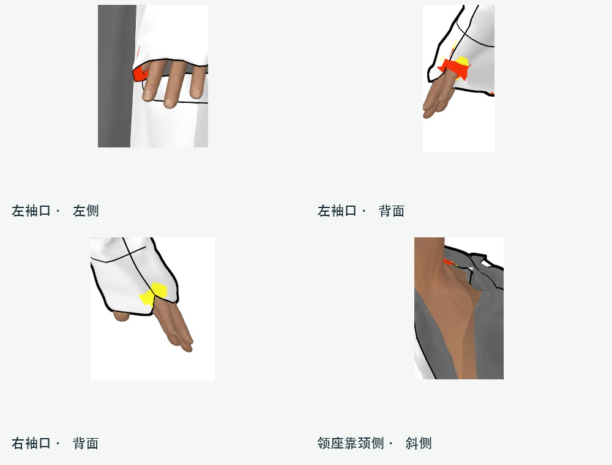

# Carlton coat pattern and CLO fitting

A saved FreeSewing Carlton web draft was converted into an editable CLO coat, checked against its original outlines, and reviewed in three poses before and after a collar correction.

## Source and build

- The initial input was `Carlton _ Draft Pattern _ FreeSewing.html` and its four browser support files. The saved page embeds the **Joost** draft, with 106 cm chest and 92 cm waist. The published [draft settings](pattern/joost-settings.json) and [embedded geometry](pattern/joost-web-draft.svg) come from that page. The separate Elanor export is reference material in the local archive. [FreeSewing Carlton and designer credits](https://freesewing.eu/designs/carlton/)
- The first 3D assembly lengthened the back tail. The outline correction restored the source geometry. At 96 dpi the maximum round-trip deviations were **0.120 mm** for 20 source templates and **0.082 mm** for the 28-piece assembly. [Template DXF](pattern/joost-20-templates.dxf) · [Template errors](data/20-template-outline-errors.csv) · [Assembly errors](data/28-assembled-outline-errors.csv)
- CLO 2026.1.382 simulated the assembled coat on Luka in relaxed arms, the original A-pose, and horizontal arms. The base coat has 28 pieces and 169 sewing groups. The collar correction added 10 short simulation tacks to settle the lapels and collar. The 28-piece DXF outline vertices match the pre-repair export exactly. [Corrected DXF](pattern/joost-28-assembled.dxf) · [Round-trip check](data/28-collar-roundtrip.json)

## Fit evidence

| Version | Relaxed arms | A-pose | Horizontal arms |
| --- | --- | --- | --- |
| Baseline | [Four maps](maps/baseline/relaxed/) | [Four maps](maps/baseline/a-pose/) | [Four maps](maps/baseline/arms-horizontal/) |
| Collar corrected | [Four maps](maps/collar-repaired/relaxed/) | [Four maps](maps/collar-repaired/a-pose/) | [Four maps](maps/collar-repaired/arms-horizontal/) |

Each folder contains the native CLO categorical Fit Map, GLB engineering strain, native CLO stress, and four-view fold angles. The stress color scale supports visual inspection. No point stress readings were collected. [CLO Fit Map definitions](https://support.clo3d.com/hc/en-us/articles/360000436368-Garment-Fit-Maps)

The collar stayed turned down in all three poses and cleared the collar-area penetration screen. Relaxed arms still showed local **Can't Wear** flags at the left cuff and neck-side collar stand. One sampled left undersleeve point near the cuff was about 6.8 mm inside the skinned hand surface. The collar stand’s engineering strain P95 was 16.4% in that pose. The wrist overlap and collar-stand ease remain physical-sample questions. [Collar checks](data/collar-checks.csv) · [Relaxed fit-flag measurements](data/relaxed-fit-flag-check.csv)

## Archive and verification

The accompanying local ZIP contains the original HTML and browser assets, 10 editable CLO projects, both full HTML reports, raw captures, GLB and DXF evidence, the separate Elanor reference, and a per-file SHA-256 inventory. The [manifest](manifest.json) identifies its exact bytes and links the public evidence to the native export metadata. This repository copy contains the portable pattern and fit evidence. The editable projects, which contain CLO Library assets, travel in the local ZIP.

[Base pose comparison](data/base-pose-comparison.csv) · [Base region comparison](data/base-region-comparison.csv)
