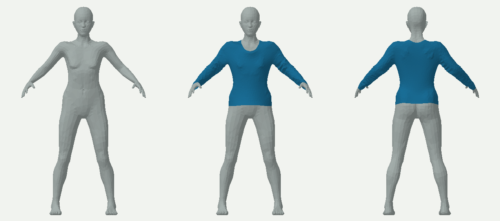
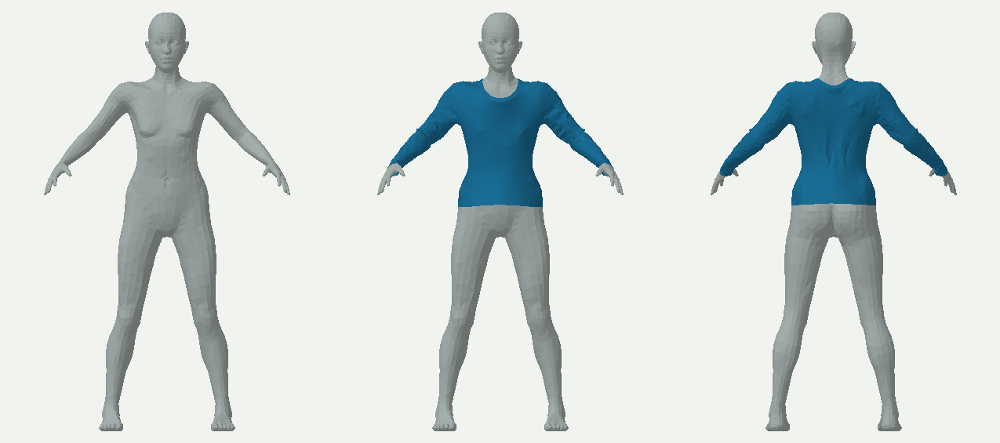

# 人台改尺与长袖试穿对照

在 Boat Linux 上用同一长袖 DXF、缝合、面料和直立姿势对照改尺前后的 MakeHuman 参考人台。调整前采用此前通过验收的直立基线，调整后用 MCP 导出的 OBJ 重建碰撞体并重新求解。两组使用相同视角和比例。

| 量体 | 调整前（mm） | 目标（mm） | Boat 独立实测（mm） |
| --- | ---: | ---: | ---: |
| 身高 | 1665.93 | 1672 | 1672.00 |
| 胸围 | 851.32 | 845 | 845.00 |
| 腰围 | 711.90 | 700 | 700.14 |
| 臀围 | 946.99 | 938 | 937.76 |

四项独立复测最大误差为 0.2432 mm，低于 0.5 mm 门槛。每组八个物理步，核对九帧。衣片拓扑、UV 和缝合定义一致；两组均通过独立袖管和相交检查。面料为同一实验估计值，实物合体尚待验证。

CLO Luka 的导出网格另行通过 MCP 量体与改尺。该导出带开放边，尚未建立长袖碰撞与袖管骨架的验收配置。此案例发布图和数据来自 MakeHuman 试穿，附 Luka 量体数值。

- [下载离线报告](report.html) · [试穿验收数据](boat-verification.json) · [网格独立复测](mesh-measurements.json)
- [CLO Rust MCP 源码与使用说明](https://github.com/liush2yuxjtu/clo-rust/tree/main/clo_mcp)
- [已验证的长袖纸样](../../../patterns/fitted-tshirt)
