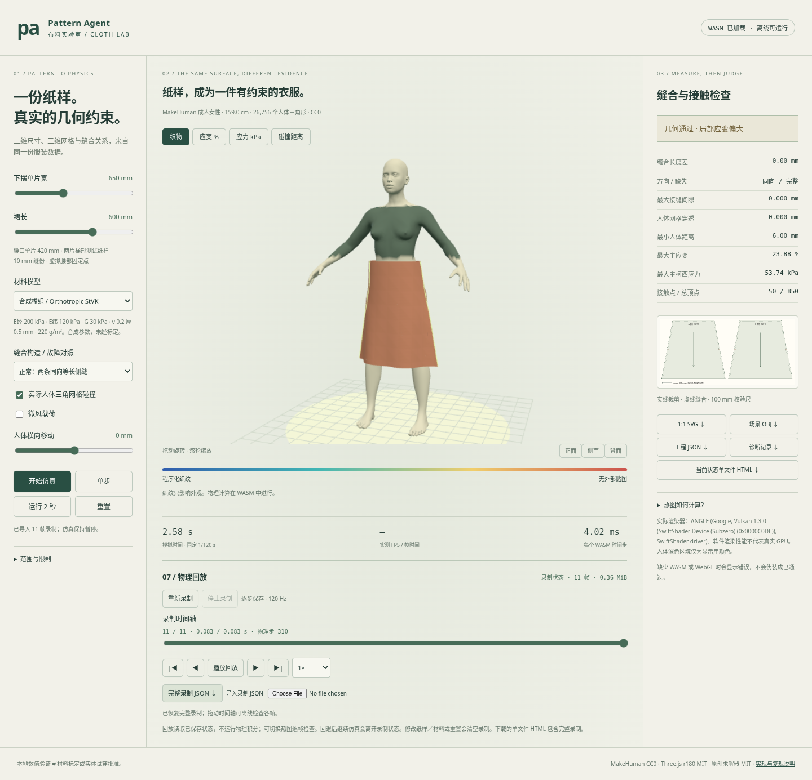
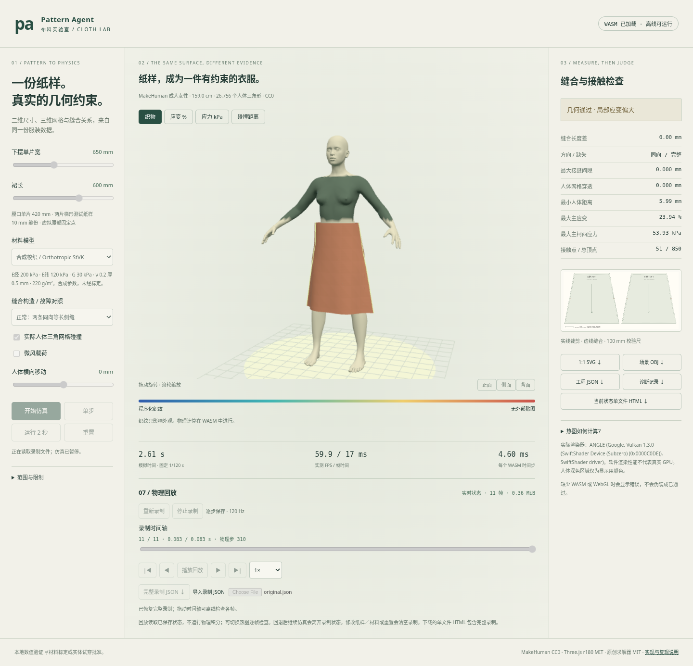
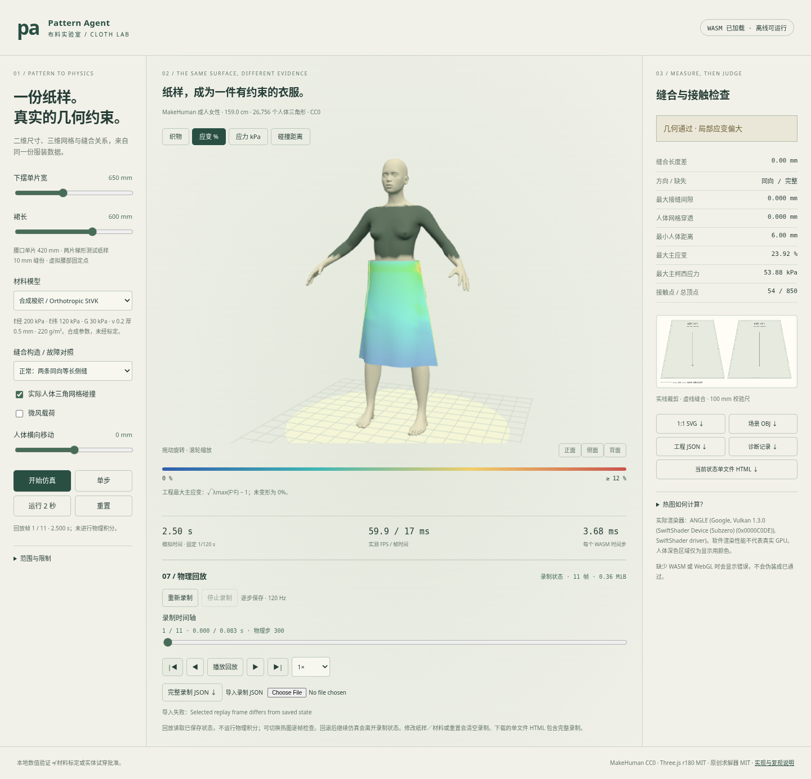

# 复验：修复录制文件交接与状态提示

范围：`web/cloth-lab/`，对应公开网址
<https://liush2yuxjtu.github.io/pattern-agent/cloth-lab/>。这不是根目录的另一个
`cloth-lab.html` 实验。执行仓库 `/verify`，保留真实 Playwright、WASM、独立几何
和张量验证；不新增或依赖 CI。

## 首先复现的三处问题

[修复前真实 FAIL](first-fail/receipt.json) 不是旧的成功记录：

1. 实际导出的录制 JSON，参数值全部不变，只倒转根参数对象的字段顺序，就被误报
   `Selected replay frame differs from saved state`。JSON 对象字段顺序不应改变物理状态。
2. 在真实运行的仿真中选择录制文件，延后实际 `File.text()` Promise 的完成，读取期间
   全部编辑控件仍可用，实际 WASM 积分从 316 增加到 333。旧实现允许新的物理／纸样
   操作与尚未完成的导入交错。
3. 回退到录制第一帧后，活动提示仍显示“就绪”或上次运行内容，而不是当前帧。

复现时专门将人体移动 40 mm 且不推进物理，方便区分“真的导入了原状态”与“原场景
没变”。修复前截图中的瞬时穿透是该探针的设置，不是正常验收轨迹。

## 修复与验证方法

- 参数校验返回固定字段顺序的语义对象；完整状态比较继续检查所有实际参数和数组，
  真正不同的风载参数仍被拒绝。没有移除来源指纹、边界或选中帧一致性检查。
- 读文件前暂停仿真并锁定编辑、录制和时间轴；读取完成后同步校验／恢复，再解锁。
  失败保留原工程，成功和失败都保持暂停。
- 查帧提示显示实际帧号、时钟和“不进行物理积分”。
- 增加 `tools/cloth_lab/verify_handoff.py`，通过真实下载／上传和延后的原始文件读取
  检查六个边界；只延后 Promise，不替换文件字节、人体、求解器或网络响应。
- 原有回放验证增加“文件输入值已清空”的完成条件，避免用上一条错误提示判断本次
  异步导入已经结束。

精确候选见 [candidate.json](candidate.json)。WASM 二进制和 MakeHuman 来源均未改变。
[相同输入下的 61 帧比较](unchanged-physics.json) 证明修复前后全部物理缓冲区、时钟和
参数逐字节一致；不要求计时元数据相同。没有改碰撞／接缝／张量容差或应变警告。

## 单独保留的宿主限制

直接导航到本地 `file://`，本轮真实返回 `ERR_BLOCKED_BY_ADMINISTRATOR`，见
[literal-file-BLOCKED.json](literal-file-BLOCKED.json)。该边界是 **BLOCKED**，不能声称
本机双击文件已通过，也未修改浏览器策略绕过限制。断网验证执行的是实际下载 HTML
的字节，通过 `set_content` 运行，检查零外部请求、完整时间轴和精确继续模拟；这与
本地文件 URL 导航是两个边界。

本页是两片测试裙片与合成材料模型；局部高应变警告保留。物理适体仍为 NOT_RUN，
不据此批准生产；历史 T 恤 FAIL 不被覆盖。

## 本地验收结果

**功能／数值验收 PASS，36 项浏览器检查**：原有实验室 15 项、完整回放 15 项、
文件交接新增 6 项。另通过实际 WASM 内核 3 项、纸样反例 6 项、原生／MCP 重开
和站点下载回归。完整命令、候选字节及结果见 [receipt.json](receipt.json)。

全部 61 帧按原阈值检查接缝、4,770 个碰撞采样点和双向边面相交、所有三角形的
应力应变。最大接缝间隙与独立穿透均为 0 mm；高应变警告保留。
[逐帧独立数值](frame-oracles.json)、[文件交接检查](handoff-receipt.json)、
[回放检查](replay-receipt.json)、[原有回归](browser-receipt.json) 均为本轮实际运行。

[实际下载与导入文件](actual-downloads.zip) 与 [摘要](artifact-hashes.json) 保留了新
单 HTML、完整轨迹 JSON、仅字段顺序不同的输入，以及真正参数不一致的拒绝对照。
原始日志用 gzip 保留；不是以页面文字、截图或旧日志代替数值检查。

