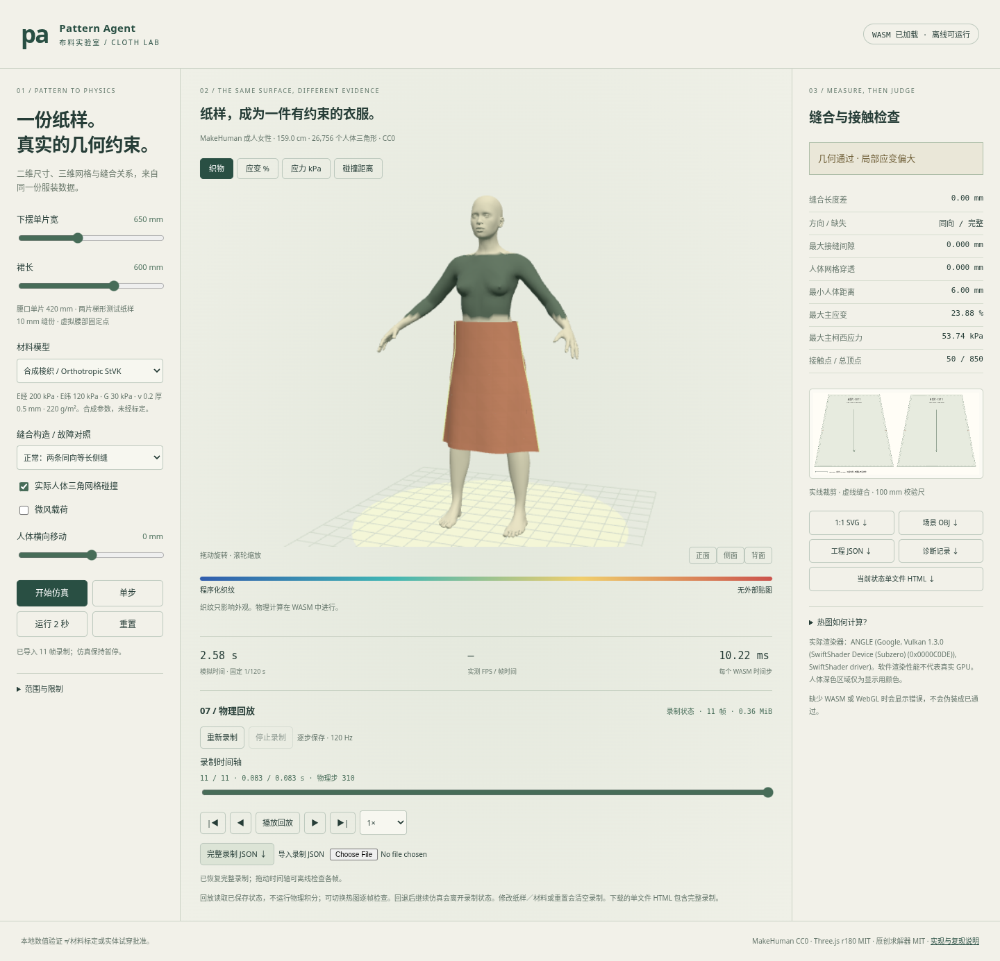
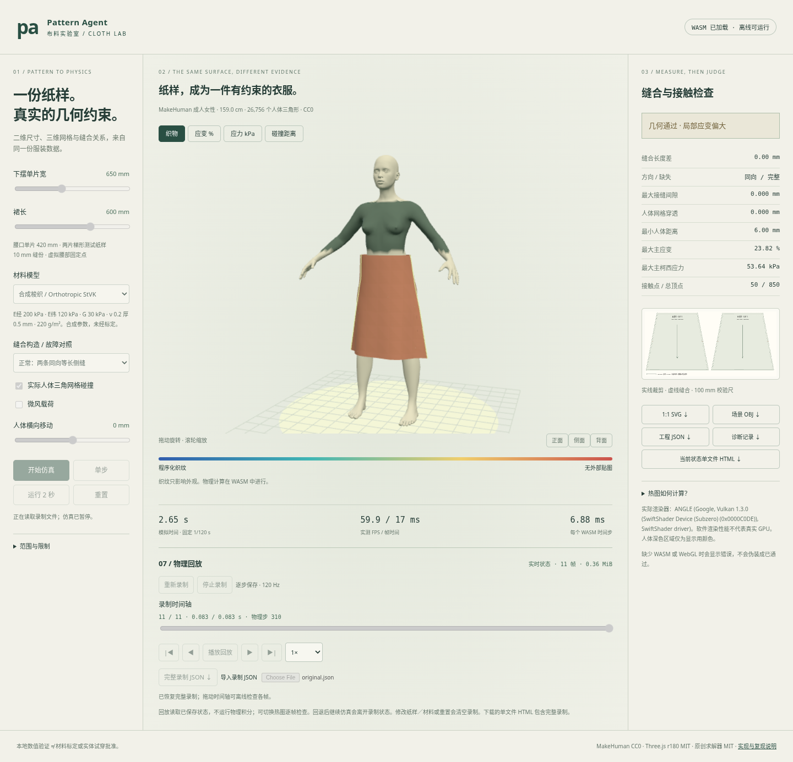
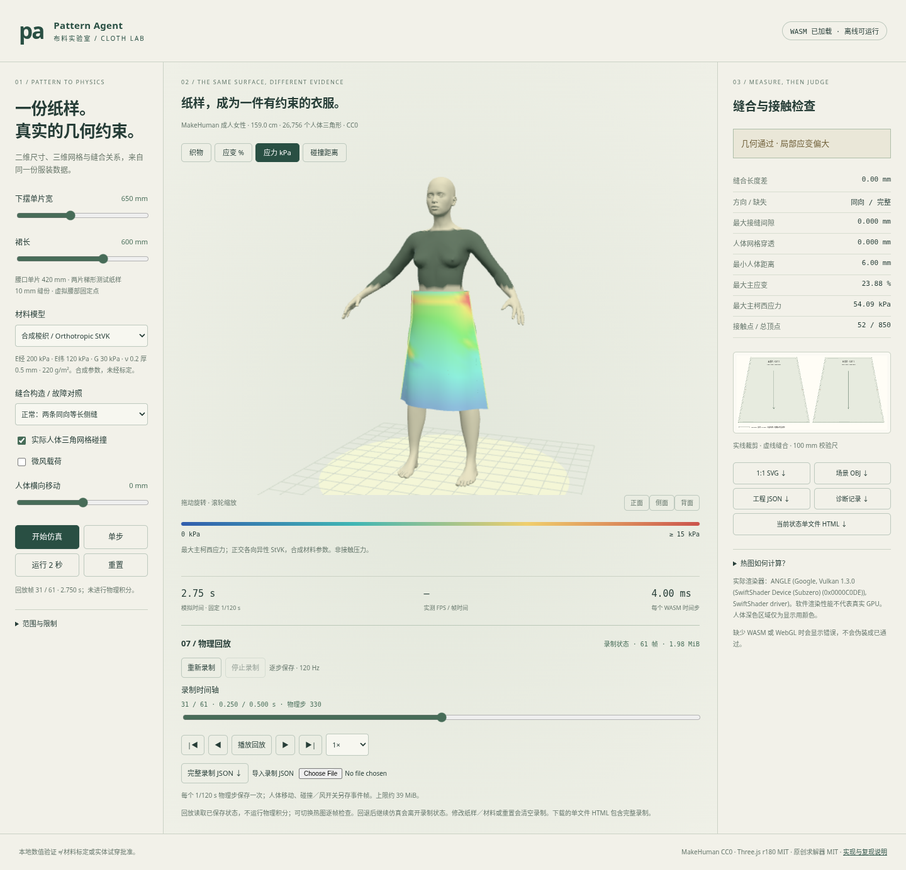

# 公开页面复验：功能／数值 PASS

网址：<https://liush2yuxjtu.github.io/pattern-agent/cloth-lab/>。
修复提交：[`b4bdf98`](https://github.com/liush2yuxjtu/pattern-agent/commit/b4bdf9801f5022cbac9241059c669d890d8a04b0)。
[既有 Pages 发布](https://github.com/liush2yuxjtu/pattern-agent/actions/runs/44239026183) 成功后，
实际公开页面通过 Playwright 驱动和独立数值检查；不是以发布任务成功当作验收。

## 本轮真实结果

- **36 项浏览器检查 PASS**：原有功能 15 项、完整物理回放 15 项、文件交接 6 项。
- 相同参数只改变 JSON 字段顺序可正常导入；恢复坐标、速度历史、固定点、接触标志、
  时钟及人体偏移全部匹配实际录制。真正的参数差异仍被拒绝。
- 从真实运行中的仿真开始，延后实际文件读取完成时，编辑／录制／时间轴控件锁定，
  实际 WASM 积分入口计数保持不变；读取成功和失败后均能正常使用控件，仿真保持暂停。
- 查帧后的提示显示当前实际帧号和时钟，明确未进行物理积分。
- 61 帧均重新核验完整缝合关系、4,770 个顶点／边中点／面重心、双向边面相交，以及
  全部 1,536 个衣片三角形的应力应变。最大接缝间隙和独立穿透均为 **0 mm**。
- 实际 GPU 应力／应变颜色缓冲区匹配独立张量计算。穿透、错缝长、漏缝和反向缝合
  的录制反例仍被正确拒绝；未改变容差或通过条件。
- 断网执行实际下载 HTML 字节：零外部请求、全部时间轴保留、递归保存和精确继续
  模拟通过。本地和线上全部 61 帧完整物理缓冲区逐字节一致，见
  [local-live-match.json](local-live-match.json)。
- 390 px 布局、实际容量上限和性能日志已重跑。软件渲染为 SwiftShader，不能据此
  推断硬件 GPU 帧率。原始耗时保存在 [replay-receipt.json](replay-receipt.json)。

## 两个被保留的失败与恢复

第一次站点下载回归在“不存在的 PDF 应返回 404”处失败。紧接着的独立请求返回了
**503**，正文是 GitHub Unicorn 错误页，见 [missing-response.json](missing-response.json)。
之后同一精确 URL 在 API 和真实 Chromium 导航中均返回了 404，见
[missing-diagnosis.json](missing-diagnosis.json)。没有将 503 改判为通过，也没有模拟响应。
验证器现在在失败消息和成功记录中保留实际 URL、状态与内容类型。

重跑时另一项授权的并行发布将站点根版本推进到
`27789580081307a900de0ac5ada6b765e654f7bd`，旧 expected-commit 检查正确失败。
先独立读回完整 HTML，确认 SHA-256 仍为
`e8ec81825d1a65b0f5e058caeaa70c3aeed0f058fbb8ea65f17a270dde6f3474`，与已验证候选完全一致，
再以当前根版本重跑**完整下载流程**。最终通过，实际缺失 PDF 状态为 **404**。
见 [当前版本独立读回](current-public-readback.json) 和 [完整站点回归](pages-receipt.json)。
布料代码和物理结果未因该并行发布而改变。

初始断言失败和版本不匹配的原始日志分别保存在
`logs/pages-first-fail.log.gz`、`logs/pages-concurrent-version.log.gz`，最终日志为
`logs/pages-current.log.gz`。不以局部请求成功替代完整回归。

## 证据与范围

[总验收](receipt.json) · [新增交接测试](handoff-receipt.json) ·
[完整回放](replay-receipt.json) · [原有回归](browser-receipt.json) ·
[逐帧独立数值](frame-oracles.json) · [实际下载文件](actual-live-downloads.zip) ·
[文件摘要](artifact-hashes.json)。测试浏览器与临时服务均已关闭；未新增或依赖 CI。

直接 `file://` 导航仍因宿主浏览器策略返回 `ERR_BLOCKED_BY_ADMINISTRATOR`，该独立
边界维持 **BLOCKED**；详见 [当前候选的直接文件导航结果](../literal-file-BLOCKED.json)。
断网 HTML 字节运行 PASS 不等于本机直接打开文件 URL 已通过。
材料未经实测标定，正常轨迹最大主应变约 24.23%，警告保留；physical fit 为 NOT_RUN，
不据此批准生产。历史 T 恤 FAIL 保持原样。

