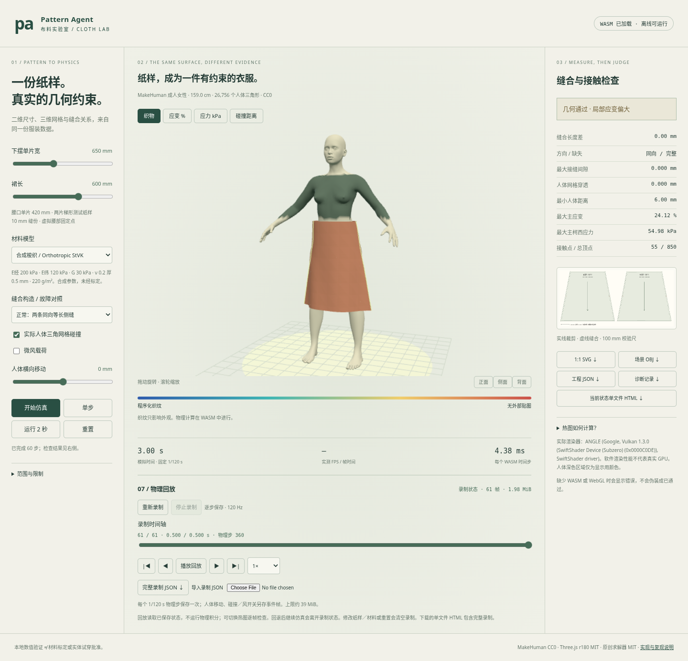
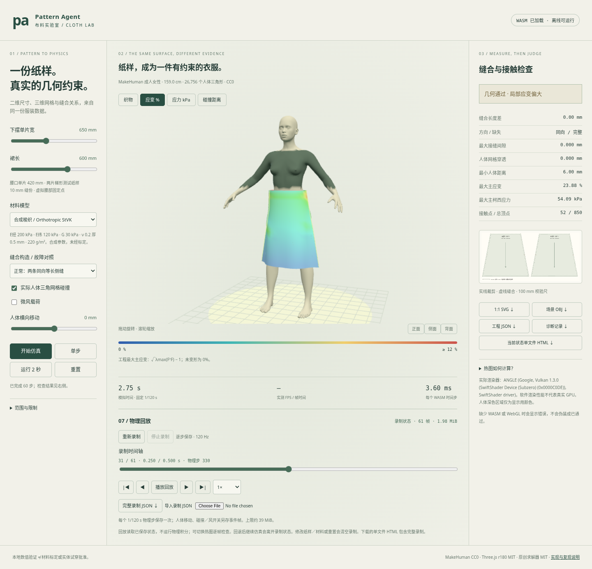
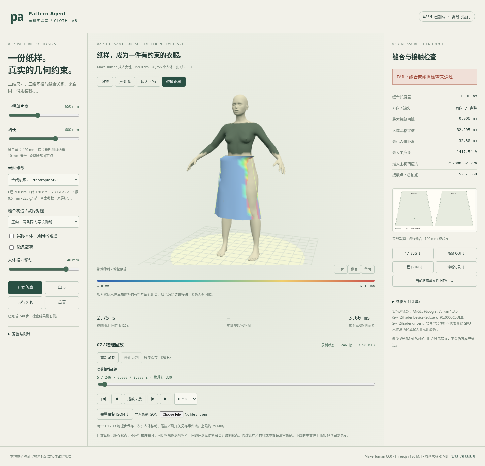
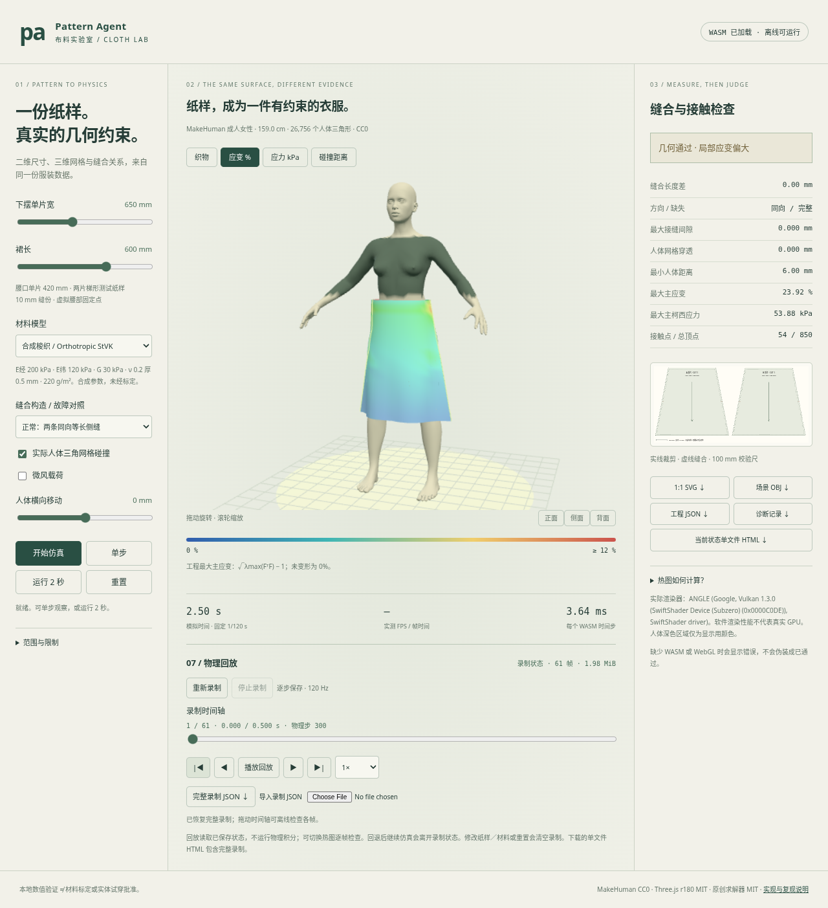
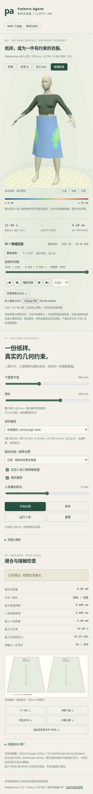

# 第七项：完整物理回放验收

2026-11-18，北京时间。本地与公开网址 `/verify`：**PASS**。本次新增逐步录制、时间轴查帧、
前后单帧、首尾定位、暂停与四档调速，以及 JSON / 单 HTML 的完整轨迹保存。
源码入口是 `web/cloth-lab/`，线上路径为 `/pattern-agent/cloth-lab/`；仓库里另一个
`cloth-lab.html` 是不同实验，不是本次修改目标。功能提交为 [`9b24405`](https://github.com/liush2yuxjtu/pattern-agent/commit/9b244052ed3951692f94248f583ebc2396f9bc55)；[线上完整验收](live/README.md) 已通过。

## 可审查的版本与操作

精确候选见 [candidate.json](candidate.json)：源代码基线
`2ef738b636f5656790109fc51a547b6e412d3eb2`，提交前快进合入
`96df90edf99e13526f01eba51d424df94bb755c9`，已逐文件确认验收源码未改变；HTML SHA-256 为
`61465c3613fdaecb6e98c52da9481e2c23e9043e42f0cbdd41cf5598263964f5`。
MakeHuman CC0 来源指纹没有改变。WASM 只新增两个只读时钟导出，物理求解算法及
缝合、碰撞、材料参数、验收阈值不变。完整命令、原始日志、结果见
[receipt.json](receipt.json)、[replay-receipt.json](replay-receipt.json) 和 `logs/`。

操作：开始录制 → 单步／运行两秒／开始仿真 → 停止录制 → 拖动时间轴或前后查帧。
热图可在回放时切换；回退后单步会从该状态继续物理仿真，原录制仍然保留。
修改纸样／材料或重置会清空录制。完整 JSON 和下载的单 HTML 都包含全部轨迹。
回放读取保存的数组，不逆向积分，也不依靠重新模拟生成一个相似画面。

## 实际核验结果

- Playwright 从真正的 WASM 步 300 开始录制，推进 60 个实际时间步，得到 61 帧。
  每帧保存当前位置、上一时刻位置、固定点、接触标志、参数和实际求解器时钟。
- 对**全部 61 帧**独立重开：每帧 850 个衣片顶点、1,536 个衣片三角形，原始
  MakeHuman 的 13,380 个顶点和 26,756 个三角形；每帧 4,770 个顶点／边中点／
  面重心采样，另外检查衣边→人体面与人体边→衣面两个方向的相交。
  接缝间隙最大 0 mm，独立穿透最大 0 mm，双向相交均为 0。
- 用 float64 NumPy 重算每帧全部三角形的 F、C、Green 应变、工程应变及柯西应力，
  保持原容差。实际 WebGL 颜色缓冲区随所选帧的应力／应变改变；不是显示示意图。
- 从实际 WASM 积分导出入口计数：查帧、前后查看和播放期间积分次数不增加；恢复的
  坐标、速度历史、固定点、接触标志、时钟、人体位移均与保存数据逐位一致。
  在过去帧继续一步，与原轨迹的下一帧逐位一致，移动人体的场景也通过。
- 真实关闭碰撞并把衣片顶点注入人体后，录制轨迹的失败帧可反复重放，页面仍为
  **FAIL**。独立采样发现最大穿透约 43.002 mm；页面的顶点穿透约 32.295 mm。
  两者采样范围不同。重新开启碰撞后恢复状态通过独立核验。
- 缝长不等（差约 39.328 mm）、漏缝、反向缝合三个反例，在录制回放中仍被拒绝。
  相容来源、数组、参数、帧数和选中状态的校验在改动场景前完成；损坏导入不改变现状。
- 四档速度使用浏览器内“实际点击事件→播放结束”计时；0.5 秒录制在
  0.25× / 0.5× / 1× / 2× 下分别约 2.084 / 1.055 / 0.543 / 0.352 秒。
  自动化操作的等待时间单独保存，未混入回放墙钟时间。软件渲染与浏览器调度有开销。
- 真正下载 HTML 后断网重开：0 个外部请求，时间轴和全部帧保留；递归另存一次仍
  可以重新打开并继续模拟。实际下载见 [录制及单文件交付 ZIP](actual-recordings-and-downloads.zip)。
- 实际推进超过容量：1,201 帧时自动停止，40,834,000 字节状态缓冲区（38.94 MiB），
  原数据仍能查帧。编码／导入会额外使用临时内存，该数不是浏览器总内存。
- 录制复制耗时 p95 约 0.20 ms，查帧 p95 约 9.41 ms，播放回调 p95 约 4.78 ms。
  机器使用 SwiftShader 软件渲染，不据此宣称硬件 GPU 帧率。
- 原有 15 项浏览器验收、3 项实际 WASM 内核测试、6 项纸样反例测试、OpenSloper
  原生／MCP 重开、站点下载回归也通过；无页面／控制台／HTTP 错误。390 px 无横向溢出。

逐帧数值见 [frame-oracles.json](frame-oracles.json)。所有原始文件的字节数与摘要见
[raw-artifacts.json](raw-artifacts.json)。日志保留原始字节，用 gzip 避免终端空行改变。
实际浏览器及临时 HTTP 服务已关闭；没有新增或依赖 CI 验证。

## 范围

正常录制最大主应变约 **24.23%**，页面保留局部应变警告。这里通过的是数据回放、
所述合成材料张量和离散几何检查，不代表成衣适体或生产批准。仍无布料自碰撞、CCD、
软组织人体和面料实测标定；physical fit 为 NOT_RUN。历史 T 恤 FAIL 不受此实验覆盖。

## 可见证据

