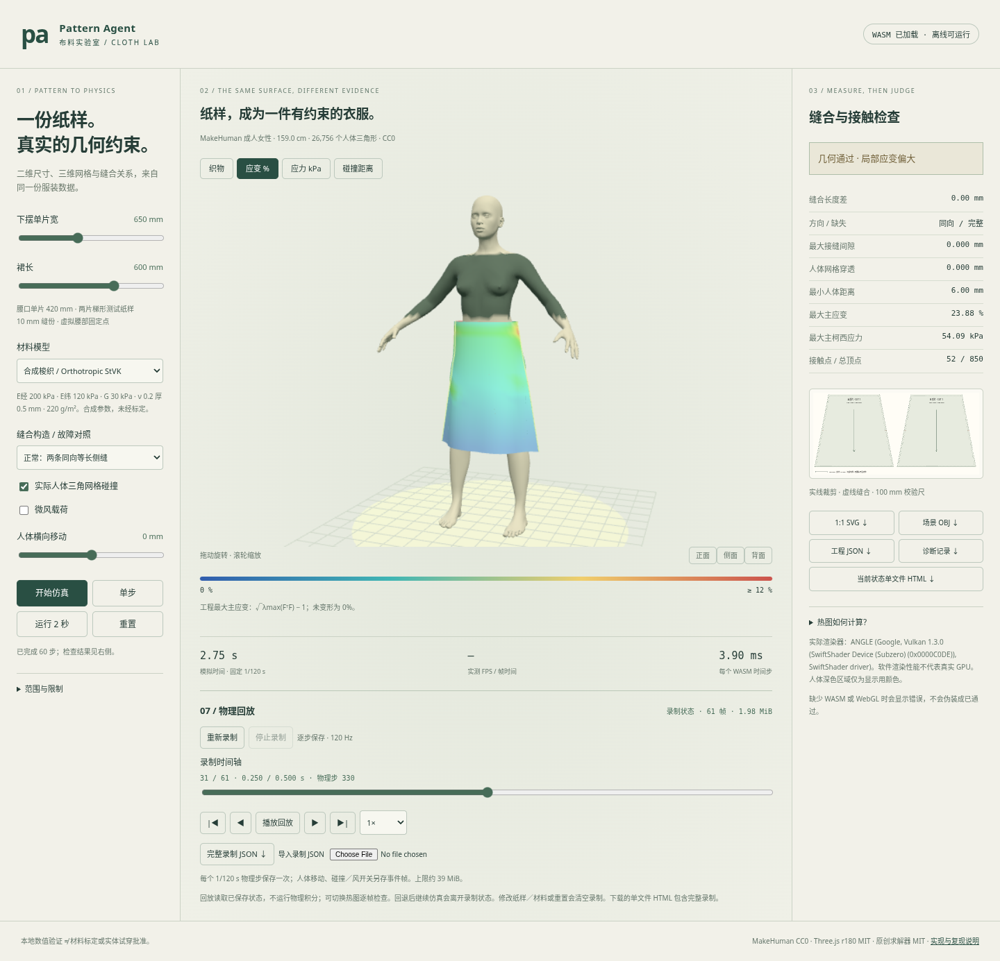
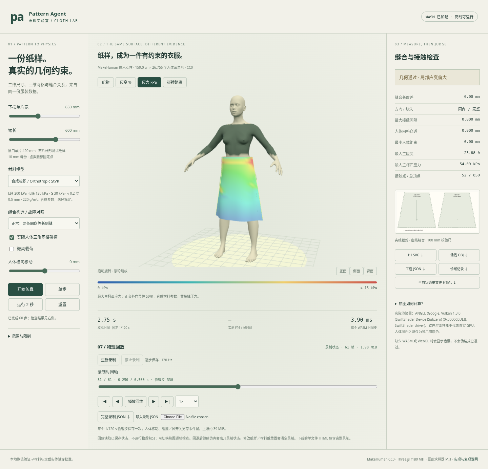
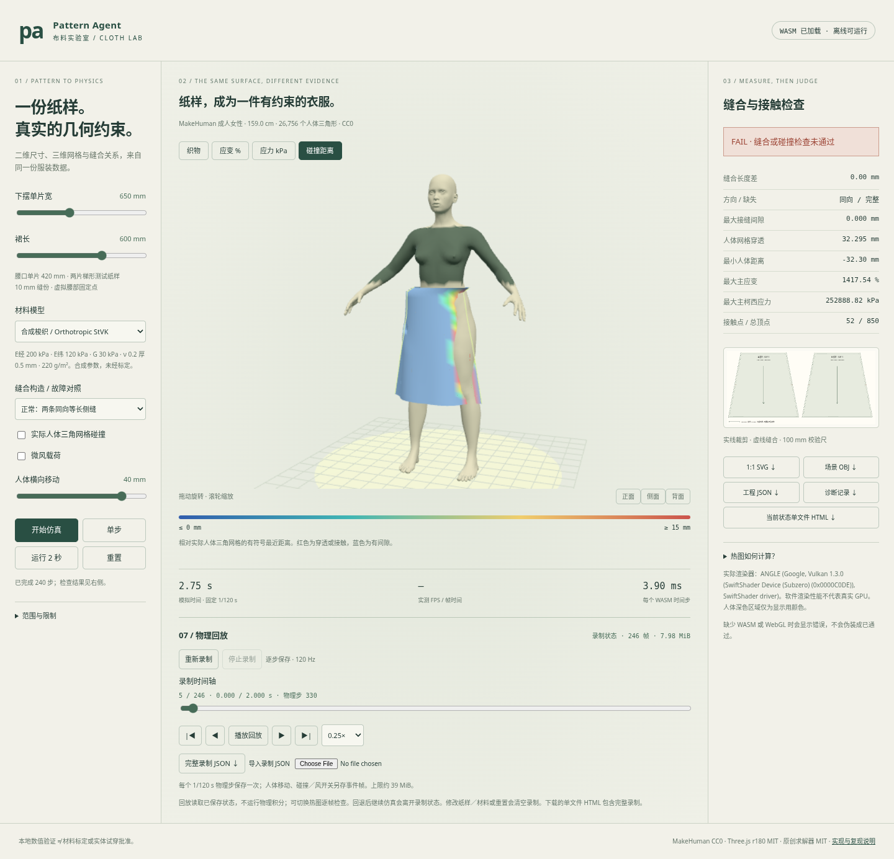
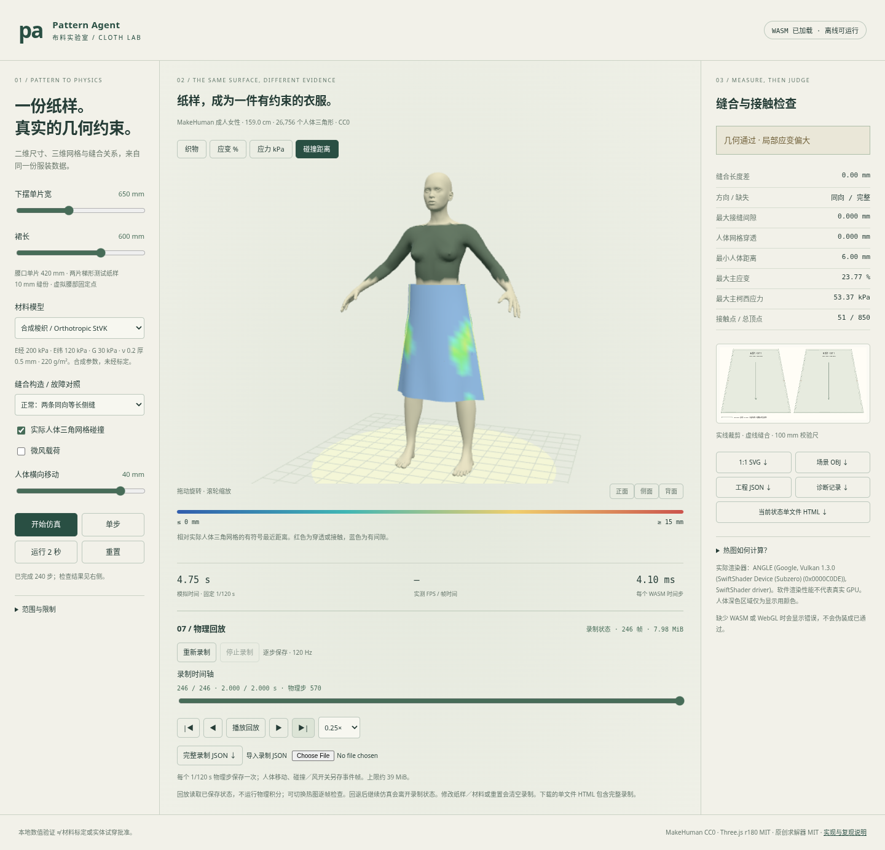
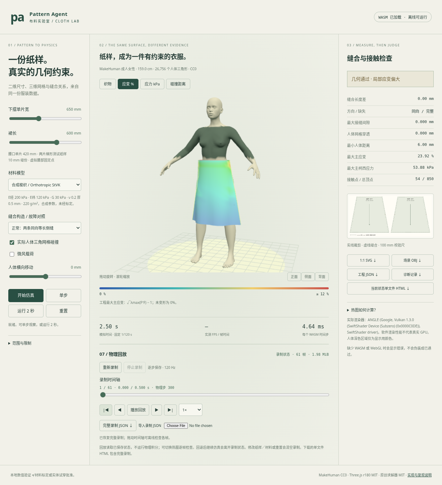
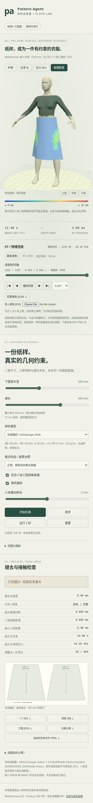

# 公开网址：完整物理回放 PASS

入口：<https://liush2yuxjtu.github.io/pattern-agent/cloth-lab/>。
发布并实测的功能提交：`9b244052ed3951692f94248f583ebc2396f9bc55`。
[既有 Pages 发布记录](https://github.com/liush2yuxjtu/pattern-agent/actions/runs/44230757495)
为 success；随后通过了真正公开页面的 Playwright 驱动和独立数值验收。
没有新增或依赖 CI 验证。此证据提交仅修改文档，不改变已发布的应用。

| 验收边界 | 真实结果 |
| --- | --- |
| 页面身份／源码 | HTTP 200，根 build commit 匹配发布 SHA；HTML 字节 SHA-256 与本地候选完全一致 |
| 120 Hz 录制 | 实际推进 60 个 WASM 步，保存 61 个完整状态 |
| 每帧独立几何 | 全部 61 帧；接缝间隙最大 0 mm；4,770 个采样点独立穿透最大 0 mm；双向边面相交均为 0 |
| 每帧独立张量 | float64 重算每帧所有 1,536 个三角形的应力应变，通过原容差；真实 GPU 颜色缓冲区也匹配 |
| 查帧／播放 | 坐标、上一时刻坐标、固定点、接触标志、时钟、人体位移和开关恢复准确；实际 WASM 积分入口计数不增加 |
| 四档调速 | 0.5 秒轨迹的浏览器墙钟约为 2.084 / 1.059 / 0.529 / 0.303 秒，分别为 0.25× / 0.5× / 1× / 2×；保留调度开销 |
| 故障轨迹 | 真实注入穿透仍为 FAIL；独立测得约 43.002 mm；错缝长、漏缝、反向缝合仍被拒绝 |
| 人体与继续仿真 | 实际 MakeHuman 位移、固定点及碰撞开关正确恢复；从过去帧继续一步，与原录制下一帧逐位相同 |
| 文件／离线 | 实际下载 JSON、单 HTML、递归保存的 HTML；断网重开保留全部帧，0 个外部请求 |
| 容量／手机 | 实际达到 1,201 帧上限并自动停录；状态缓冲区约 38.94 MiB；390 px 无横向溢出 |
| 原有功能回归 | 原有 15 项实验室检查和站点下载回归全部通过；无页面／控制台／HTTP 错误 |

同一主机的本地与线上录制，全部 61 帧的完整状态缓冲区、时钟、参数和事件种类
**逐字节一致**，见 [local-live-frame-match.json](local-live-frame-match.json)。
计时元数据独立保留，不要求两次运行耗时相同。

实测录制复制 p95 约 0.30 ms，查帧 p95 约 9.34 ms，播放回调 p95 约 4.42 ms。
渲染器为 SwiftShader 软件实现；这些数值不代表硬件 GPU 表现。正常录制最高主应变
约 **24.23%**，页面保留警告。测试裙片的材料未经实测标定，仍无布料自碰撞、CCD
或软组织仿真；physical fit 为 NOT_RUN，不据此批准生产。

- [总验收记录](receipt.json)、[完整回放记录](replay-receipt.json)、[逐帧独立数值](frame-oracles.json)
- [原有实验室回归](regression-receipt.json)、[站点下载回归](pages-receipt.json)
- [公开文件独立读回](public-readback.json)、[发布元数据](publication.json)
- [实际线上录制与下载文件 ZIP](actual-live-recordings.zip)、[原始文件摘要](raw-artifacts.json)
- 原始命令日志在 `logs/`；gzip 保留原始字节。浏览器和临时服务均已关闭。

