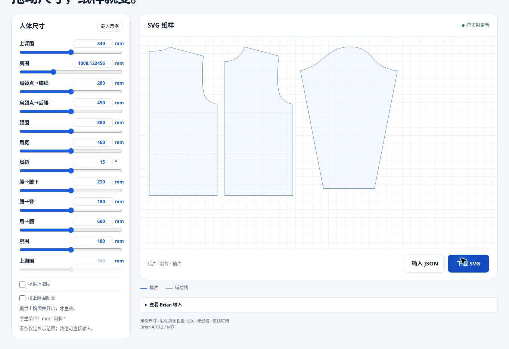

# Brian 原生输入规则对齐

本次范围是 Brian 4.10.2 的输入契约与交互界面。不是官方网页的像素布局复刻，
也不声称完成真人尺寸提取、工厂放码或实物合体。

- 字段和顺序：原库声明的 11 项必填和一项可选。
- 单位：原生 mm 与角度；不换单位、不取整、不钳制人体数值。
- 默认选项：由原库加载，胸围松量恢复为 15%。
- 上胸围：提供数值与启用 draftForHighBust 分开，保留原库的条件及回退。
- 示例身材与真实输入分开；清空必填值不会自动填回示例。
- 数值框接受小数和旧滑条范围外数值；滑条仅提供自适应显示窗口。
- 删除非原生整体大小参数；下载的输入 JSON 就是实际调用参数。

## 已完成的本地对照

`npm test`：47 组独立输入、141 片裁片、13,066 个坐标，容差为零。
原始 native SVG 逐字一致，展示排版不改变裁片路径。原包十个文件逐项校验。
原 22 项成人边界向量保留为回归输入，并新增小数、旧范围外尺寸、缺失值、
上胸围独立选项、额外原生字段及选项覆盖。

界面检查覆盖 12 个原生数值框、12 个滑条、每个必填字段的缺失和恢复、
活动数值框不重写、输入期间不导出旧纸样、上胸围开关分离和 SVG/JSON 导出。
详情见 `ui-local.json`、`independent-native.json` 和 `prepublication.json`。

## 真实浏览器边界

当前主机的 Chromium 启动与 Grok 通道不可用。托管浏览器拒绝 data: 预览，
因此提交前的可视候选验收记录为 BLOCKED，未把 DOM 测试当作像素验收。
不绕过浏览器策略。下一步沿用用户已授权的 GitHub Pages 正常 HTTPS 发布，
再独立读取线上文件、实际操作小数和缺失值，并下载重读 JSON 与 SVG。
正式验收与发布提交绑定后另存；发布成功本身不代表界面 PASS。

## 已发布 HTTPS 验收：PASS

验收时间：2026-11-18（北京时间）。源提交：[de8c54c](https://github.com/liush2yuxjtu/pattern-agent/commit/de8c54cd4bedcc2d74fec819760f7e8892909ad1)。
[正式页面](https://liush2yuxjtu.github.io/pattern-agent/freesewing/brian/) 已实际打开和操作。
[原有 Pages 发布任务 44281926593](https://github.com/liush2yuxjtu/pattern-agent/actions/runs/44281926593) 成功；该任务只做发布，本地对照及浏览器操作提供验收证据。

- 实际逐字输入 `1000.123456` mm：原数值进入 Brian，四分之一胸围宽度为 `287.5354936` mm。
- 清空胸围：不补示例值，清除旧预览并禁止 SVG 导出。
- 仅提供上胸围：不启用制版选项。开启选项后使用 `940` mm 上胸围，原胸围仍保留在输入中。
- 输入 `2100.123456` mm：原数值不钳制，滑条显示窗口自动扩大。
- 12 个数值框均使用原生字段、`step="any"`，不设人体尺寸 min/max。
- 点击真实按钮下载 JSON 和 SVG，并重新用原包计算：输入 JSON 等于实际调用参数，三片裁片的完整切线 `d` 均严格相等，SVG 物理单位为 mm。
- 独立 HTTP 读取线上 HTML、输入契约及 build.json；文件 SHA256 等于已验证源文件，并与部署元数据绑定。

原始浏览器观察见 [hosted-browser.json](hosted-browser.json)，包括勾选开关后、下一帧更新前的一次即时观察；判定使用随后“已实时更新”的状态。
实际下载文件为 [downloaded-input.json](downloaded-input.json)、[downloaded-pattern.svg](downloaded-pattern.svg)。
下载重读断言见 [download-reopen.json](download-reopen.json)，发布哈希见 [hosted-http.json](hosted-http.json)，总验收见 [hosted-acceptance.json](hosted-acceptance.json)。

截图已读回为 1363×936 JPEG。官方网页的视觉布局、手机视口和真人合体不属于本次 PASS；本次对齐的是 Brian 原生输入及裁片几何。
提交前的 BLOCKED 记录保留，正式 HTTPS 实机验收已补齐。此后续提交仅保存验收证据，不改运行时代码。
