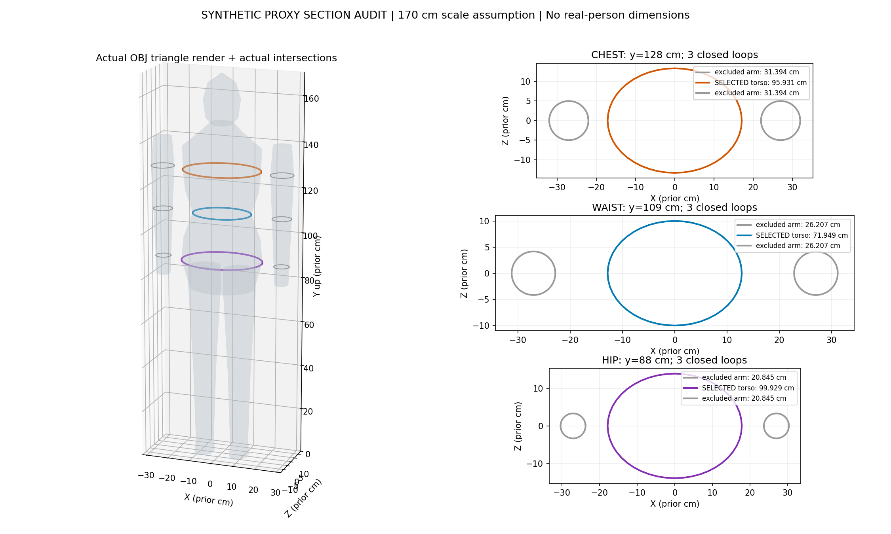
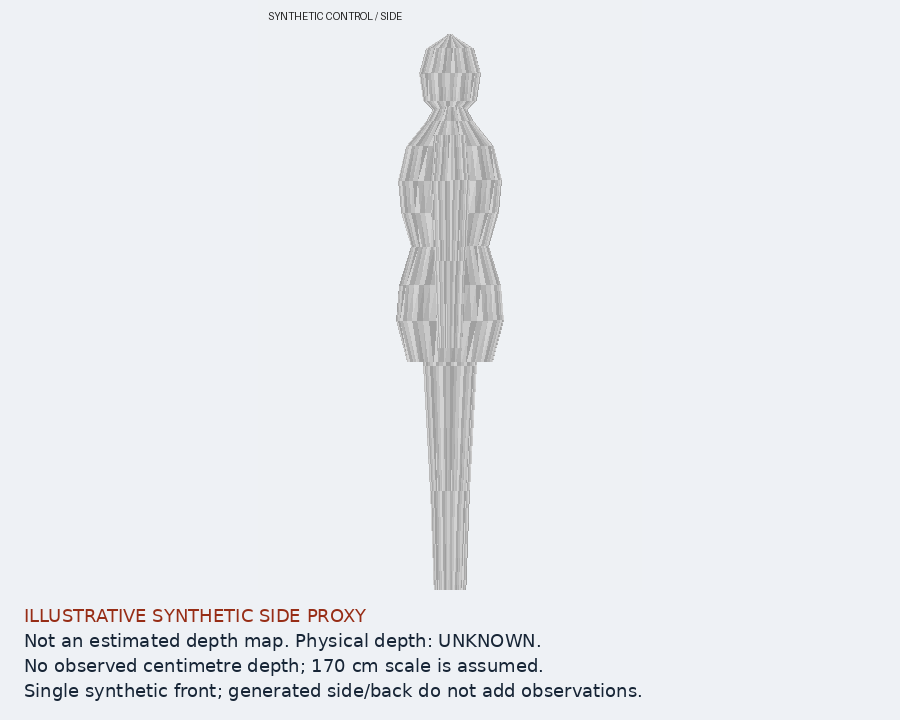

# Synthetic measurement audit

Recalculated circumferences from the actual `body.obj` triangles, excluding disconnected arms:

| Dimension | Corrected value | Basis |
|---|---:|---|
| Chest at y=128 | 95.9315 cm | Calculated synthetic mesh proxy |
| Waist at y=109 | 71.9486 cm | Calculated synthetic mesh proxy |
| Hip at y=88 | 99.9286 cm | Calculated synthetic mesh proxy |
| Height | 170 cm | Assumed scale prior |
| Bust-point distance | unknown / null | No semantic landmarks |
| Physical depth | unknown / null | Illustrative preview provides no depth measurement |

These are not real-person measurements. The only front reference is a synthetic control; side and back are generated previews, not source photographs. `prior_avatar` is the evidence mode. The supplied numeric report and observed-dimension claim were rejected.

## Actual geometry method

The OBJ uses X left/right, Y vertical, Z front/back; native coordinates are already prior-scaled cm. No additional rescaling was applied. Each triangle was intersected at the supplied Y level. Endpoint coordinates were joined using 0.000001 cm quantization, undirected duplicate segments were removed, and degree-two graphs were traversed into closed loops. Each plane yielded three closed loops. The central loop (index 1 when sorted left-to-right) has the center closest to the XZ origin and is visibly the torso; two detached arm loops were excluded. Only the selected polygon perimeter was summed. OBJ group names were not used to supply values.

A separate VTK 9.3.1 OBJ reader, plane cutter, and closest-seed connectivity selector independently recalculated the same torso circumferences. Maximum difference was below 0.00000001 cm. This verifies geometry computation, not anatomical validity. `vtk-independent-check.json` preserves the result and the mesh hash.

## Visible evidence

The prior false depth caption was removed in full and replaced with a visible statement that physical depth is unknown. The retained preview is identified as an illustrative synthetic side proxy, not an inferred depth map. No depth estimator was run.

## Uncertainty and provenance

`corrected-measurements.json` includes explicit units, source hashes for every input, method, scale assumption, basis, mesh_checked flag, source status, unavailable values, and uncertainty. The assumed 170 cm height has no calibration object or known camera distance. A 1% change in assumed height changes all these lengths by 1%; this is sensitivity, not a statistical confidence interval. Body-shape prior, polygon discretization, anatomical section choice, clothing/camera ambiguity and unobserved views remain unresolved. No anatomical accuracy claim or confidence interval is justified.

## Reproduction and checks

From the run directory: `python outputs/reproduce.py --inputs inputs --out outputs`.

Executed local NumPy triangle-plane geometry, Matplotlib actual triangle rendering, Pillow caption replacement, and independent VTK measurement. The JSON and both PNGs were reopened after writing; component counts, null unknowns, numerical agreement, and readable image dimensions were checked. The rendered PNGs were also visually inspected. Outputs: section evidence 2250×1350 px, corrected preview 900×720 px. No external paid services or image generation were used. No execution blockers remain.
