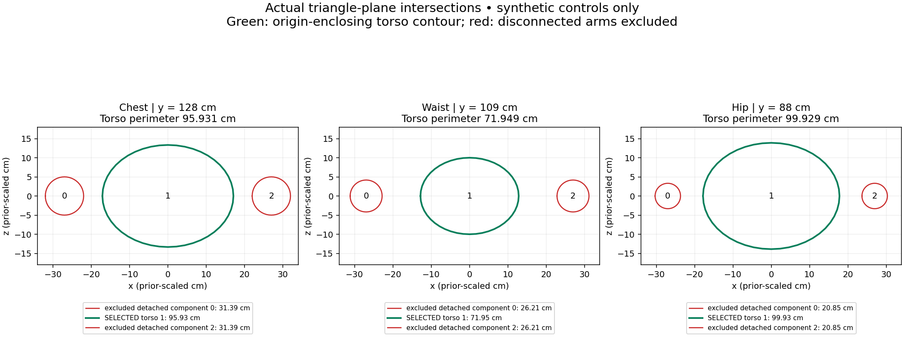
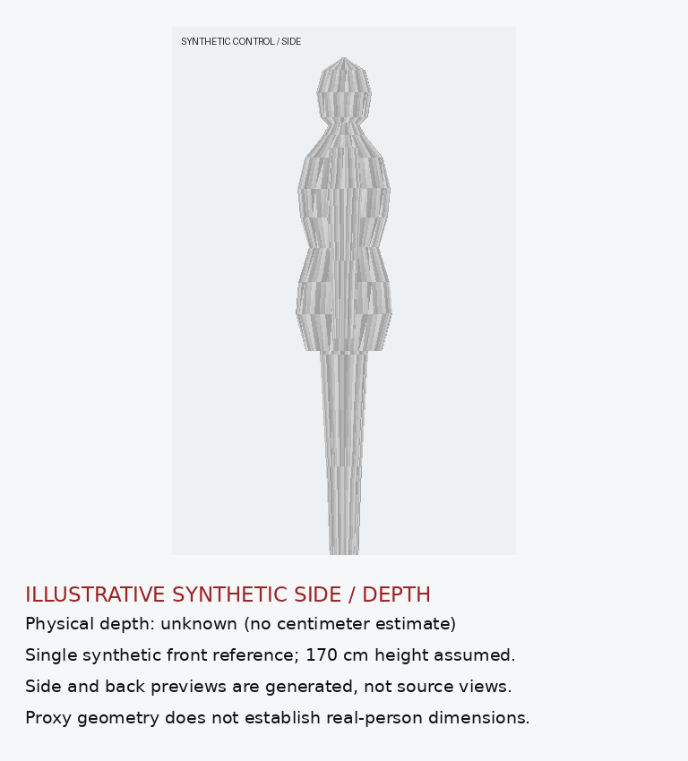

# Measurement audit — synthetic controls

Recomputed actual body.obj triangle-plane sections. All values below are synthetic mesh proxies in prior-scaled centimeters, using an **assumed 170 cm height**, not observed real-person dimensions. No anatomical accuracy is established.

| Section | y (cm) | Selected torso (cm) | All-loop sum (cm), rejected | Loops |
|---|---:|---:|---:|---:|
| chest | 128 | 95.931477 | 158.718481 | 3 |
| waist | 109 | 71.948608 | 124.362106 | 3 |
| hip | 88 | 99.928621 | 141.619191 | 3 |

Triangles are intersected with each y plane. Endpoints are joined at 0.000001 cm tolerance; duplicate undirected segments are removed. Every reconstructed node must have degree two; closed loops are traversed once. The central contour enclosing x=z=0 is selected (largest enclosed area if ambiguous). Detached left/right arm loops are excluded. Geometry, not OBJ group numeric hints, determines the result. Section evidence labels each component and length.

The front is a single **synthetic** reference. Side/back images are generated previews and add no observed dimensions. Mesh bounds are 0–170 in y and its header declares assumed centimeters. No rescaling was applied. Physical scale uncertainty and model error are unknown; numerical joining tolerance is not an anatomical accuracy bound. Polygonal circumferences depend on the supplied mesh and section heights.

Bust-point distance remains **null**: semantic landmarks and reliable multiview evidence are absent. Physical depth remains **null**: the prior 25.3 cm claim is unsupported. corrected-depth.png visibly replaces the false observed-depth caption with an illustrative/unknown caption. Height is a prior, not a measurement.

Independent verification: `python outputs/independent-check.py` reopens the OBJ through VTK, cuts each plane, and sums only central line cells with all endpoints |x| < 20 cm. This spatial window separates the torso from detached arms in these controls. Independent results agree to less than 0.0001 cm. Both PNG files were independently reopened with Pillow and visually inspected. The first independent check used |x| < 23 cm and included small inward arm segments; correcting the window to 20 cm resolved the mismatch. This check is specific to the supplied fixture.

SHA-256 hashes of all input files and full component diagnostics are in corrected-measurements.json. Reproduce with `python outputs/reproduce.py` from this run directory (Python, NumPy, Matplotlib, Pillow). Script also supports `--inputs DIR --output DIR`.

