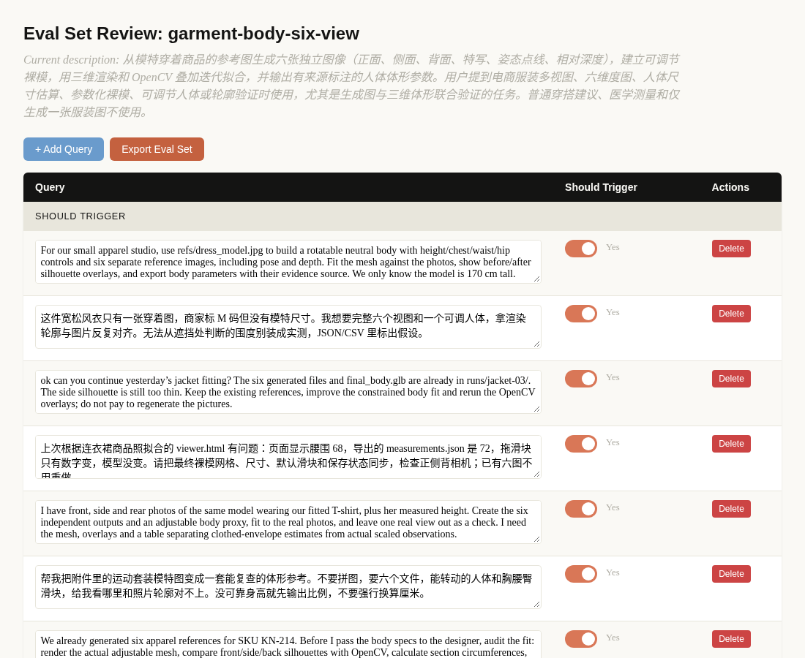

# Garment body skill verification

The skill and local evaluation tools are ready for installation. Overall native trigger/hill-climb verification is **BLOCKED**: this machine has no Claude CLI. No model trigger score or best description is asserted.

- [Receipt](receipt.json) and [commands](commands.json): exact scope and results.
- [Helper benchmark](helper-benchmark.json): old 5/9 → hardened 9/9 on analytical robustness controls.
- [Public CLI results](public-cli-summary.json): actual mask overlay and known VTK mesh section.
- [Browser evidence](review-browser-review.png): upstream 20-query review UI; query/label edits exported and reopened. The edits are test fixtures, not approved ground truth.
- [Native blocker](native-readiness.json): absent executable, null model results.

These checks do not establish real body measurement accuracy, garment fit, six-image quality, or native skill loading. The installable package is byte-checked against its canonical source.
