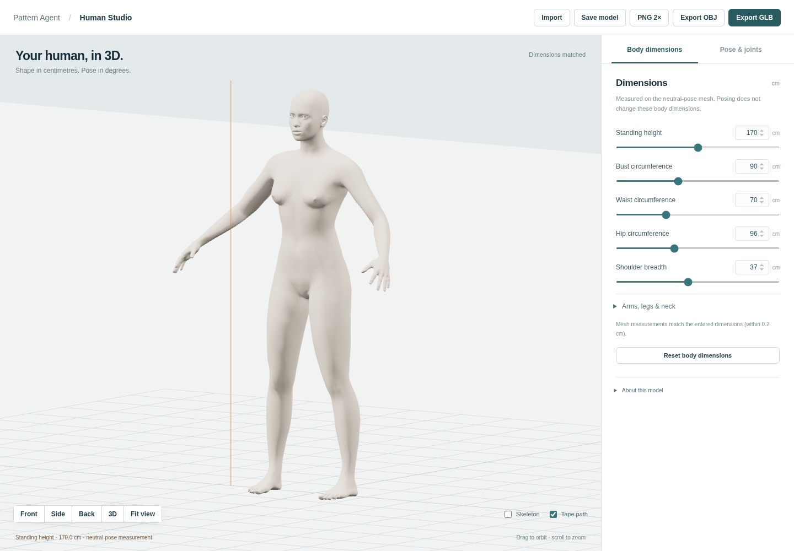
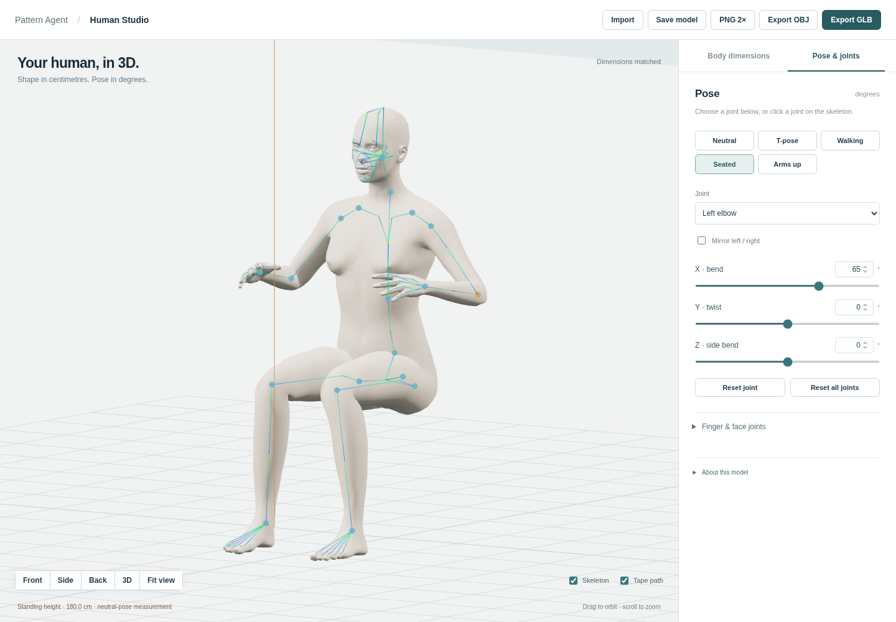

# Human Studio verification — 2026-11-17

[Open the articulated human model](https://liush2yuxjtu.github.io/pattern-agent/human-studio/)

The new editor uses the CC0 MakeHuman adult-female anatomical mesh, authored morph targets and 163-bone rig. It renders13,380 body vertices and 26,756 triangles. The earlier lofts remain archived test fixtures; they are not the current editor.

Twelve body dimensions are adjusted in cm, with actual neutral-pose mesh tape paths/landmarks recalculated by the shape solver. Local joint angles are separate. Individual joints, fingers and pose presets change actual skinned geometry. Save/reload and import preserve calibrated vertices and pose. Downloads are JSON state, actual 2×renderer PNG, posed OBJ in cm, and articulated GLB in metres.

## Verification

- [Browser acceptance](local/report.json): actual controls, all 12cm dimensions, elbow/wrist/finger movement, presets,195cm framing, cameras, off-step state, save/reload/import, real downloads and desktop/mobile viewport. No failed assets or JavaScript errors.
- [Independent geometry audit](local/independent-geometry.json): NumPy reopens actual downloaded files, recomputes mesh tape paths, decodes GLB node matrices/inverse binds/weights, and independently applies linear blend skinning. OBJ and GLB match the posed browser geometry with correctcm/metre conversion.
- [Fault controls](local/negative-controls.json): falsified bust dimension,1cm OBJ vertex displacement and 100×GLB unit error are all rejected.
- [Verified exported files](local/verified-exports.zip): sample180cm model, editedbodydimensions,seatedpose, actualriggedGLB,cmOBJ,JSON,2×PNG and browservertexdata.
- [Existing site regression](local/existing-pages.json): root/mobile navigation, fourdownloadhashes andnativepatternworkbench behavior preserved.
- [Local receipt](local-receipt.json), [commands](commands.json), [asset provenance](../../../web/human-studio/assets/provenance.json). [Hosted verification passed](live/receipt.json):37 actualbrowserchecks,7 primaryassethashes,independentdownloaded-filegeometryand3corruptioncontrols. [Live screenshots and exports](live/) are preserved.

Model tape-path agreement is a software measurement result, not proof that this generic model reconstructs a real person. Skinning is not physical tissue/collision/cloth simulation. Extreme combinations can exceed the bounded morph envelope; the editor shows measured residuals and closest supported values. GLB has current shape/pose/rig; the centimetre calibration controls are in the web editor.

## Reproduction

Follow `.agents/skills/verify/references/human-studio.md`. Three.js r180 is vendored under MIT and model assets are CC0; source revisions and asset SHA256s are recorded. No MakeHuman application logic is redistributed. The existing Pages publishing workflow is reused without CI, permission changes or paid compute.

Historical T-shirt seam gap7.6455mm and20 intersections remain FAIL; physical fit remains NOT_RUN.
