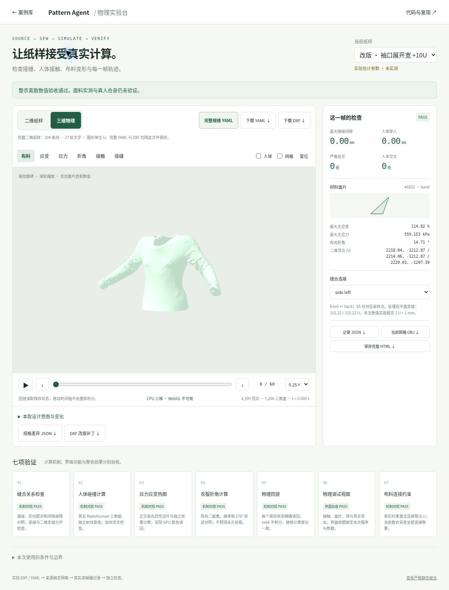

# 新物理实验台：公开页面验收

**PASS**。实际URL：
https://liush2yuxjtu.github.io/pattern-agent/intent-edit-review/physics/

发布源commit `57e1ea614169ac2a505a510a11b01ce32c4ce3d6`，既有Pages发布run `44322319957` 成功。该工作流只作发布，不代替本地验收。

- 开启TLS校验的HTTP客户端从公开URL取回46,107,845字节，SHA为 `80ccaf68114ad1d650ccfec248c812cc77d31ab5c9383e56d4904f18f617c872`，与本地最终HTML相同。
- 独立云浏览器实际打开同一公开URL，自动使用SVG软件三维；两case均可显示三维网格、字段与帧0/60，旋转改变实际投影路径，播放推进到保存帧。
- 两套二维各204条图元、27处文字；切到二维时三维SVG真实隐藏。
- 两份完整中文YAML由页面DOM取得，与仓库原文逐字节相同。六次真实浏览器下载均与原YAML/DXF/spec diff/geometry patch一致。
- 本机公开Chromium早先实测遇到环境TLS根证书限制（BLOCKED），原日志保留。没有ignoreHTTPS、改变证书或启用被禁用的图形功能。云浏览器完成了实际公开UI操作；本地WebGL2软件GL缓冲读回另有36项PASS，不能将两类证据混称硬件GPU验收。

[公开字节](public-final-bytes.json) · [实际UI操作](public-ui-final.json) · [六份下载读回](public-download-readback.json) · [发布记录](pages-svg-publication.json) · [文件摘要](artifact-manifest.json)

截图中的人体复选框已关闭以查看衣片；此前带人体的应力/折角图也已保留。软件路径的光照与遮挡较简化，真实记录及数值结论不随显示切换改变。原型和袖口各61帧的离散数值通过不等于材料实测、真人合身或生产批准；三项其他改版仍PROFILE_REQUIRED。
