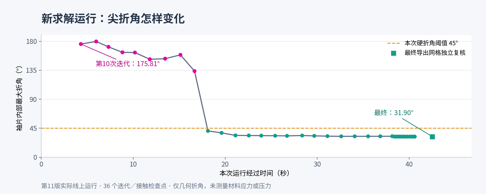

# 袖子尖折取证 /verify — 2026-11-18

结论：**PASS**，范围为新技能、独立几何检查器及真实彩色调试器／日志流程。
源 Site 第11版，提交 `fa0f009efc1d403018622306389fad5a617d0a14`；原 owner-only 访问范围不变。

- [技能源文件](../../../.agents/skills/verify-sleeve-creases/SKILL.md)
- [彩色取证页](https://pattern-atelier-three-wasm.liushiyuxjtu.chatgpt.site/sleeve-debugger.html)
- [精确回执](receipt.json)、[独立对比](independent-comparison.json)、
  [本地浏览器](local-browser.json)、[线上浏览器](live-browser.json)、
  [真实求解检查点](solver-checkpoints.json)、[CLI退出与读回](cli-runs.json)。

## 具体证据

修复前的161条内部邻接边超过45°，修复后基础款为0。全袖最大值为179.66°／31.90°。
截图中那条向外翘起的可见尖棱另按同一材料边的两个UV端点匹配：
117.4297762°降至6.6209252°，原边374:400改成373:399；端点误差0 mm。
它与“全袖最大值”是不同测点，不能混用。

独立Python标准库检查器与页面JavaScript逐边比较17294条边，最大角度差
5.68e-14°。15项本地正反例通过，包含真实旧坏模型、正常圆柱、
170°折回、绕序错误、退化面、非流形、空有效范围和CLI报告／Trace重开。
旧模型CLI返回2且保留FAIL，修复样例返回0；无效输入返回3。

真实Playwright：本地37项、线上48项通过，包含着色开关、源材料边配对、实际鼠标旋转、
镜头同步、方向箭头、390px手机、WebGL恢复、下载后重读、当前工程导入、错误导入保留原模型、
缓存绕过和求解中撤销旧结论。线上逐文件核对11个实际部署文件SHA-256。

真实线上新求解运行了240次迭代及接触阶段，共保留36个折角检查点；
早期最大约175.81°，最终约31.90°。
这不是旧模型的模拟历史。开启观察后的重算位置差约2.15e-15 m，
原有几何穿着检查仍通过。日志与曲线来自实际worker回调，未使用预计算缓存冒充实时求解。

## 验证环境与限制

按项目 `.agents/skills/verify/SKILL.md` 和新 `references/sleeve-creases.md` 执行本地验证。
原生Playwright MCP返回 `UNAVAILABLE / Connection failed`，使用已安装Chromium与Playwright，
不安装新浏览器或启动替代服务。线上通过系统信任库验证真实站点TLS，再将同一远程响应字节
交给Chromium，以适配其缺少工作区代理CA的环境；没有用本地文件替换失败的线上响应。

几何、UI、日志软件检查不等于材料应力、压力、严格全衣自交或实物合体认证。
历史7.6455 mm接缝／20处穿插FAIL保留，材料与实物合体NOT_RUN。
新技能文件、Claude符号链接与ZIP可读回；未声称原生客户端已自动加载或评测触发率。

提交方式：核对最新remote main，保留并发文档改动；直接非强制提交main，不使用PR、Issue或CI。
候选文件摘要清单随回执另列，不将记录自身摘要循环嵌入。

