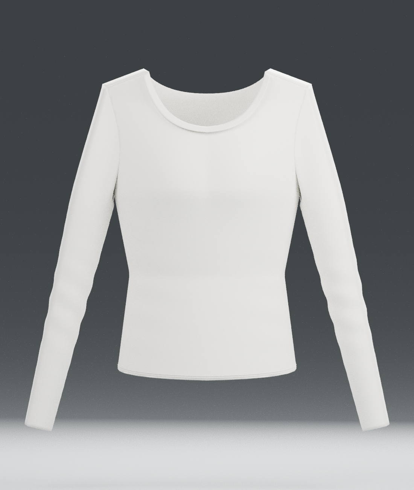
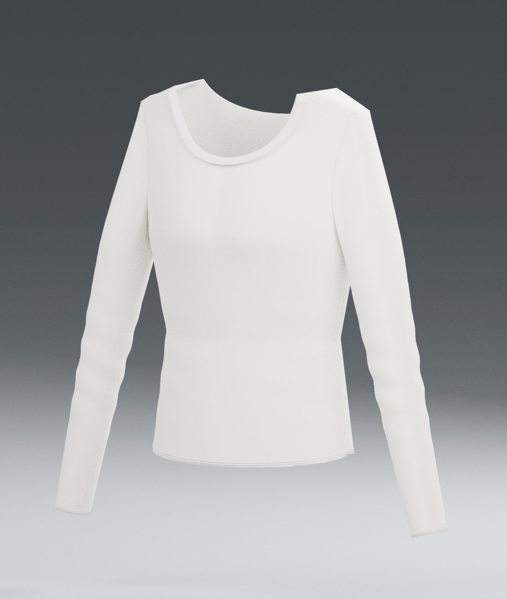
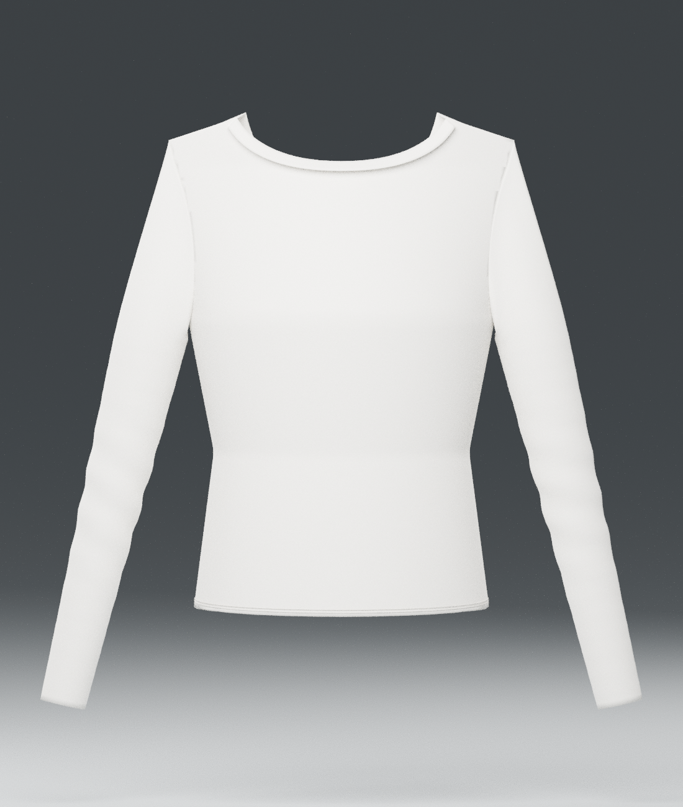
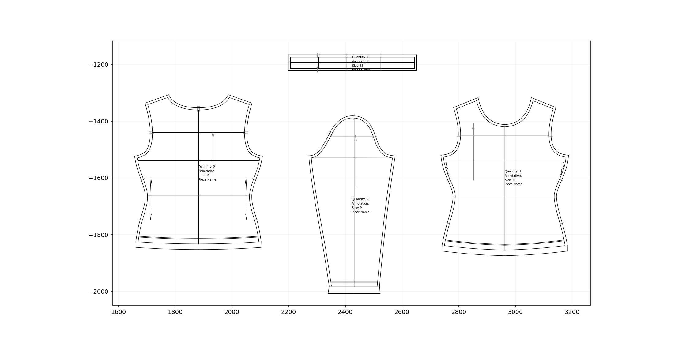

# 女士紧身长袖上衣原型资料

这是一款面向女性的紧身版长袖圆领上衣原型，核心特征是贴合身形、腰部收窄、细长袖型与较短衣身。现有资料用于说明款式、面料候选、纸样结构及尺寸要求，适合在打样沟通时共同查阅。

**当前阶段为原型开发，尚未定版。**面料选择、后身裁剪数量、衣长测量方法，以及纸样与尺寸表的一致性仍需确认。

# 三维外观预览

已在Linux环境中使用Blender 4.3.2生成三维模型，并使用Cycles渲染正面、斜侧面与背面。前后身网格取自原中码纸样内侧轮廓，袖身围度参考原袖片展开宽度；领条、肩部与侧缝连接进行了展示用重建。

**这组图是纸样轮廓驱动的三维外观示意，未进行经实测参数校准的布料物理仿真。**人体厚度、袖子姿态、面料物性及细微褶皱采用假定值，暖白颜色也不是最终色号。不得据此确认合身性、压力或生产尺寸；原始二维纸样未改动。

## 正面

## 斜侧面

## 背面

## 三维文件与复现

可编辑场景包含模型、程序化材质、灯光及相机；通用三维模型可在兼容查看器中旋转查看。复现包包含脚本、网格数据和说明，可在安装Blender的Linux机器上重新渲染。

[可编辑三维场景](../../../web/fitted-tshirt/assets/fitted-tshirt.blend)

[通用三维模型](../../../web/fitted-tshirt/assets/fitted-tshirt.glb)

[三维重建复现包](../../../web/fitted-tshirt/downloads/fitted-tshirt-complete.zip)

[三维示意使用说明](../README-render.txt)

# 款式与穿着效果

上衣采用圆领窄领条、常规装袖和修身衣身。正面参考照片体现贴合胸腰的轮廓，衣摆接近腰部，与参考裤装搭配时露出部分腹部；后侧参考照片显示顺滑的背部，未见明显后中拼缝。

正背面款式图补充了肩缝、袖窿、收腰侧缝，以及下摆和袖口的车缝位置。款式图用于表达缝制后的外观，不能直接代替裁剪纸样。图中衣身的视觉长度与模特照片不完全一致，实际衣长应以确认后的尺寸及样衣为准。

# 三个文件的用途

## 原始工程文件

**女紧身款T恤.prj**，大小约179千字节，很可能是服装制版软件的原生工程文件。结合行业格式，可能来自ET服装制版软件，但创建软件和版本尚未确认。

该文件用于保留可编辑工程的可能性较高。其内部为结构化二进制数据，可识别到中码标记，但尚未完整解码，也未在原始软件中打开验证。因此，不能确认它保存了哪些纸样、是否包含全部尺码或完整放码规则。

## 二维裁剪纸样

**女紧身款T恤.dxf** 已读取坐标并重建图形，包含后身、长袖、前身及领条四类形状。各片均标注中码，材料代号为“面料A”。这一代号不代表纤维成分。

图中包含内外轮廓、对位刀眼、方向箭头、辅助线，以及衣摆和袖口的折边参考线。内外轮廓与缝合线及裁剪边界的用途相符，正式加工前应由制版师确认。

| 纸样形状 | 识别依据 | 文件标注数量 |
| --- | --- | --- |
| 后身 | 领口较浅的衣身片 | 2 |
| 袖片 | 圆弧袖山及逐渐收窄的长袖 | 2 |
| 前身 | 领口较深的衣身片 | 1 |
| 领条 | 长方形窄条 | 1 |

此图由裁剪文件坐标重建，仅用于查看纸样布局，不能按页面显示尺寸直接裁剪。

**后身标注数量为2，需要核对。**款式参考没有显示后中缝，不能直接据此认定要裁两片完整后身。目前该导出文件只明确显示中码，没有看到八个尺码的成套套版。

加工注释“拔1CM”表示指定局部拉伸或拔开1厘米；“溶0.6CM”表示指定局部归拢、吃进0.6厘米长度。它们不是整件衣服统一增加的缝份。文件没有明确的单位声明，坐标大小与毫米制纸样相符，导入及打印前须校验比例。

## 纸样矢量示意图

**女紧身款T恤.emf**，大小约15千字节，是由绘图指令组成的矢量图。图中左侧为后身、中间为袖片、右侧为前身，上方为领条，与二维裁剪文件的基本排列一致。

它保留了纸样轮廓及部分标记，但比裁剪文件简化，没有其中全部文字、辅助线和额外轮廓。适合查看布局或用于说明文档，不应直接视为完整裁剪母版。

# 七张参考图片的作用

| 图片顺序 | 内容 | 主要用途 |
| --- | --- | --- |
| 第一张 | 实体面料色卡及供应商规格 | 查看成分、克重、幅宽、缩水和颜色 |
| 第二张 | 后侧面模特照片 | 说明背部轮廓、收腰及贴身程度 |
| 第三张 | 正面模特照片 | 说明圆领、修身衣身、长袖及短款效果 |
| 第四张 | 正面技术款式图 | 表达正面缝线、结构与车缝位置 |
| 第五张 | 背面技术款式图 | 表达背面结构及无明显后中缝的外观 |
| 第六张 | 面料资料表红框行 | 记录另一套面料候选信息 |
| 第七张 | 八个尺码的成衣尺寸表 | 定义尺寸目标、放码变化及测量方法 |

正面模特图中腰部的横向纹路更像穿着产生的褶皱，不能直接认定为设计分割缝。照片本身也不能证明具体纤维成分、克重或精确尺寸。

# 面料候选与颜色

## 实体色卡规格

| 项目 | 色卡内容 |
| --- | --- |
| 货号及品名 | 1253号，40支纯棉拉架 |
| 纤维成分 | 棉95.5%，氨纶4.5% |
| 实用幅宽 | 175厘米 |
| 克重 | 每平方米155克 |
| 每公斤长度 | 约3.62米 |
| 缩水标注 | 挂干条件下，宽向及长向均约5% |

“40支”是纱线支数，“拉架”是弹力面料的常见行业称呼。虽然品名写有“纯棉”，实际成分包含4.5%氨纶，不能按百分之百棉理解。每公斤米数用于面料长度换算，不是单件耗料。

照片中手指似乎指向07号纯白，旁边02号为米白。**07号纯白属于可能的颜色意向，尚未最终确认。**色卡下方的“配套罗纹”信息未填写；备注说明主身与配套罗纹的色号并非一一对应。

## 资料表红框行

红框第14行属于针织平纹类上衣面料，编号为10679，成分显示为氨纶10%、粘胶90%，并标有人棉。相应数字列疑似为幅宽175厘米、克重每平方米280克；由于截图缺少表头，这两个字段仍需核对。

| 对比项目 | 实体色卡 | 资料表红框行 |
| --- | --- | --- |
| 主要纤维 | 棉 | 粘胶或人棉 |
| 氨纶含量 | 4.5% | 10% |
| 克重 | 每平方米155克 | 疑似每平方米280克 |
| 幅宽 | 175厘米 | 疑似175厘米 |

两套面料参数不同，可能影响厚薄、垂感、弹性及贴身效果。应先确定最终面料，再评估纸样松量和样衣效果。

# 成衣尺寸规格

尺寸单位为厘米，中码为基码。以下为原尺寸截图中的目标值，尚未逐项验证与裁剪纸样完全一致。表内数据属于成衣尺寸，不能直接当作穿着者的人体尺寸。

| 测量部位 | 加小码 | 小码 | 中码 | 大码 | 加大码 | 二加大码 | 三加大码 | 四加大码 |
| --- | --- | --- | --- | --- | --- | --- | --- | --- |
| 后中长 | 49 | 51 | 53 | 55 | 57 | 59 | 61 | 63 |
| 肩宽 | 37.6 | 38.8 | 40 | 41.2 | 42.4 | 43.6 | 44.8 | 46 |
| 胸围 | 75 | 80 | 85 | 90 | 95 | 100 | 105 | 110 |
| 腰围 | 62 | 67 | 72 | 77 | 82 | 87 | 92 | 97 |
| 下摆围 | 75 | 80 | 85 | 90 | 95 | 100 | 105 | 110 |
| 袖窿围 | 39.6 | 41.3 | 43 | 44.7 | 46.4 | 48.1 | 49.8 | 51.5 |
| 袖长 | 58 | 58.5 | 59 | 59.5 | 60 | 60.5 | 61 | 61.5 |
| 袖肥 | 26.1 | 27.3 | 28.5 | 29.7 | 30.9 | 32.1 | 33.3 | 34.5 |
| 袖口 | 14.5 | 15.5 | 16.5 | 17.5 | 18.5 | 19.5 | 20.5 | 21.5 |
| 领围 | 50.4 | 51.7 | 53 | 54.3 | 55.6 | 56.9 | 58.2 | 59.9 |

中文测量说明规定后中长从后领口量至下摆，胸围在腋下2厘米处测量，腰围在腋下16厘米处测量，袖长从袖顶量至袖口。“脚围”在本款中指下摆围；“袖口”不意味着存在单独拼接的袖口部件。

截图上方英文示意从前领口起量衣长，与中文“后中长”存在冲突。公差栏看起来写作“+0-2”，其含义不够明确，不能直接按正负2厘米执行。

# 打样前需要确认的事项

- [ ] 确认最终使用棉氨纶面料还是粘胶氨纶面料，并核实克重与幅宽。

- [ ] 确认最终颜色及领条面料，核对主身与领条的色差。

- [ ] 在兼容制版软件中打开原始工程文件，核实纸样、尺码及放码设置。

- [ ] 核对后身数量，明确是否存在后中缝及实际裁剪方式。

- [ ] 校验裁剪文件单位和打印比例，确认缝份、折边与加工注释。

- [ ] 统一衣长测量起点、公差定义及其他测量口径。

- [ ] 将中码纸样与尺寸表逐项比对，完成样衣后检查贴身程度、衣长和活动量。

# 资料来源

资料来自本次提供的三个同名文件，以及面料色卡、两张模特照片、正背面款式图、面料资料表截图和尺寸表截图。原型介绍保留了这些资料之间的差异，未将尚待确认的选项作为最终生产规格。

# 原始文件附件

[原始工程文件](../source/女紧身款T恤.prj)

[二维裁剪纸样](../source/女紧身款T恤.dxf)

[纸样矢量示意图](../source/女紧身款T恤.emf)
