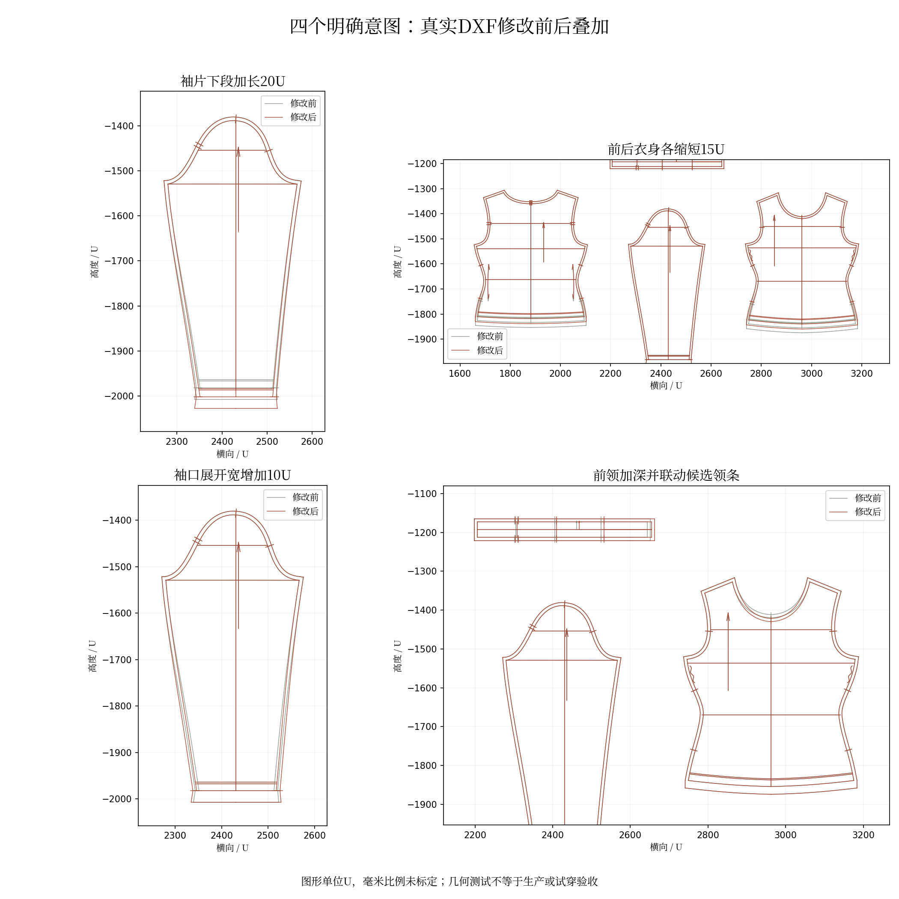

# 自然语言意图到规格与DXF 子代理基准测试

本轮由四个子代理各实现一个具体设计意图，第五个子代理独立审计最终文件。基准是已提交的女紧身款T恤两份输入。四项正向任务均生成了新的完整中文YAML、规格diff、带旧值保护的几何补丁和实际DXF，首次独立审计4/4通过。另有三项不完整或非法请求均正确阻止，未生成伪成功图纸。

| 意图 | 独立结果 | 代码流水线中位耗时 | 交付 |
| --- | --- | --- | --- |
| [袖长 +20U](results/01_sleeve_length/spec-diff.md) | PASS | 1.204s | [新规格](results/01_sleeve_length/new-spec.yaml) · [规格补丁](results/01_sleeve_length/spec-diff.json) · [几何补丁](results/01_sleeve_length/geometry-patch.json) · [DXF](results/01_sleeve_length/output.dxf) |
| [前后衣身 −15U](results/02_body_length/spec-diff.md) | PASS | 1.243s | [新规格](results/02_body_length/new-spec.yaml) · [规格补丁](results/02_body_length/spec-diff.json) · [几何补丁](results/02_body_length/geometry-patch.json) · [DXF](results/02_body_length/output.dxf) |
| [袖口展开宽 +10U](results/03_cuff_width/spec-diff.md) | PASS | 1.244s | [新规格](results/03_cuff_width/new-spec.yaml) · [规格补丁](results/03_cuff_width/spec-diff.json) · [几何补丁](results/03_cuff_width/geometry-patch.json) · [DXF](results/03_cuff_width/output.dxf) |
| [前领深 +10U，领条联动](results/04_front_neck/spec-diff.md) | PASS | 1.203s | [新规格](results/04_front_neck/new-spec.yaml) · [规格补丁](results/04_front_neck/spec-diff.json) · [几何补丁](results/04_front_neck/geometry-patch.json) · [DXF](results/04_front_neck/output.dxf) |

耗时为同一机器实际重复3次的单案例读取、变形、派生数值复算、补丁生成与写文件时间；不含子代理推理、Python冷启动或独立审计。四个实现各测试一次，不代表开放任务成功率、模型间比较或推理速度。三个原始时间样本见[性能记录](results/performance.json)。



## 实际量测与互校

- 袖纵线593.272857→613.272857U；前后中纵线分别缩短15U；袖口161.357117→171.357117U。
- 前领深92.388916→102.388916U；领条437.199756→448.566944U，宽40U，保持基准实际候选长度比，误差小于1e-6。该比例未升级为生产批准值。
- 每个输出保持231个主实体、1487个多段线顶点。独立审计逐实体核对实际DXF与新YAML，重算23项尺寸、25个接口以及连接和缝级观察值。
- 未改裁片完整保持；指定固定区域与下摆保形要求经过检查。无新增轮廓自交。输入本就存在最高约0.084212U的微小轮廓间隙，输出没有显著扩大；本次没有冒称修复了完整生产净样。
- 规格补丁正向重放、反向语义恢复通过；DXF补丁重放和反向逐字节恢复通过。20项故障控制、17项程序与审计器测试通过。
- 真实CLI对删除负向样例和篡改DXF坐标均返回失败；第三方ezdxf重开四个输出，审计零错误、零修复。

完整证据：[独立审计](results/independent-audit.json)、[第三方重开](results/review/third-party-dxf-reopen.json)、[验证目录](../../docs/verification/intent-edit-benchmark-20261117/)。

## 三项拒绝对照

| 意图 | 结果 | 原因 |
| --- | --- | --- |
| 袖子加长2厘米 | BLOCKED | 每U毫米数未标定 |
| 抬手更舒服，外观尽量保持 | BLOCKED | 缺动作与目标等关键条件 |
| 袖口展开宽减少1000U | REJECTED | 实测目标宽为负 |

## 如何复跑

从仓库根目录运行，输出目录必须为空。Python3.12实测；依赖见requirements.txt。

```bash
python -m pip install -r experiments/intent-edit-benchmark/requirements.txt
python experiments/intent-edit-benchmark/run_benchmark.py --output /tmp/my-intent-run
python experiments/intent-edit-benchmark/audit_benchmark.py --results /tmp/my-intent-run --output /tmp/my-intent-audit
python -m unittest discover -s experiments/intent-edit-benchmark -p 'test_*.py' -v
```

也可通过实际意图文件运行本次已实现的单项案例：

```bash
python experiments/intent-edit-benchmark/run_benchmark.py --intent-file experiments/intent-edit-benchmark/results/01_sleeve_length/intent.txt --output /tmp/my-sleeve-run
```

CLI目前精确匹配本次已实现的封闭意图目录；新的措辞或新操作仍需要子代理生成并审核代码，不是已经实现了通用自然语言编译器。四个案例各从原型起步，本次没有验证组合或连续改版。

重放规格补丁和图形补丁：

```bash
python experiments/intent-edit-benchmark/apply_patch.py spec patterns/fitted-tshirt/input-spec.yaml experiments/intent-edit-benchmark/results/01_sleeve_length/spec-diff.json /tmp/sleeve-spec.yaml
python experiments/intent-edit-benchmark/apply_patch.py dxf patterns/fitted-tshirt/input.dxf experiments/intent-edit-benchmark/results/01_sleeve_length/geometry-patch.json /tmp/sleeve-output.dxf
```

## 单位与生产交接

正向案例明确采用图形单位U。原DXF只有ENTITIES段，未声明HEADER或$INSUNITS；补丁保持原容器。某些CAD读取器会采用自己的默认单位，例如本次ezdxf内存返回6，这不是文件声明或真实标定。导入时不能把该默认值当作已确认比例，更不能直接按毫米或米裁剪。

材料、裁数、净裁角色、装袖映射、缝份折边等待确认值未被自动填入。生产状态BLOCKED；物理试穿NOT_RUN。本次PASS只对应意图与二维文件、规格和补丁一致性的测试。

[下载完整复现包](intent-edit-benchmark.zip)，包含代码、原型两份输入、案例和证据；现有网页文件保持不变。
