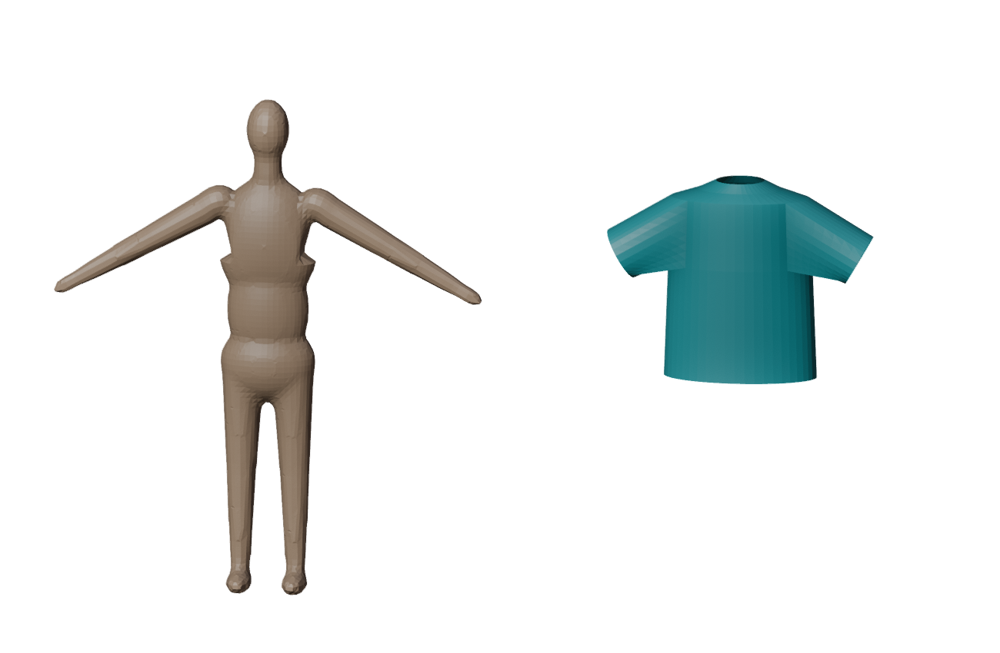
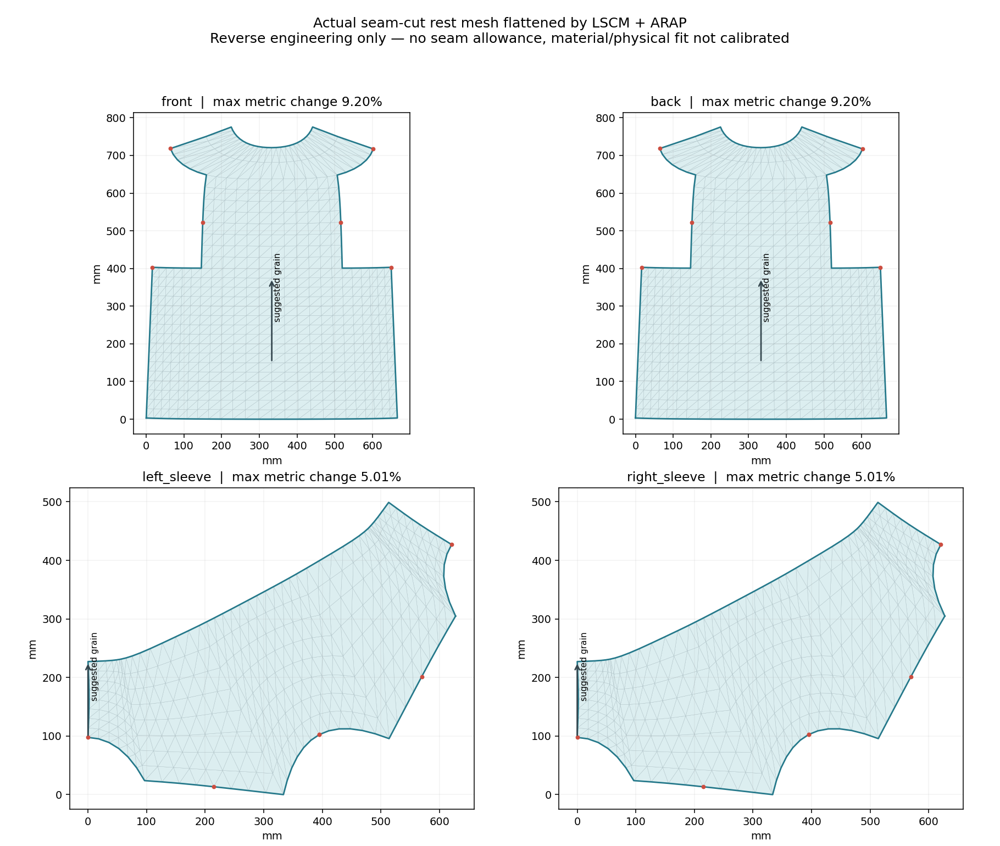
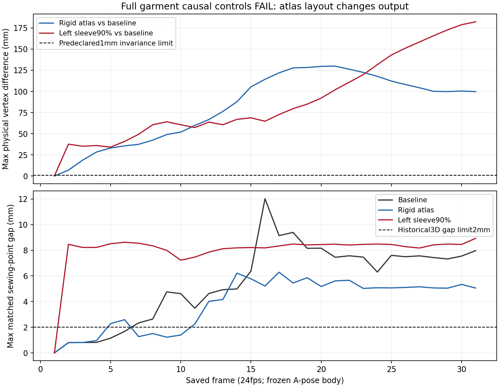

# One-shot human → separate garment → measured2D panels

**Assets and2D transfer are verified. Armhole fit remains UNKNOWN.** This uses
the same frozen one-shot human and garment geometry as `../oneshot_motion`, so
the representation and solver controls can be compared without replacing the
source with an unrelated attractive model. It does not recover the missing
original manufacturing patterns.

## Deliverables

- [`assets/human.blend`](assets/human.blend): exactly one complete human mesh
  and its rig, no garment. [`assets/cloth.blend`](assets/cloth.blend): exactly
  one source-rest garment mesh, no human, rig or external cache. Both were
  independently reopened and all vertices/triangles matched exactly.
- Equivalent separate OBJ files and measured input arrays are in `assets/`.
- [`pattern/pattern.svg`](pattern/pattern.svg) and
  [`pattern/pattern.pdf`](pattern/pattern.pdf): physical1:1 sewing-line panels,
  a100mm calibration mark, seam IDs, matched notches and proposed grain axes.
  **No seam allowance. Not manufacturing-approved.** The large PDF is one sheet;
  print at100% and measure the calibration before use.
- [`pattern/pattern.json`](pattern/pattern.json): all4 cut panels, original
  triangle/vertex correspondence, seam chains and metric distortion.
- Independent fit questions: [`reviews/review.md`](reviews/review.md),
  [`reviews/armhole-fit-contract.json`](reviews/armhole-fit-contract.json).
  Follow-up solver critique: [`reviews/dynamic-atlas-review.md`](reviews/dynamic-atlas-review.md).




## What actually passed and failed

The garment is opened along shoulders, side seams, armholes and sleeve-underarm
seams into front, back, left sleeve and right sleeve disks. LSCM initialization
and metric optimization perform a real surface flattening; this is not a planar
projection. The independent checker imports neither the unwrap code nor its
reported verdict. It confirms3392/3392 source faces,264 cut-edge sides, no
flipped triangles and no positive-area self-overlap within a panel.

Each original shared3D armhole curve is986.944407mm. After flattening, each side's
bodice sewing line is1001.132103mm and sleeve cap977.861378mm: a23.270725mm
discrepancy. The front/back halves differ by11.266621/12.004104mm; the largest
matched local segment difference is2.454816mm. These are2D arc-length differences,
not3D point gaps. They were introduced during flattening and are not declared
designer ease. The reversible zero-ease diagnostic conditionally FAILS; actual
manufacturing suitability is UNDETERMINED without intended ease and fabric.

Method controls run before interpretation:3 known-answer flattening probes;
6 independent2D analytic checks;2 metric-invariance transforms;9 specific fault
injections. Because the real baseline already fails seam compatibility, negative
controls must show the injected defect through a new error or a measured worsening,
not merely return another FAIL. One control preserves total sleeve-chain length
exactly while worsening local mismatch from2.455 to27.884mm. It is detected.
These bounded controls are not a universal verifier accuracy claim.

### The forward solver also failed its control

The initial static `rest_shape_key` implementation did not change any physical
trajectory when a sleeve was shortened. The cloth did move75.7mm byframe10, and
disabling Cloth removed that movement, excluding a simply static output. Raw
stopped trials and the ineffective source are retained in
`evidence/static-rest-failure/`; never use their arithmetic strain changes as proof
that the solver used2D dimensions.

Tiny independent controls establish a working *input influence* mechanism:
animate the base input from original3D atframe1 to2D atframe2, enable
`use_dynamic_mesh`, with no pins. Shortening the rest sheet changes physical
positions while they remain atz≈.30m, rather than jumping to the input planez0.
This proves influence only; the small high-stiffness sheet oscillates.

The complete garment then runs three fresh processes with identical preplaced3D
and frozen A-pose body: baseline; rigidly rotate/translate each2D panel; shorten
only the proposed left-sleeve grain direction to90%. Rest coordinates and actual
physical meshes are exported separately. Total nominal mass is fixed; stiffness
is assumed isotropic. It is **not flat-panel sewing or a donning simulation**.

Already atframe2 the rigid-atlas control differs by6.947mm, exceeding the
**predeclared1mm** trajectory tolerance, despite intrinsic edge-length change
of only0.346µm. The full model therefore fails the causal control. Input sensitivity
alone cannot isolate a paper-size effect from layout/solver instability. The cause
is unresolved; do not widen the tolerance to obtain PASS. See measured per-frame
comparisons and independent final-mesh checks under `evidence/metric/`.

All3×31 frames completed. Maximum atlas-vs-baseline displacement is129.872mm;
the sleeve perturbation gives182.281mm, only1.404× that control drift, below the
predeclared5× isolation requirement. Independent v2 final-frame checks count
100/103/94 cloth self-intersection pairs for baseline/atlas/short respectively;
cloth-body pairs and inside-body samples are zero. Final maximum sewing-point
gaps are7.972/5.056/8.928mm (baseline's worst saved gap is12.017mm). Only the
final frame of each run received this additional v2 surface audit. All3 cache-free
final snapshots independently reopen with exact vertex/triangle matches. None
of these results establishes correct arm passage or fit of the forward output.



## How to test whether an armhole fits a human

A human has a shoulder/axilla region, not a natural garment-shaped armhole.
Define independent measured shoulder and axillary landmarks, body envelopes and
the intended style/ease first. Bone locations in this synthetic model are proxies.

| Layer | Required evidence | This experiment |
| --- | --- | --- |
|2D representation | Metric scale, complete panels, no flips/overlaps, traceable seams | PASS |
|Sewing compatibility | Front/back notches, local and total lengths, declared ease, cap height/pitch and grain | Conditional seam FAIL; intended ease unknown |
|2D drives3D | Same initial placement; atlas invariance; isolated size response | FAIL causal control |
|Correct wearing | Same-frame body association, correct-side armhole→sleeve→cuff, no surface crossings | No new forward-wearing approval |
|Functional fit | Calibrated fabric, anatomical targets, prescribed motion, strain/shear, migration and calibrated pressure | UNKNOWN |
|Physical fit | Measured person, sewn sample, same movements and wearer feedback | NOT_RUN |

Actual upper-arm section probes independently expose another false approval:
a positive boundary distance does not prove the body is inside the garment.
The moved-body/stale-path negative is rejected in all4 sections. Baseline sections
contain open/ambiguous chains, so they remain UNKNOWN rather than artificially
closing them. At220mm, a local garment-loop candidate has657.656mm perimeter
versus301.555mm for the body proxy; this is neither the sleeve-cap length nor an
anatomical armhole circumference. See `evidence/sections/` and10 analytic tests.

## Reproduce

Run from repository root with Python3.12, NumPy, SciPy, matplotlib, PyMuPDF and
Blender4.3.2. Use fresh output directories. Frozen single-file source generators
are retained unchanged in `../oneshot_motion`. The committed assets are their
separated geometry, not new claims that the earlier failing motion was fixed.

```sh
blender -b -t 1 --python-exit-code 2 --python experiments/pattern_roundtrip/split_assets.py -- --human experiments/oneshot_motion/assets/model.blend --topology experiments/oneshot_motion/evidence/topology.json --source-frame experiments/pattern_roundtrip/assets/source-frame-0001.npz --out /tmp/pattern-split
python3 experiments/pattern_roundtrip/unwrap_pattern.py --topology experiments/oneshot_motion/evidence/topology.json --source-frame experiments/pattern_roundtrip/assets/source-frame-0001.npz --out /tmp/pattern-unwrap
python3 experiments/pattern_roundtrip/export_pattern_pdf.py --svg /tmp/pattern-unwrap/pattern.svg --out /tmp/pattern-unwrap/pattern.pdf
python3 experiments/pattern_roundtrip/verify_pattern.py --pattern /tmp/pattern-unwrap/pattern.json --source-topology experiments/oneshot_motion/evidence/topology.json --source-frame experiments/pattern_roundtrip/assets/source-frame-0001.npz --out /tmp/pattern-verdict.json --negative-controls
python3 experiments/pattern_roundtrip/section_proxies.py --pair experiments/pattern_roundtrip/assets/source-pair.npz --out /tmp/pattern-sections
```

The verifier's exit2 is the expected conditional seam FAIL. Rebuilding the actual
unwrap reproduced JSON and SVG byte-for-byte. PDF size matches SVG within0.000057mm.

Run three fresh Blender processes; each output directory must be new:

```sh
blender -b -t 1 --python-exit-code 2 --python experiments/pattern_roundtrip/drape_metric.py -- --pattern experiments/pattern_roundtrip/pattern/pattern.json --pair experiments/pattern_roundtrip/assets/source-pair.npz --topology experiments/oneshot_motion/evidence/topology.json --case baseline --frames 31 --out RUNS/baseline
blender -b -t 1 --python-exit-code 2 --python experiments/pattern_roundtrip/drape_metric.py -- --pattern experiments/pattern_roundtrip/pattern/pattern.json --pair experiments/pattern_roundtrip/assets/source-pair.npz --topology experiments/oneshot_motion/evidence/topology.json --case atlas_rigid --frames 31 --out RUNS/atlas_rigid
blender -b -t 1 --python-exit-code 2 --python experiments/pattern_roundtrip/drape_metric.py -- --pattern experiments/pattern_roundtrip/pattern/pattern.json --pair experiments/pattern_roundtrip/assets/source-pair.npz --topology experiments/oneshot_motion/evidence/topology.json --case left_sleeve_90 --frames 31 --out RUNS/left_sleeve_90
python3 experiments/pattern_roundtrip/compare_metric_runs.py --baseline RUNS/baseline --atlas RUNS/atlas_rigid --short RUNS/left_sleeve_90 --protocol experiments/pattern_roundtrip/causal-protocol.json --out /tmp/metric-control.json
python3 experiments/pattern_roundtrip/inspect_metric_results.py --runs RUNS --out /tmp/final-geometry.json
blender -b -t 1 --python-exit-code 2 --python experiments/pattern_roundtrip/reopen_metric.py -- --runs RUNS --out /tmp/metric-reload.json
```

Expect exit2 from the causal comparator. Saved integer frames are not a
continuous-time collision certificate. Historical241-frame/121-frame Cloth
failures and the missing original paper-pattern project retain their old status.
