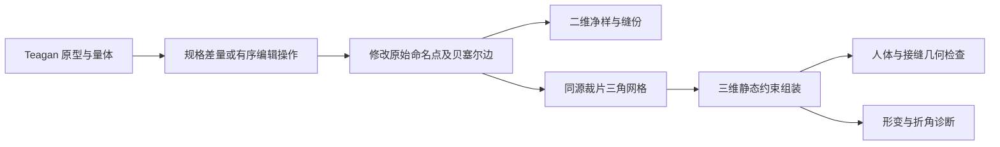

# Teagan 纸样工作室源码归档与交接

ChatGPT Page：https://chatgpt.com/space/page_d12df540967881918d782ee33d35da29

这里集中保存本次纸样工作室的成果与交接入口。你可以继续在原站点使用，也可以从 pattern-agent 的新目录恢复源码。当前归档对应 **Sites 第 14 版**，源提交 `5fd4986222886d1e4aaa5944122eaaec397c9a2a`。

[打开工作室](https://pattern-atelier-three-wasm.liushiyuxjtu.chatgpt.site) · [查看完整 Git 归档](https://github.com/liush2yuxjtu/pattern-agent/tree/main/experiments/teagan_sites_studio) · [折角验证说明](https://chatgpt.com/space/page_2e42cf6dd28881918f9be37fe7bcbe37) · [状态机修复说明](https://chatgpt.com/space/page_c8d2debf086881919f2961aff7da9bcb)

# 三篇页面怎么读

| 页面 | 适合解决的问题 |
| --- | --- |
| 本页：源码归档与交接 | 做了什么、从哪里运行、证据在哪里、有哪些边界 |
| [全衣折角诊断与验证方法](https://chatgpt.com/space/page_2e42cf6dd28881918f9be37fe7bcbe37) | 为什么曾经全绿、怎样量尖棱、怎么比较修复前后 |
| [工作室状态机与故障回归](https://chatgpt.com/space/page_c8d2debf086881919f2961aff7da9bcb) | 为什么会出现旧值、消失或迟到结果，如何复跑修复验证 |

# 从原型到纸样，再到三维

原型是 FreeSewing Teagan 4.10.2 的真实开源制版算法，不是根据一张 T 恤图片猜一圈轮廓。基础、宽松、短身是同一个原型的不同参数。原型来源、量体、命名点、贝塞尔路径及哈希都保留在源码与 `app/dist/prototypes/`。



目前站点用尺寸控件与版师工具表达修改意图，保存规格补丁和有序编辑记录；没有接入能够理解任意自然语言并自动完成所有改版的通用版师代理。二维和三维共用裁片来源，修改后会重新检查，不能沿用旧几何的 PASS。

# 页面中有哪些能力

四个窗口可以独立多选：二维纸样、普通三维、三维形变热图、三维折角热图，共 15 种非空组合。默认只开二维加普通三维；热图按需开启。三个三维窗口独立旋转和缩放，纸样、裁片选择和展开状态联动。

编辑能力包括点与控制柄拖动、毫米坐标、吸附及轴向约束、线曲转换、精确拆分、量尺和曲线弧长、逐边缝份/折边、剪口及对位、布纹及裁剪数量、走缝、固定端点配缝优化、纸面排版、撤销重做、草稿/版本/导入重放。导出包括工程 JSON、规格补丁、1:1 SVG、毫米 DXF、A4 拼页和米单位 OBJ。它没有实现完整工业 CAD 的省道转移、任意结构切分、放码矩阵或原生 CAD/CAM 往返。

人体为离线分发的 MakeHuman hm08 CC0 参考模型，非个人扫描。Three.js 负责显示；WebAssembly 实际参与几何单位转换、差量/展开和形变计算。衣服三维来自真实裁片的静态约束组装，含接缝、内部/跨缝弯曲、对称及参考人体接触约束。

# 这几轮主要修了什么

曲线检查从“总长度对上就算过”改为同时检查端点、接点切向连续性和内部零导数；旧算法失败例保留。袖山控制柄在固定端点、袖口和袖底缝长度的前提下微调到零吃势配缝，三维增加跨缝弯曲与异常折回限制。箱形设计可以有意存在，但那个局部突出的尖棱需要用实际网格检查。

显示改为独立的窗口与相机状态，并检查 WebGL 丢失/恢复。全衣折角热图改为连续固定 0–180° 色标，包含袖底邻域及拼缝；选中一条边可读精确角度、查看两侧法线并定位近景。袖子对照检查器保留旧新同材质位置的证据；实测求解日志和 Chrome Trace 可导出。

第 14 版继续修复快速尺寸输入、立即保存/导出、撤销、异步导入、迟到 Worker 回调、资源重试、拖动失效和可写调试快照，避免新工程配上旧热图或旧 PASS。细节与复现见状态机页面。

# 源码、许可和证据存在哪里

| 新目录中的位置 | 内容 |
| --- | --- |
| `app/` | 93 个原始受控文件，14,216,626 字节；源码、构建资产、WAT/WASM、人体、原型、测试、许可证 |
| `SOURCE-MANIFEST.json` | 每个原始文件的字节数与 SHA-256、源提交、第 14 版来源、排除项 |
| `evidence/` | 已有线上报告、独立 NumPy 复核、旧问题复现与带版本名的截图 |
| `pages/` | 这三篇 ChatGPT Pages 的 Markdown 副本和可点击链接 |
| `tools/` | 归档哈希检查、隔离构建和原有浏览器测试的可移植运行入口 |
| `.agents/skills/verify/` | 这个新目录的实际复核步骤 |
| [本次归档复跑回执](https://github.com/liush2yuxjtu/pattern-agent/tree/main/docs/verification/teagan-sites-archive-20261118) | 实际命令、退出码、检查结果与本地截图 |

部署绑定 `.openai/hosting.json`、依赖安装目录和 Git 内部文件不复制到新应用。原有第三方许可，包括 Teagan/相关库及 MakeHuman CC0，随原始文件保留。此轮归档不重新部署，不改原站点的访问权限；三篇新页面保存为个人页面。

# 如何从归档启动

```sh
cd experiments/teagan_sites_studio/app
npm ci --cache /tmp/teagan-studio-npm-cache --no-audit --no-fund
npm run build
python3 -m http.server 8080 --directory dist
```

在浏览器打开 `http://localhost:8080/`。尖棱对照检查器在 `/sleeve-debugger.html`。本次环境为 Node.js v24.22.1；更完整的 Linux 验证还需要 Python、NumPy、Pillow、Playwright 和已安装的 Chromium。

# 验证结论应怎样读

归档保留第 14 版的 **50 项线上状态检查**和 **85 项线上四视图检查**，两者都是各自范围内的证据。独立 NumPy 对原始网格逐项复核折角；修复后最大角度数值差约 2.13×10⁻¹⁴°。本次归档还从新目录重新安装、构建并跑本地检查，结果单独保存，不把以前的线上记录冒充本次新测试。

几何和软件的 PASS 只说明指定参考人体、网格与操作范围通过检查。真实面料应力/压力、个人合体、动态运动和真人试样仍未验证。另一个历史 T-shirt 实验的最大接缝间隙 **7.6455 mm**、**20 个非相邻面相交**仍为 **FAIL**，物理合体为 **NOT_RUN**，不被这个 Teagan 场景覆盖。

归档中的 `app/README.md` 和旧验证报告保留了逐轮开发的原始字节，早期“三视图”“无人体接触”等说法属于历史阶段；以本交接页与新目录 README 的第 14 版说明区分当前能力和历史记录。
