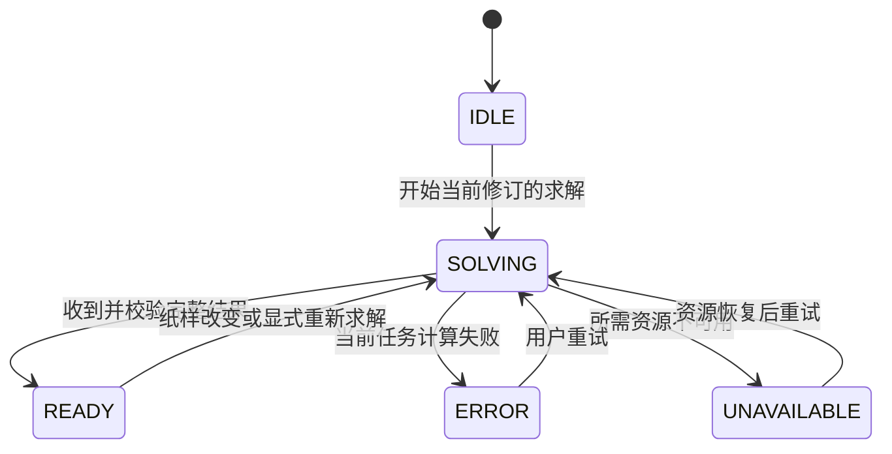

# Teagan 工作室状态机与故障回归

ChatGPT Page：https://chatgpt.com/space/page_c8d2debf086881919f2961aff7da9bcb

这里保存工作室第 14 版的状态机修复说明。状态机就是一套“现在处于哪一步、谁能修改什么、下一步允许发生什么”的规则。[打开工作室](https://pattern-atelier-three-wasm.liushiyuxjtu.chatgpt.site) · [完整源码与重跑方法](https://github.com/liush2yuxjtu/pattern-agent/tree/main/experiments/teagan_sites_studio)。

# 原来隐藏着哪些互相影响的状态

尺寸滑杆尚未提交、纸样已经修改、旧 Worker 仍在计算、窗口正在切换、人体资源尚未加载，这些事情会同时发生。若它们共用一个“已经准备好”开关，页面就可能显示新纸样配旧热图、晚到的导入覆盖新修改，或者切换线框时取消计算。

第 14 版明确分开五类状态：尺寸草稿、已提交纸样修订、当前求解任务、窗口及相机显示、人体及 WebGL 资源。显示偏好不改纸样，也不取得求解任务的所有权。

# 一次求解怎样走

`READY` 的意思是“手上有属于当前纸样的完整结果”。其中的几何检查仍可以是 `PASS` 或 `FAIL`。`ERROR` 的意思是计算没有产生可信的完整结果；此时不能把上一次的 PASS 或热图数值留下来。待提交尺寸也会使旧分析失效。

每个任务绑定纸样修订号和任务代次，只允许拥有一个 Worker。新修订取消旧任务并断开回调；旧任务后来送来的进度、错误或结果要被识别并忽略。成功结果还要检查结构与有限数值，不能只因为收到一个 message 就写入缓存。

# 修复了哪些可重现的问题

| 操作 | 旧风险 | 第 14 版行为 |
| --- | --- | --- |
| 快速改衣长，再改袖长，立即保存 | 防抖互相覆盖或保存旧尺寸 | 按字段合并；保存和工程导出先提交草稿 |
| 刚输入就撤销 | 误撤销更早的已提交工程 | 先取消当前未提交输入 |
| 正在计算时切换线框或视图 | 无关显示操作取消或重启任务 | 求解所有权保持，显示独立更新 |
| 新任务开始后，旧任务报错 | 旧回调终止新 Worker | 按修订和代次拒绝迟到事件 |
| 计算失败、资源缺失 | 留下旧热图和旧 PASS | 明确错误/不可用，清空旧分析，提供重试 |
| 大工程文件读取较慢，期间又编辑 | 迟到导入覆盖较新的修改 | 读取顺序与编辑版本双重检查 |
| 拖点期间换了纸样或指针取消 | 按旧坐标意外提交 | 清理拖动并拒绝过期提交 |
| 删除了量尺所引用的点 | 量尺继续引用不存在的点 | 纸样更新后清除失效引用 |
| 调试者修改读取到的 JSON 对象 | 意外改坏内部几何或历史 | 只返回隔离快照 |
| WebGL 丢失并恢复 | 错误地触发改版或求解 | 只恢复对应窗口的渲染资源 |

基础预设缓存被固定保留；动态结果缓存有数量上限。缓存命中也要属于当前源纸样和人体条件。人体资源重试与求解重试分开，避免按钮表面重试却仍使用坏资源。

# 怎样复现检查

入口是 `app/src/studio-state.mjs`，浏览器集成在 `app/src/main.js`。`npm run verify:state` 检查生命周期、尺寸合并、任务取消与快照隔离，并执行 **5,000 次确定性乱序事件**，共 23 项断言。随机序列固定种子，发现问题可以复跑。

原有 `scripts/verify-studio-state-browser.py` 在真实 Chromium 中点击和输入，检查 DOM、当前规格、任务数量、按钮状态和几何归属。它有意注入迟到 Worker 回调、延迟 `File.text()` 和一份不完整资源，验证错误处理；最后再使用真正的原生 Web Worker 求解，不能只通过替身回调就宣称求解成功。

保留的第 14 版线上记录有 **50 项检查、80 次混合界面转换**，无未处理 JavaScript 错误和 WebGL 警告。实际重算与基准缓存的全顶点最大差约 **2.15×10⁻¹⁵ 米**，说明这轮状态修复未改变该对照的几何结果。四视图的另外 85 项线上记录与本记录范围不同，不应相加称为一份统一物理验收。

# 日常怎样查看状态

在浏览器控制台调用 `patternStudio.getStateMachine()`，查看 `documentRevision`、`pendingSpec`、`fit.phase`、`fit.generation`、`fit.workerActive`、窗口状态和 `violations`。调用 `patternStudio.getDiagnosticLog()` 读取实际转换日志。返回值是副本；改副本不能修改内部工程。不要仅凭某个按钮显示绿色判断所有数据都属于当前纸样。

# 保存的证据和限制

`evidence/state-machine/live-verification.json` 是既有线上完整验收，`live-real-solve-state.json` 是真实重算后的状态；`before-repro.log` 保存旧问题复现。截图 `live-v14-injected-error.png` 是故障注入场景，不代表站点当前持续故障；`live-v14-retry-pass.png` 是对应恢复结果。

[归档本次复跑回执](https://github.com/liush2yuxjtu/pattern-agent/tree/main/docs/verification/teagan-sites-archive-20261118) 单独记录从新目录恢复后的构建和本地浏览器检查。此轮只归档，不重新部署、不更改原站点权限。真实面料力学与个人试穿仍未验证。

来源：Sites 第 14 版，源提交 `5fd4986222886d1e4aaa5944122eaaec397c9a2a`。完整步骤、脚本与许可证在归档内，不依赖聊天记录才能接手。
