# M 码女式紧身针织 T 恤从原始 DXF 重建的四姿势试穿报告

[ChatGPT Page 原件](https://chatgpt.com/space/page_c0a18719f4888191ba82428b17fd6a73) · [本次使用的原始 DXF](input/女紧身款T恤.dxf)

# 1 哪里值得先试改

**先看腋下。** 双手放下后，上胸大部分布料已经放松，两侧腋下仍有细褶，平举时从腋下到胸前又被拉开。建议先检查袖子接到衣身的位置和角度，再试只给腋下多留一点空间。

**袖口要看你想穿到哪里。** 自然垂臂时，袖口斜着盖到手背。盖手款可以保留；想要齐腕，就先折到腕骨再弯肘试穿。两手腕都有接触着色，但左右袖口的拉伸分布很不同，改袖围前应先核对两侧摆放与缝合。

**后腰有褶，可以先捏一点衣长看看。** 两道斜褶在后中下摆附近汇合。如果希望背面更平，横向捏起少量布，向两侧渐减，观察褶有没有变浅、下摆是否仍水平。

# 2 看四种姿势的整体效果

同一位女模特、同一套 M 码纸样和针织面料预设。上排正面，下排背面；各姿势按画面裁切放大，判断袖长请看袖口相对腕骨的位置。

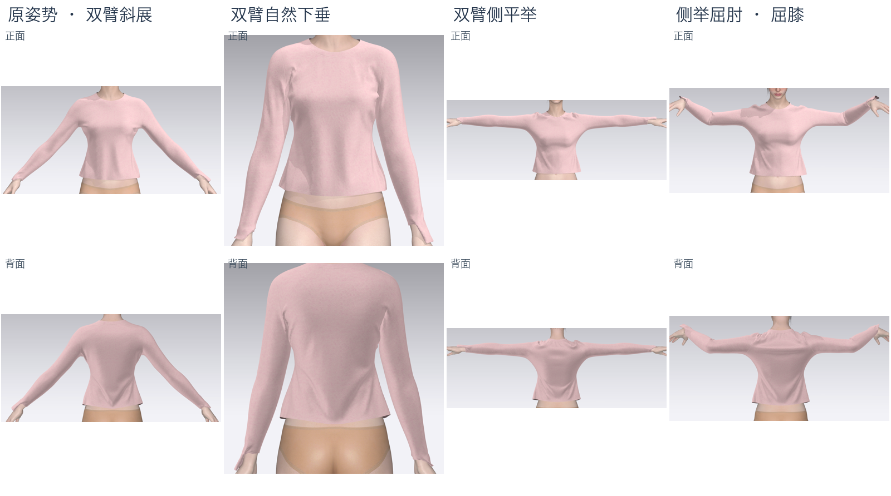

# 3 用四类图看具体位置

## 应力图看布料受力的位置

腕部可见局部着色。平举及屈肘时，上胸和袖身也出现受力带。图例是显示范围，截图用于定位。

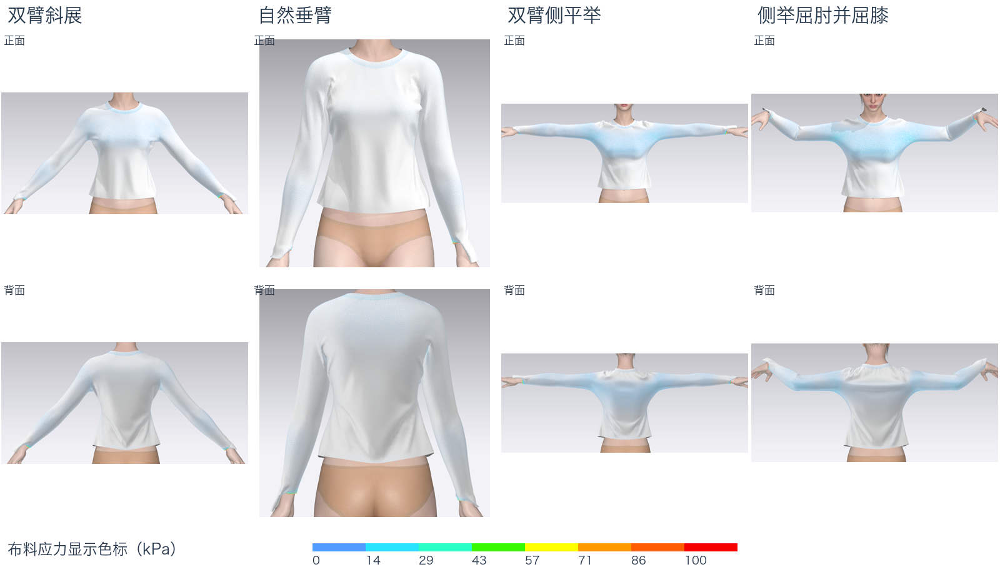

## 应变热图看哪里被拉长

以下每张图上排为 CLO 应力截图，下排为根据原始裁片和穿着后网格计算的伸长百分比。看下排：垂臂时重点看腋下，侧平举和屈肘时看胸前到上臂的连续拉伸带。

**双臂斜展**

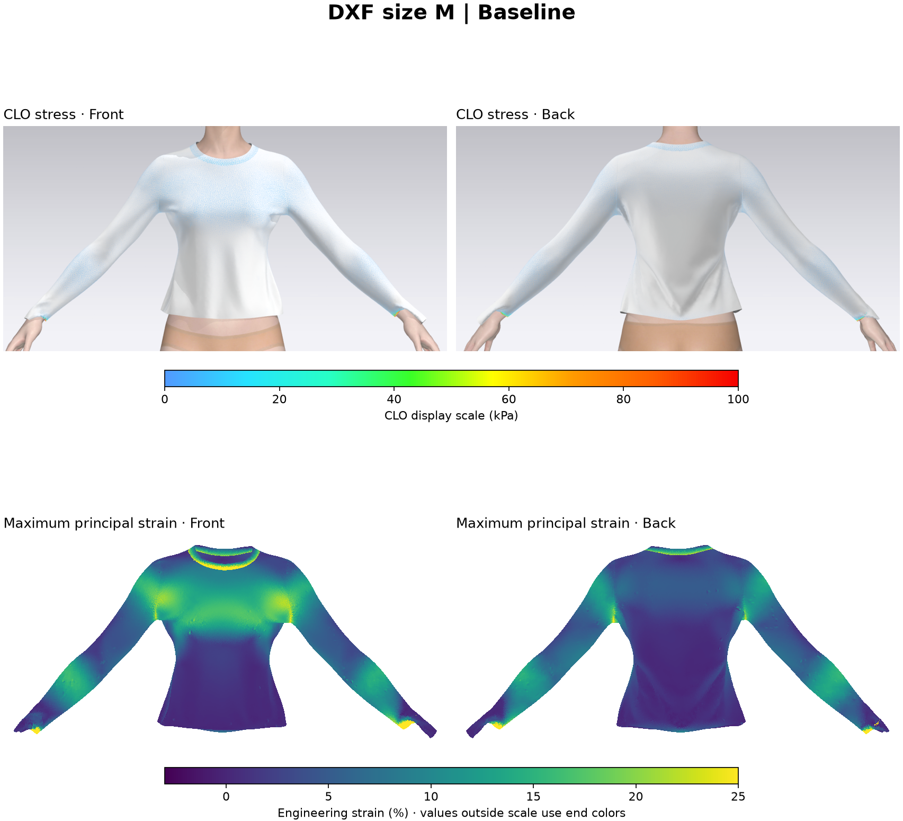

**自然垂臂**

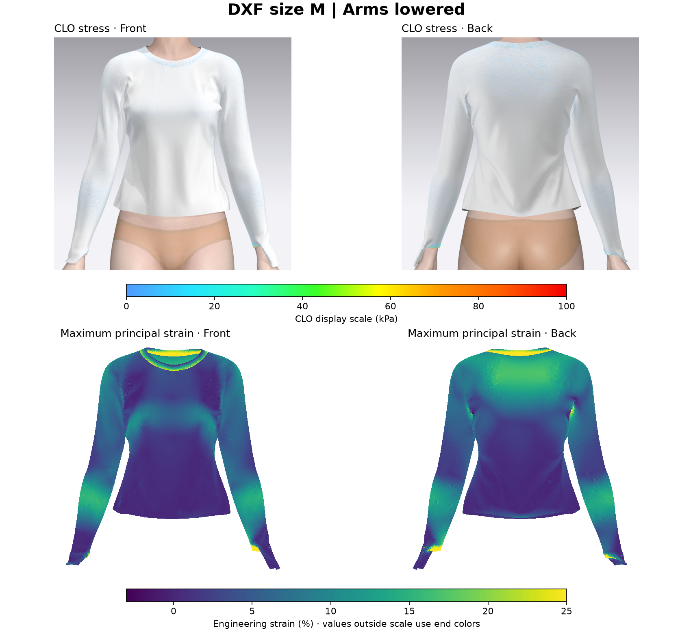

**双臂侧平举**

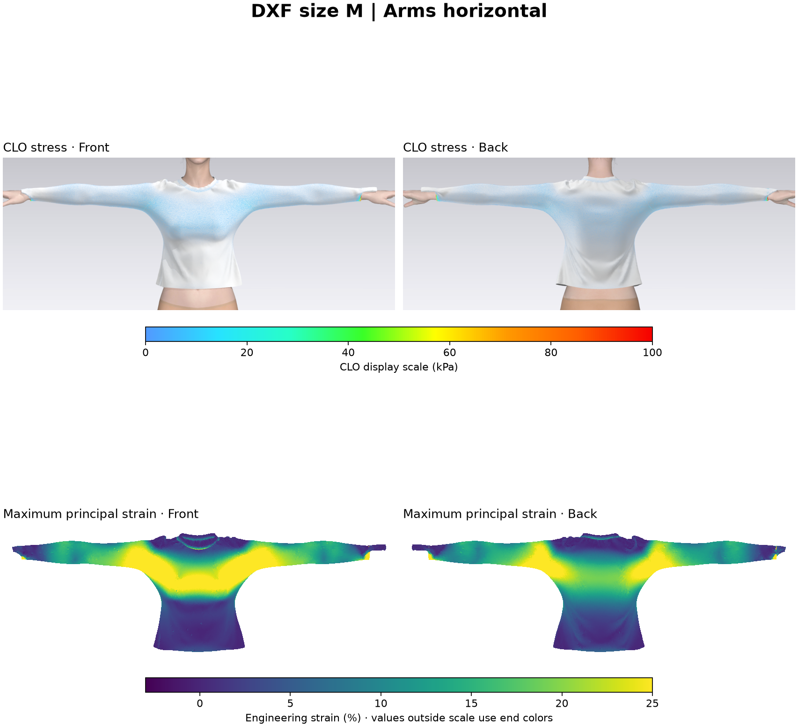

**侧举屈肘并屈膝**

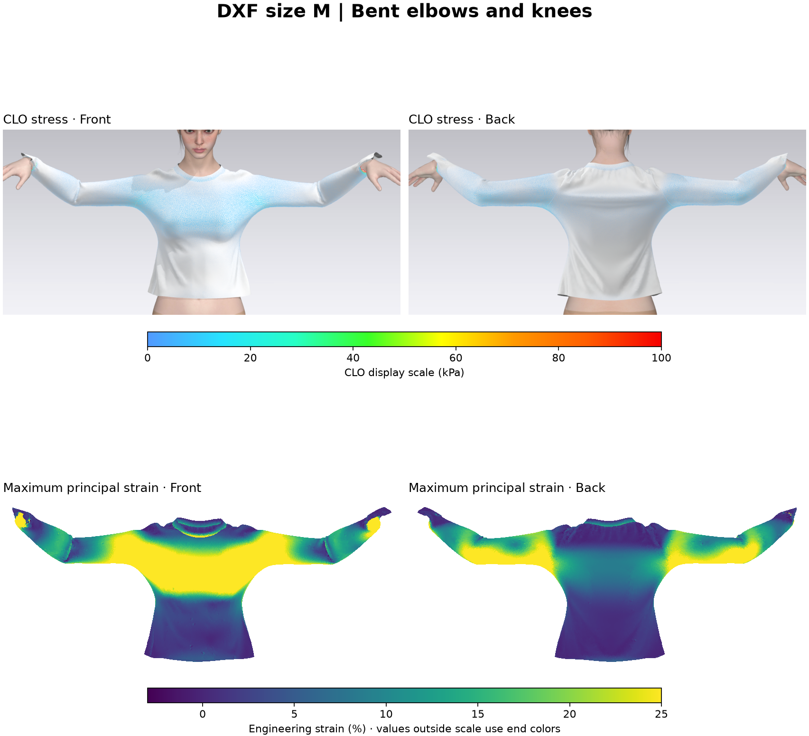

## 四视角折角图看折痕

从正、背和两侧看同一件衣服。亮色表示布面在相邻网格间弯折较急。垂臂时可沿后腰看 V 形褶，屈肘时可见肘部也出现弯折。

**双臂斜展**

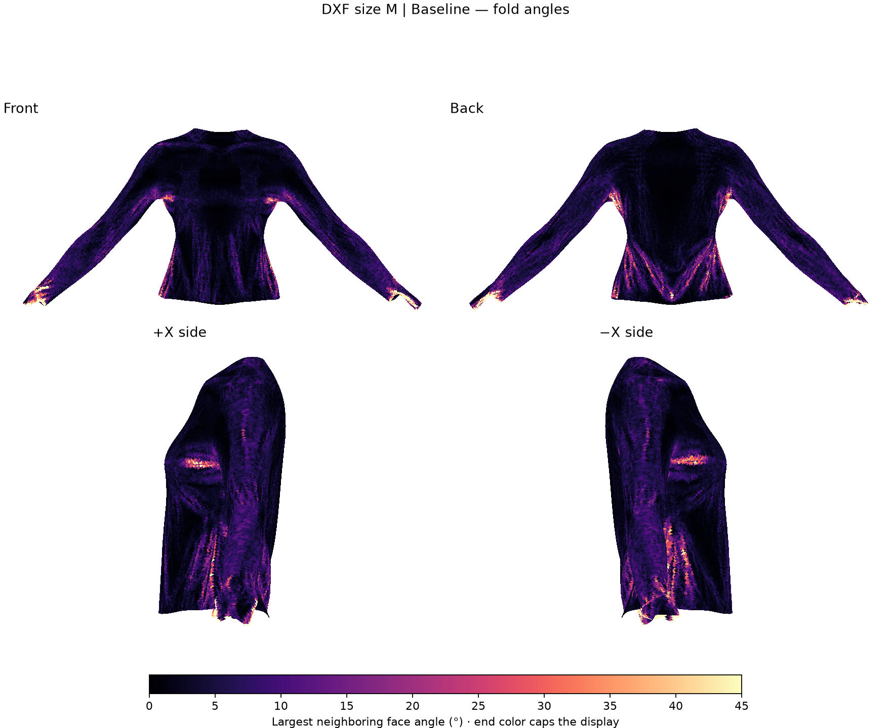

**自然垂臂**

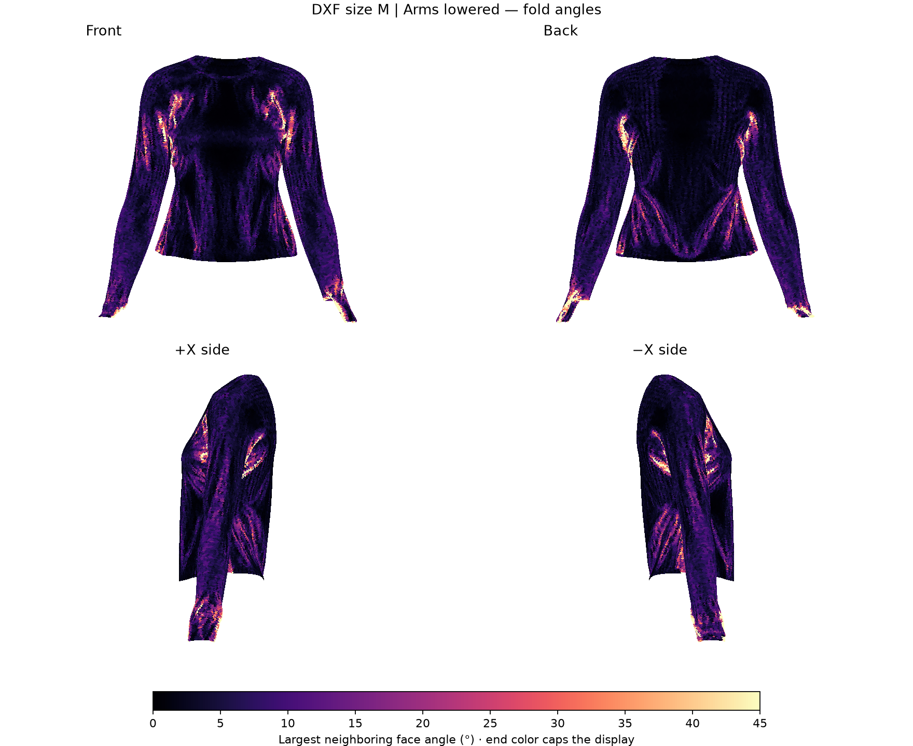

**双臂侧平举**

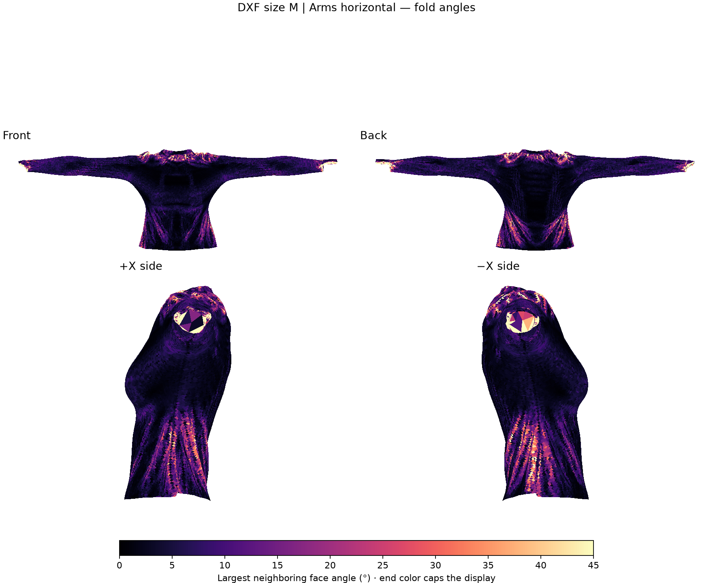

**侧举屈肘并屈膝**

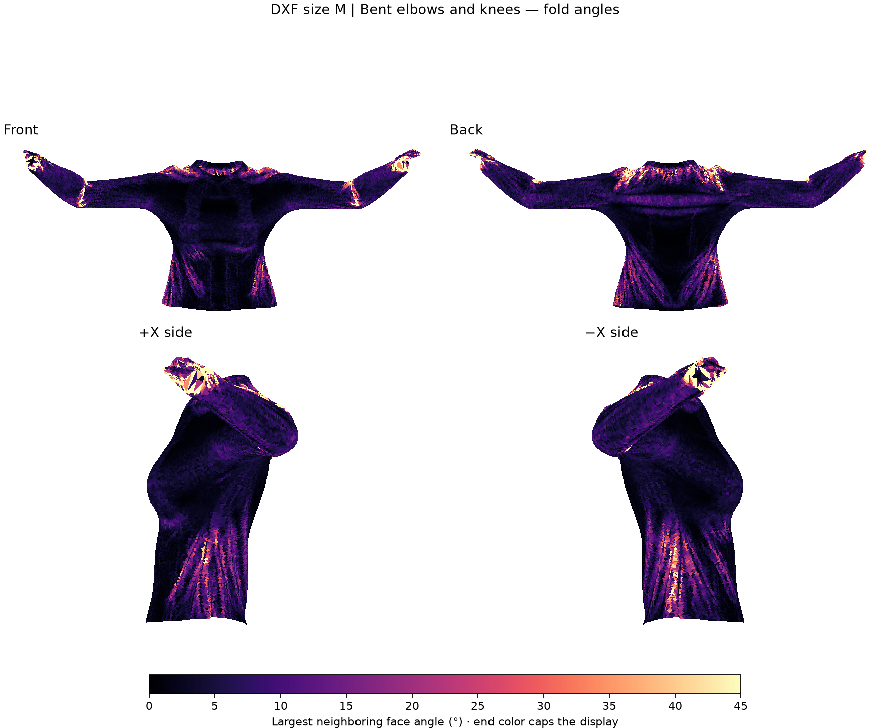

## 试身压力图看哪里压着身体

四个姿势的手腕都有接触着色，垂臂时前腋也有窄带。后腰 V 形褶附近着色很弱。此图来自 CLO 原生试身压力模式，色标为 0–5 kPa；本次没有逐点压力测量。

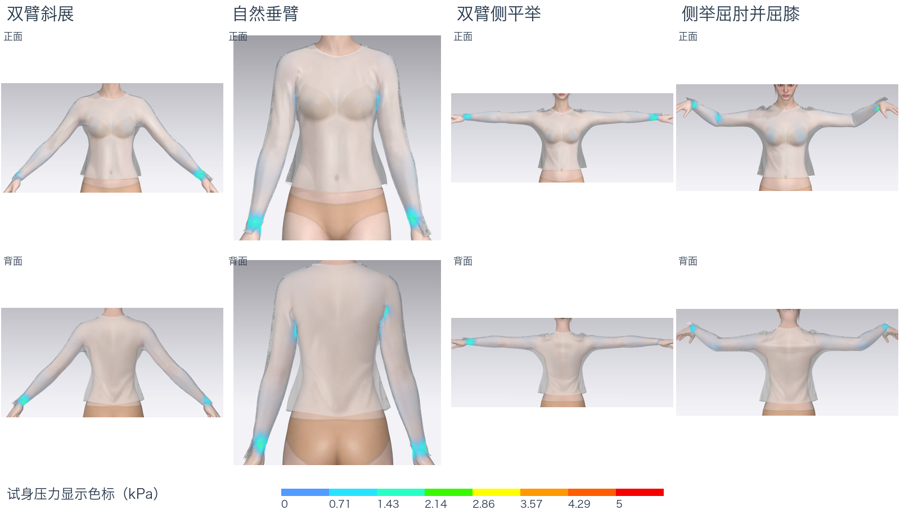

# 4 用数字核对

表中数值是各区域里**伸长超过 10% 的布料面积占比**。前腋取两侧腋点周围半径 55 毫米，袖口取末端 30 毫米，后腰取后片下三分之一。

| 姿势 | 前腋 | 整个前片 | 后腰 | 右袖口 | 左袖口 |
|---|---:|---:|---:|---:|---:|
| 双臂斜展 | 70.1% | 30.3% | 0.3% | 23.5% | 0.0% |
| 自然垂臂 | **47.5%** | **3.3%** | **0.2%** | 28.5% | 0.0% |
| 双臂侧平举 | 100% | 39.7% | 0.6% | 25.4% | 0.0% |
| 侧举屈肘并屈膝 | 100% | 45.7% | 0.6% | 21.3% | 0.0% |

垂臂时，将近一半的前腋区域达到比较阈值，而整个前片只有 3.3%。后腰四种姿势均低于 1%，支持先试衣长。左袖口显示 0.0% 是按一位小数报告的面积占比，仍可有接触压力。

**本次建模条件。** 由主 DXF 净缝线重建，左右袖镜像。原领条按折后 20 毫米宽、前后两段建模。6 块裁片、14 组缝线；采用 CLO 针织面料预设。四个姿势分别从新基准工程开始，用同样的 380 步模拟和 25 步压力刷新。已核对四组服装网格的二维坐标、三角形拓扑、裁片对应和阈值。

# 5 你想先试哪个方案

**A　只试腋下活动量（建议优先）。** 核对袖子装入的位置，再试局部留量。以垂臂和侧平举复测同一区域，同时看下摆有没有上移。

**B　袖口改到腕骨。** 在样衣上折定目标长度，再弯肘。若仍觉得勒，再单独试袖口围。

**C　试着把后腰做平。** 先捏衣长，确认 V 形褶和下摆都改善后再改纸样。

**D　保留现版。** 若目标就是盖手袖和自然腰褶，可先用目标面料打样，验证活动和穿脱感受。

你想先试哪项？可以直接说「先试 A，袖长保留」。
