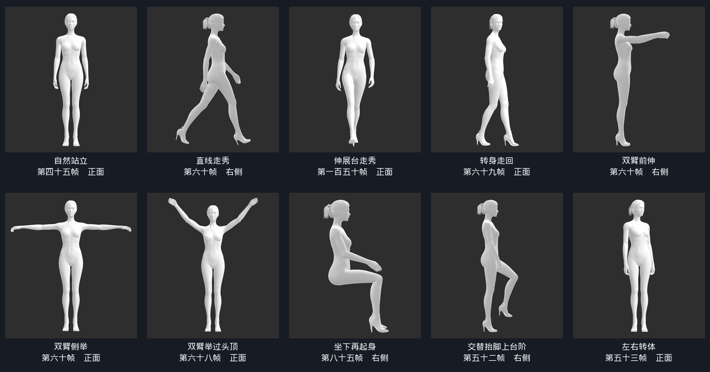
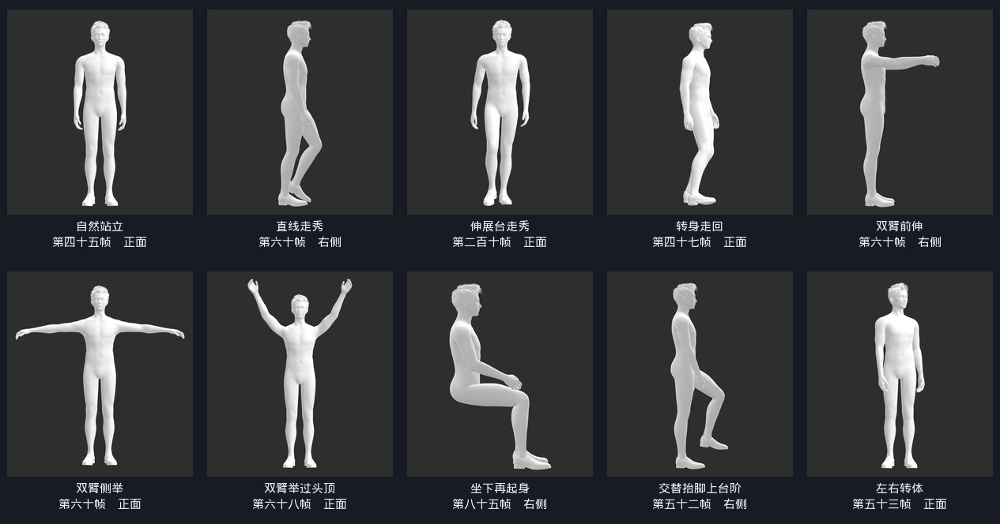

# Boat 虚拟机 Style3D 动作验收报告

**人台动作兼容性通过。** 2026 年 11 月 20 日，在 Boat 虚拟机 中使用 Style3D Studio 10.1.1077 复验了全部 20 个动作文件。女款 V4 和男款 V4 人台各通过 10 项。动画编辑器以 30 帧/秒、1 倍时间缩放运行，所有动作的时间轴总帧数均与源文件一致。

输入文件为参考对话中的 `Style3D-10项服装复验动作包.zip`。我通过 Studio 的动画文件选择器导入了 16 个自制动作，并在逐字节比对一致后，使用虚拟机预装的四个原厂走秀动作进行验证。虚拟机 V4 动作库中的全部 20 个文件均通过 SHA-256 校验，与动作包中的对应文件一致。[Style3D 动作导入说明](https://help.style3d.com/studio/en/c4905/c74f/3365/a314/a6db3/0cf5/2d99a)

Studio 原生动画控制器共检查了 56 个采样帧。两个自然站立版本在第 45 帧均保持静止。每个动态版本在至少一个参考帧上都出现了人台网格位置变化。Studio 为每个动作原生导出了一张截图用于目视核查。[Style3D 动画编辑器说明](https://help.style3d.com/studio/en/c4905/c2c8/38ae/5b8a)

## 三维人台动作视频

- [女款 V4 的 10 项人台动作（MP4，约 1 分 16 秒）](media/avatar-female.mp4)
- [男款 V4 的 10 项人台动作（MP4，约 1 分 15 秒）](media/avatar-male.mp4)

视频在 Boat 虚拟机内使用 Style3D 的男女 V4 人台模型逐帧渲染。画面使用实际的人体表面和发型，以统一灰色材质从斜前方和侧面展示。女款视频采用赤足人台，以便观察足部动作。男款视频保留默认鞋履。两段视频均为 30 帧/秒，走秀和转身时镜头跟随人台。视频由独立渲染器制作，下面的截图由 Style3D Studio 原生导出。

## Style3D 原生截图

截图使用 Studio 的普通渲染模式和已安装的 V4 人台。女款 V4 人台保留了默认高跟鞋，两个走秀动作仍使用动作包中的平底鞋版文件。每张截图独立取景。

## 逐项验收结果

| 动作 | 女款总帧数 | 男款总帧数 | 女款视频起点 | 男款视频起点 | 结果 |
|---|---:|---:|---:|---:|---|
| 01 自然站立，双臂下垂 | 91 | 91 | 00:00.00 | 00:00.00 | 均通过 |
| 02 直线走秀 | 499 | 508 | 00:03.03 | 00:03.03 | 均通过 |
| 03 T 台走秀 | 600 | 607 | 00:19.67 | 00:19.97 | 均通过 |
| 04 转身约 180° 后走回 | 120 | 73 | 00:39.67 | 00:40.20 | 均通过 |
| 05 双臂前伸 | 126 | 126 | 00:43.67 | 00:42.63 | 均通过 |
| 06 双臂侧举 | 126 | 126 | 00:47.87 | 00:46.83 | 均通过 |
| 07 双臂举过头顶 | 151 | 151 | 00:52.07 | 00:51.03 | 均通过 |
| 08 坐下再起身 | 181 | 181 | 00:57.10 | 00:56.07 | 均通过 |
| 09 左右交替抬脚模拟上台阶 | 218 | 218 | 01:03.13 | 01:02.10 | 均通过 |
| 10 左右转体 | 181 | 181 | 01:10.40 | 01:09.37 | 均通过 |

## 验收范围与限制

每次测试仅载入一个人台。帧数和代表性姿势已核查，Style3D 内的连续播放、布料模拟、碰撞和服装合身尚待验证。Studio 启动时提示，虚拟机未检测到 NVIDIA 显卡，模拟功能将被禁用。[Studio 启动提示原图](media/boat-gpu-warning.jpg)
