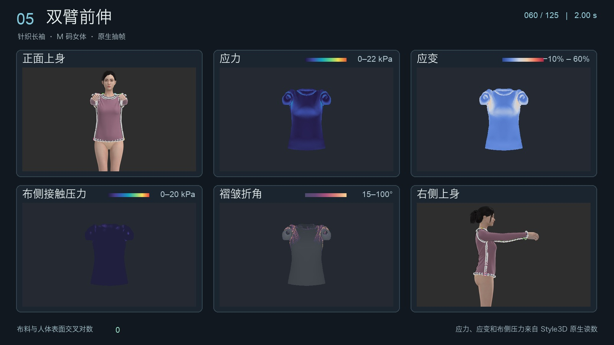

# FreeSewing 女式针织长袖 M 码 · 十项动作复验

10 项录完布料轨，累计 74 个抽查帧、444 条逐片记录。0 项抽样通过，10 项需复测。逐项复看正面、背面和右侧固定机位，再用表格复核交叉对数与热点。

[播放五图抽帧视频](media/baseline.mp4) · [10 项判定 CSV](media/baseline-summary.csv) · [逐帧 CSV](media/baseline-frames.csv) · [逐帧逐片 CSV](media/baseline-pieces.csv)

## 人台与方法

沿用 FreeSewing JS 的长袖针织 T 恤 M 码及 Style3D 女体 M 预设。身高 164.0 cm、胸围 84.0 cm、腰围 66.0 cm、臀围 90.1 cm。沿用六片、14 组缝合和 Polyester Jersey 软件预设。布料在 macOS Style3D Studio 10.1.258 原生录制。源动作来自先前在 Boat 核验的同一套 30 帧/秒 SANIM 文件，已校验文件哈希。表中帧号为源动作帧，工程帧见逐帧数据。

五图视频同步展示正面外观、应力、应变、布侧接触压力和折角。视频按抽查帧停留。应力与布侧压力为 kPa，应变为百分比，折角为度。超出色标的区域在视频中饱和，表格保留实际读数。表内每种读数取各抽查帧所有裁片 P95 中的最高值。交叉采用非共面三角面配对计数。抽样通过要求零对穿插、画面覆盖正常及原生布侧读数有效。

零交叉时仍检查袖口、胸背、下摆是否持续覆盖。两段走秀的逐帧 CSV 同时提供前后衣身各自的坐标中位点到最近人体网格顶点的距离，帮助排查整件衣服脱离。这个距离可用于定位，不能替代三视图。

## 逐项对照

| 动作 | 视频起点 | 抽查 / 源帧数 | 穿插峰值 | 应力 kPa | 应变 % | 布侧压力 kPa | 折角 ° | 判定与目视观察 |
|---|---:|---:|---:|---|---|---|---|---|
| 01 自然站立 | 0.0 s | 5 / 91 | 10（0 帧） | 7.01（前领条，0 帧） | 23.45（前领条，0 帧） | 4.85（后领条，45 帧） | 53.26（后身，22 帧） | 需复测。双袖持续覆盖前臂，背腰可见浅横褶。起点右袖 10 对交叉，后四个抽查点均为零。 [三视图](media/baseline-01.jpg) |
| 02 直线走秀 | 3.6 s | 9 / 499 | 882（0 帧） | 11.63（前领条，120 帧） | 50.06（后领条，120 帧） | 5.67（后身，120 帧） | 146.06（前身，120 帧） | 需复测。第 60 帧衣身已甩到腰后；第 120 帧前、后衣身中心离最近人体顶点均超过 26 cm。此后零交叉仍判失盖。 [三视图](media/baseline-02.jpg) |
| 03 T 台走秀 | 9.8 s | 9 / 600 | 1252（0 帧） | 20.63（前身，0 帧） | 138.13（前身，0 帧） | 4.12（右袖，0 帧） | 114.20（后领条，225 帧） | 需复测。起帧有大段前臂露出。第 70 帧衣服甩到背后；第 150 帧前、后衣身中心离最近人体顶点均超过 3.19 m。 [三视图](media/baseline-03.jpg) |
| 04 转身走回 | 15.9 s | 7 / 120 | 3907（119 帧） | 26.76（前领条，119 帧） | 332.32（前领条，119 帧） | 8.21（前身，119 帧） | 129.92（前身，119 帧） | 需复测。转身后衣身扭绞。末帧从背向机位可见胸前露出，衣片与人体交叉激增。 [三视图](media/baseline-04.jpg) |
| 05 双臂前伸 | 20.8 s | 7 / 126 | 12（0 帧） | 7.23（前领条，25 帧） | 24.41（前领条，25 帧） | 4.74（后领条，0 帧） | 55.03（左袖，125 帧） | 需复测。侧面可见双臂确实前伸，袖口随手腕移动。起点右袖 12 对交叉，其余抽查点均为零。 [三视图](media/baseline-05.jpg) |
| 06 双臂侧举 | 25.6 s | 7 / 126 | 19（125 帧） | 7.11（左袖，60 帧） | 36.36（前身，49 帧） | 3.55（后领条，125 帧） | 52.51（后身，0 帧） | 需复测。平举段双袖和袖口覆盖连续，正背未见大片露肤。回落末帧右袖检出 19 对交叉。 [三视图](media/baseline-06.jpg) |
| 07 双臂举过头顶 | 30.5 s | 7 / 151 | 1226（115 帧） | 17.57（右袖，30 帧） | 128.97（右袖，30 帧） | 4.83（后领条，68 帧） | 131.76（左袖，115 帧） | 需复测。Normal 补录中袖筒卷到肘部，举高时前臂大片露出，回落仍未恢复。XGPU 首轮前三个可对照抽查点均为零交叉。 [三视图](media/baseline-07.jpg) |
| 08 坐下再起身 | 35.4 s | 7 / 181 | 4128（132 帧） | 28.45（后领条，85 帧） | 340.67（后领条，85 帧） | 15.15（后身，132 帧） | 154.02（后身，132 帧） | 需复测。坐姿时衣身堆到颈前、后背失去覆盖；起身第 132 帧交叉峰值 4,128 对。场景未加入椅面碰撞体。 [三视图](media/baseline-08.jpg) |
| 09 交替抬脚上台阶 | 40.2 s | 9 / 218 | 171（86 帧） | 6.65（前领条，0 帧） | 32.10（右袖，161 帧） | 5.69（后领条，26 帧） | 68.21（左袖，161 帧） | 需复测。右侧可辨两轮抬膝。起点及两脚交替期间前臂可见穿出袖面，九个抽查帧均为阳性。场景无台阶碰撞体。 [三视图](media/baseline-09.jpg) |
| 10 左右转体 | 46.4 s | 7 / 181 | 1054（85 帧） | 11.95（右袖，85 帧） | 60.24（右袖，85 帧） | 4.52（前领条，125 帧） | 79.27（右袖，150 帧） | 需复测。两次转体可辨。双前臂穿出袖面，回正后仍未恢复覆盖；峰值为第 85 帧 1,054 对。 [三视图](media/baseline-10.jpg) |

## 复验边界

各动作的原生求解设置见 CSV。起始过渡控制段在分析窗口之前。举过头顶和坐立的 XGPU 首轮只有部分轨，逐项表以 Normal 补录的完整轨为准。两种设置的同帧对数不同，例如过头举臂第 61 帧为 0 对和 621 对。因此在 Normal 中发现的失盖属于当前设置下的筛查结果。复测应固定同一求解设置和人台后再做通过判定。[同帧对照 CSV](media/baseline-solver-comparison.csv) · [过头举臂 XGPU 首轮](media/baseline-07-xgpu.jpg) · [坐立 XGPU 首轮](media/baseline-08-xgpu.jpg)

压力图使用布侧读数定位接触部位。人体压力接口每个抽查帧返回 53,734 个原始样本，对应 53,930 个顶点。样本差 196，人体侧定量和抽查帧之间的表面穿插仍待复测。走秀优先复查衣身是否始终随人台，转身优先复查胸背覆盖，再复查袖口和腋下。
