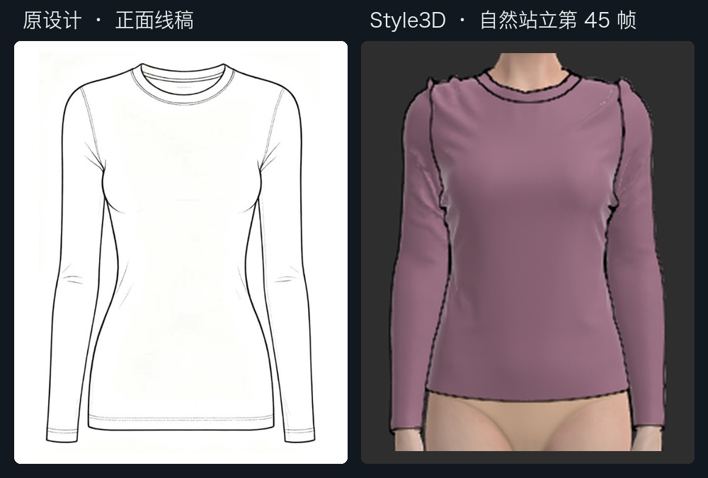

# FreeSewing 女式针织长袖 M 码 · 十项动作修复复验

本轮 10/10 项先通过统计、再通过目视。10 项录制完整布料轨。累计 113 个抽查帧和 678 条逐片读数，其中 0 帧检测到表面交叉，0 帧触发覆盖告警。

[修复版五图抽帧视频](media/retest.mp4) · [10 项判定 CSV](media/retest-summary.csv) · [逐帧 CSV](media/retest-frames.csv) · [逐帧逐片 CSV](media/retest-pieces.csv)

## 修复和验收条件

沿用 FreeSewing JS 长袖针织 T 恤 M 码与 Style3D 女体，身高 164.0 cm、胸围 84.0 cm、腰围 66.0 cm、臀围 90.1 cm、上臂围 24.3 cm、腕围 14.6 cm。工程包含六片、14 组缝合。逐项目核对裁片轮廓，最大坐标误差低于 0.02 mm。模拟和取证通过 macOS Style3D 10.1.258 的 MCP 完成。[M 码净线 DXF](media/pattern-m.dxf) · [Boat 人台动作核验](avatar.html)

六片使用 Polyester Jersey 针织软件预设，名义克重 208.9 g/m²、厚度 0.52 mm。试穿结果适用于该预设下的数字试衣，实物面料和人体侧接触压力仍待对应数据校准。[面料与尺码基准记录](try-on.html)

将穿衣起点对齐到动作源的 Straight I 姿势，确认六片在起点均为零交叉。开启人体碰撞，按动作采用逐项 CSV 记录的模拟细分、迭代数和皮肤偏移。带 ArmClearance 标记的行进动作调整左右肩关节的摆臂净空，已逐帧核对原始骨骼平移、脚步和时间。Style3D 将动画模拟细分用于快速动作下的布料计算。[Style3D 动画参数](https://help.style3d.com/studio/en/c4905/c2c8/38ae/5b8a/a71b) [摆臂修正的逐帧数据校验](media/motion-source-check.json)

完整布料轨覆盖动作首末帧。抽查帧必须没有非共面三角面交叉，检测结果不得截断，三种布侧原生图需通过样本数与网格验证。用基准工程锁定前身、后身、左右袖四区各 200 个人体采样点，逐帧量出各点到对应衣片最近网格顶点的距离。警戒线取基准 P95 加 30 mm，最低为 40 mm，用于识别大范围失盖。统计通过后再目视正面、背面、右侧，检查领口、袖口、胸背和下摆。

圆领、长袖、收腰和近水平下摆与线稿相符。模拟上身的腰部收窄较柔和，肩缝有轻微起伏，袖口落在腕部。

## 逐项对照

| 动作 | 视频起点 | 抽查 / 源帧数 | 修复前 → 后穿插峰值 | 应力 kPa | 应变 % | 布侧压力 kPa | 折角 ° | 判定与目视观察 |
|---|---:|---:|---:|---|---|---|---|---|
| 01 自然站立 | 0.0 s | 5 / 91 | 10 → 0 | 9.52（左袖，0 帧） | 44.11（右袖，22 帧） | 6.01（后领条，67 帧） | 61.10（后身，45 帧） | 统计及目视通过。五帧正背侧一致，袖口停在腕部，背腰浅横褶稳定。 [三视图](media/retest-01.jpg) |
| 02 直线走秀 | 3.6 s | 24 / 499 | 882 → 0 | 10.81（左袖，0 帧） | 47.25（左袖，0 帧） | 5.68（前领条，150 帧） | 57.33（后身，498 帧） | 统计及目视通过。直行、转向、返程与回正均可辨。第 120 帧衣身跟随胸背，返程及末帧双袖保持覆盖，右袖口稳定在腕部。 [三视图](media/retest-02.jpg) |
| 03 T 台走秀 | 19.1 s | 27 / 600 | 1252 → 0 | 10.42（左袖，0 帧） | 41.06（左袖，0 帧） | 5.19（前领条，420 帧） | 58.84（后身，270 帧） | 统计及目视通过。转入直行、转向走回和最终回正均可辨。前后衣身跟随躯干，袖口随腕移动。第 70 和 150 帧的胸背覆盖已恢复。 [三视图](media/retest-03.jpg) |
| 04 转身走回 | 36.5 s | 13 / 120 | 3907 → 0 | 10.61（左袖，20 帧） | 41.15（左袖，41 帧） | 5.98（前领条，118 帧） | 49.76（左袖，20 帧） | 统计及目视通过。转身前后两面与右侧机位均可辨。最后三个问题帧的右袖口留在手腕，衣身没有随着转向卷入，胸背保持覆盖。 [三视图](media/retest-04.jpg) |
| 05 双臂前伸 | 45.1 s | 7 / 126 | 12 → 0 | 9.52（左袖，0 帧） | 40.72（左袖，0 帧） | 4.81（后领条，125 帧） | 59.71（后身，0 帧） | 统计及目视通过。前伸、保持和放下均三视确认。手腕随袖口移动，腋下及肩部保持覆盖。 [三视图](media/retest-05.jpg) |
| 06 双臂侧举 | 50.0 s | 7 / 126 | 19 → 0 | 9.52（左袖，0 帧） | 40.72（左袖，0 帧） | 4.40（后领条，0 帧） | 59.71（后身，0 帧） | 统计及目视通过。双臂从垂臂到平举再落下，肩峰、腋下和双袖覆盖连续，末帧袖口回到腕部。 [三视图](media/retest-06.jpg) |
| 07 双臂举过头顶 | 54.9 s | 7 / 151 | 1226 → 0 | 9.52（左袖，0 帧） | 41.66（右袖，61 帧） | 4.14（后领条，0 帧） | 59.71（后身，0 帧） | 统计及目视通过。过头举臂时双侧下摆略抬，衣身和腋下仍保持覆盖。保持举臂及回落阶段，双袖连续贴随手臂，末帧恢复自然垂臂。 [三视图](media/retest-07.jpg) |
| 08 坐下再起身 | 59.8 s | 7 / 181 | 4128 → 0 | 9.52（左袖，0 帧） | 40.72（左袖，0 帧） | 4.28（后领条，132 帧） | 60.79（左袖，99 帧） | 统计及目视通过。下降、坐姿保持和回起均保持后背及双袖覆盖，袖口随腕移动；场景未设置椅面。 [三视图](media/retest-08.jpg) |
| 09 交替抬脚上台阶 | 64.6 s | 9 / 218 | 171 → 0 | 9.52（左袖，0 帧） | 45.62（左袖，109 帧） | 4.99（后领条，135 帧） | 61.01（后身，109 帧） | 统计及目视通过。左右抬膝各一轮，三视图中前臂均留在袖管内，衣身随髋部移动；场景未设置台阶。 [三视图](media/retest-09.jpg) |
| 10 左右转体 | 70.8 s | 7 / 181 | 1054 → 0 | 9.52（左袖，0 帧） | 40.72（左袖，0 帧） | 4.11（后领条，0 帧） | 70.32（左袖，180 帧） | 统计及目视通过。两次转体及回正均可辨。双前臂保持在袖管内，斜褶随躯干旋转并在回正时减轻。 [三视图](media/retest-10.jpg) |

本轮保留上一版全部 74 个抽查帧，并新增 39 帧。表内图值为所有抽查帧、各裁片 P95 的最大值。应变百分比由原生伸长比换算。折角为同一衣片上相邻有效三角面的二面角。颜色超出固定色标时饱和，CSV 保留对应原始数值范围。压力使用布侧原生读数。人体侧压力接口样本数与网格顶点数见逐帧 CSV。本轮通过范围以抽查帧、面料预设和场景碰撞条件为限。
