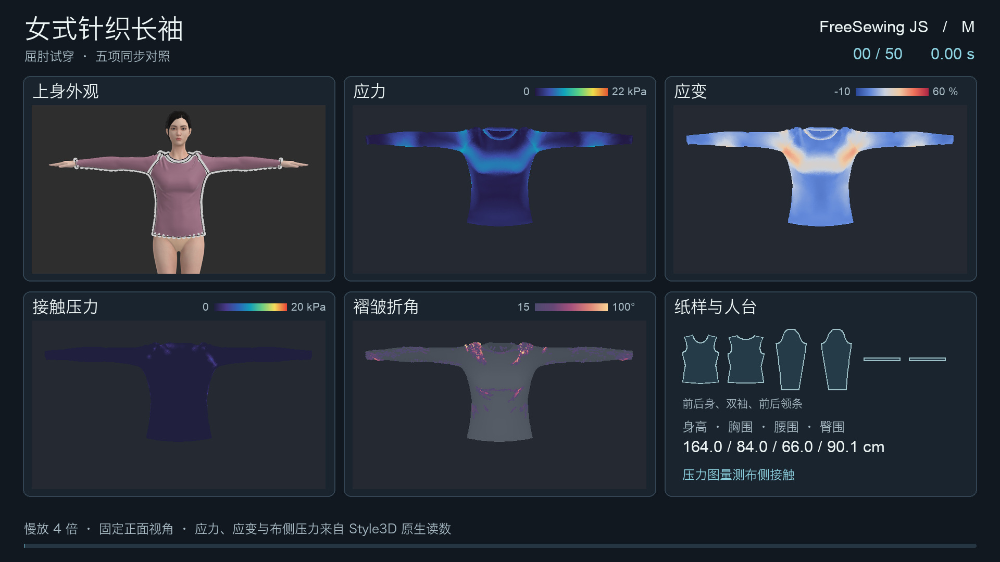
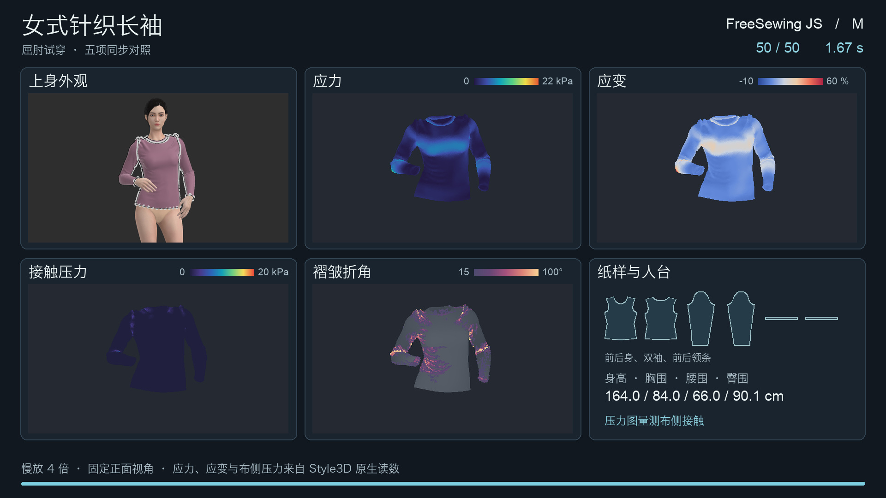

# FreeSewing 女式针织 T 恤 M 码 · 五图试穿

[播放五图同步视频（MP4，约 12 秒）](media/try-on.mp4)

用 M 码女体做平举到屈肘的对照。原动作从第 0 帧到第 50 帧，共 51 个状态。视频以四分之一速播放，起止均停留，便于同时观察上身、应力、应变、布侧接触压力和褶皱折角。

## 纸样和人台

选用现有的 `FinishedFittedKnitTee` 女式针织长袖设计，使用 FreeSewing JS 4.10.2 重新出样。六片为前身、后身、双袖和前后领条，设有 14 组缝合。新生成的 M 码 SVG、DXF 和裁片 JSON 均与先前用于该试穿工程的出样文件逐字节一致。[FreeSewing JS 设计文档](https://freesewing.dev/tutorials/pattern-design/part2/our-first-design/)

人台使用 Style3D 内置 Female M 预设的实测量体。身高 **164.0 cm**、胸围 **84.0 cm**、腰围 **66.0 cm**、臀围 **90.1 cm**、肩宽 **37.2 cm**、臂长 **53.5 cm**、上臂围 **24.3 cm**、腕围 **14.6 cm**。工程沿用 Polyester Jersey 针织预设，克重 208.9 g/m²、厚度 0.52 mm。[M 码 SVG 净线](media/pattern-m.svg) · [M 码 DXF 净线](media/pattern-m.dxf) · [量体、裁片和缝长](media/pattern-measurements.json)

## 试穿画面

从[原正面设计线稿](media/design-drawing.png)和上身画面能看到相同的圆领、长袖及收腰轮廓。屈肘后，肘部和腰侧出现更明显的折线。[第 25 帧五图](media/try-on-25.jpg)

| 视频图层 | 来源与读法 |
|---|---|
| 上身外观 | Style3D 正面快照。观察领口、双袖和下摆。 |
| 应力 | 原生逐顶点标量，单位 kPa。固定色标 0–22 kPa。 |
| 应变 | 原生伸长比换算成相对静止长度的变化百分比。固定色标 −10% 至 60%。 |
| 布侧接触压力 | 原生 Pa 读数除以 1,000。固定色标 0–20 kPa。逐帧逐片核对原始样本数、顶点数和网格指纹。 |
| 褶皱折角 | 在同一衣片网格上复算相邻有效三角面的二面角，剔除边界、退化和非流形边。视频用正面深度近似过滤受遮挡的折线，显示 15° 以上的边。 |

末帧右袖是六片中应力、应变和折角各自 P95 最高的裁片，分别为 **8.71 kPa、36.7% 和 51.7°**。后领条的布侧压力 P95 最高，为 **5.89 kPa**，统计包含零值。布侧读数用于定位接触来源裁片。[51 帧逐片统计与指纹](media/try-on-frames.json)

## 复验范围

连续模拟由 Boat 的 Style3D Studio 10.1.1077 完成。视频使用 SHA-256 核对一致的回放工程，在 macOS Style3D Studio 10.1.258 中重新逐帧取证。视频内的应力、应变和布侧压力逐帧使用相同的原生衣片几何。两个软件版本导出的逐帧网格哈希不同，视频中的读数以 macOS 采集为准。

人体侧压力接口在 51 帧均只返回 53,734 个原始样本，人台网格有 53,930 个顶点。人体侧目前只保留彩色叠层作定性定位，定量复验仍需样本与人体网格一致的读数，或同部位带单位的原生点测。本轮覆盖一个尺码和一段屈肘动作。[第 50 帧人体侧原生叠层](media/avatar-pressure-overlay.png)
